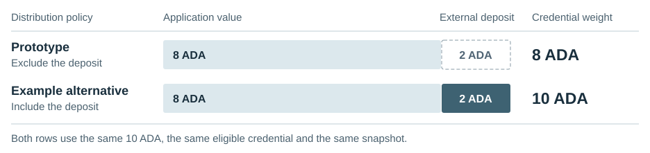

# 4. Derived distributions

[Specification contents](../README.md#table-of-contents) · [← Ledger effects](ledger-effects.md) · [Appendices →](appendices.md) · [Verification record](../verification.md) · [CIP draft](https://github.com/input-output-hk/arc-cardano-minutxo-alternatives/blob/codex/cip-output-coexistence/CIP-%3F%3F%3F%3F/README.md) · [Latest version of this page](https://github.com/nhenin/cardano-ledger-specs/blob/v2-minutxo/docs/dijkstra-utxo-deposit-rules/chapters/derived-distributions.md)

**Should an external deposit carry stake or voting weight while its output is unspent?** The deposit rules determine how much ADA the ledger holds and when it releases it. The protocol can choose separately how that ADA contributes to the stake distribution and to delegated voting power.

The **prototype** uses the ADA in the output’s value for both distributions. For an eligible minimum-ADA output, that includes its embedded reserve. For an eligible deposit-backed output, only its application ADA carries weight.

## Table of contents

<ul type="none"><li>

  
<a href="#ds-stake">4.1 Stake</a>

  
<ul type="none"><li>
      
•&numsp;<a href="#ds-stake-n01">4.1.1 N01 - Full ADA in a minimum-ADA output</a>

      
•&numsp;<a href="#ds-stake-n02">4.1.2 N02 - Application ADA in a deposit-backed output</a>

      
•&numsp;<a href="#ds-stake-n03">4.1.3 N03 - Several deposits in the Store</a>

      
•&numsp;<a href="#ds-stake-n04">4.1.4 N04 - Allocate a deposit</a>

      
•&numsp;<a href="#ds-stake-n05">4.1.5 N05 - Release a deposit</a>

      
•&numsp;<a href="#ds-stake-n06">4.1.6 N06 - Ordinary success with collateral</a>

      
•&numsp;<a href="#ds-stake-n07">4.1.7 N07 - Accepted phase-2 failure</a>

      
•&numsp;<a href="#ds-stake-n08">4.1.8 N08 - Eligibility, delegation and snapshots</a>

  </li></ul>

  
<a href="#ds-voting">4.2 Voting</a>

  
<ul type="none"><li>
      
•&numsp;<a href="#ds-voting-n01">4.2.1 N01 - Weight delegated to two DReps</a>

  </li></ul>

</li></ul>

Consider one eligible deposit-backed output holding **8 ADA** in its value, with **2 ADA** held separately. The figure compares two ways to calculate its contribution to a distribution from the same ledger state.

The prototype can derive both distributions from the output values it already tracks. An **alternative** could credit each live external deposit to its output’s staking credential at the relevant snapshot. For an eligible credential, converting a 10 ADA minimum-ADA output into the 8 + 2 ADA form would then preserve its weight. Such a policy would need to specify the recipient, eligibility and snapshot for each distribution. All nodes must agree on those rules.

Under either policy, the 2 ADA remains in the deposit until the output is spent. The ledger counts it once in the monetary total. [Deposit accounting](domain-model.md#section-1-1) · [ADA conservation](ledger-effects.md#ds-state-conservation)

## 4.1 Stake

The prototype updates instant stake from the outputs the ledger actually consumes and creates. For each output with a base staking credential, it uses the ADA in the output’s value. Registration and pool delegation determine which credentials contribute to the pool distribution at its usual snapshot. [Stake update](../../../libs/cardano-ledger-core/src/Cardano/Ledger/State/Accounting/Stake.hs#L19-L24) · [Output ADA by credential](../../../eras/conway/impl/src/Cardano/Ledger/Conway/State/Accounting/InstantStake.hs#L102-L123) · [Pool snapshot](../../../eras/dijkstra/impl/src/Cardano/Ledger/Dijkstra/Rules/Snap.hs#L124-L130)

**While the output is live.** Assume the examples below use eligible, delegated credentials.

| Case | Live outputs | Contribution under the prototype |
| --- | --- | --- |
| **4.1.1 N01** | A minimum-ADA output holds **10 ADA**, including its embedded reserve. | The credential contributes **10 ADA**. |
| **4.1.2 N02** | A deposit-backed output holds **8 ADA** and has a **2 ADA** external deposit. | The credential contributes **8 ADA**. An output carrying only tokens contributes **0 ADA**, even with a positive deposit. |
| **4.1.3 N03** | Two deposit-backed outputs carry **8 ADA** and **4 ADA** for different credentials. Their deposits are 2 ADA and 1 ADA. | The credentials contribute **8 ADA** and **4 ADA** respectively. The Store’s 3 ADA total adds no weight to either credential. |

**When a transaction is applied.** The ledger updates each credential’s UTxO stake as it spends and creates outputs. The pool distribution uses those amounts at the applicable snapshot. The allocation and release examples below keep the same credential and fund fees separately.

| Case | Applied transaction | Effect on stake |
| --- | --- | --- |
| **4.1.4 N04** | Spend the 10 ADA minimum-ADA output. Create an output carrying 8 ADA with a 2 ADA external deposit. | The credential’s base goes from **10 to 8 ADA**. The new output supplies the 8 ADA. |
| **4.1.5 N05** | Spend that deposit-backed output. Put its 8 ADA of value and the released 2 ADA into a 10 ADA minimum-ADA output. | The base goes from **8 to 10 ADA**. The new output already includes the released ADA. |
| **4.1.6 N06** | Ordinary execution succeeds. | Remove the ordinary inputs and add the ordinary outputs. Collateral-only inputs stay live. A reference used for both ordinary spending and collateral is consumed once. The proposed collateral return adds no stake. |
| **4.1.7 N07** | An accepted phase-2 failure spends collateral. | Remove the spent collateral inputs, including an input also named for ordinary spending. Add the ADA carried by the actual return, if any, if its address supplies a staking credential. This applies to both return forms. Unapplied ordinary outputs contribute nothing. |
| **4.1.8 N08** | An allocation, release or collateral spend changes which outputs are live before a snapshot. | At the usual boundary, each eligible credential contributes to its delegated pool. An output without an eligible delegation adds no pool stake. The transaction itself does not advance the snapshot. |

## 4.2 Voting

The prototype makes the same choice for **delegated representative (DRep) voting power**. The UTxO contribution comes from the ADA attributed to each eligible staking credential. Its DRep delegation determines who receives that weight. The existing voting calculation also includes eligible account balances and governance proposal deposits under their own rules. [DRep distribution calculation](../../../eras/conway/impl/src/Cardano/Ledger/Conway/Governance/DRepPulser.hs#L210-L242)

### 4.2.1 N01 - Weight delegated to two DReps

At the voting snapshot, consider two credentials with eligible delegations.

- **DRep A** receives **10 ADA** of weight from a minimum-ADA output carrying 10 ADA. Its embedded reserve is included in that value.
- **DRep B** receives **8 ADA** of weight from the deposit-backed output in the figure. Crediting the external deposit as well would give B **10 ADA** under the alternative policy.

To check the prototype’s policy, compare the complete distribution across a snapshot after ordinary success and after an accepted phase-2 failure. Include other eligible funds, a credential without an eligible DRep delegation, and external deposits on multiple live outputs. Check the amount attributed to **each DRep**. A grand total alone would miss weight credited to the wrong representative.

**Verification status.** The eight stake cases and the voting case above describe expected prototype behavior. Their dedicated distribution tests are deferred. [Verification record](../verification.md#current-implementation-status)
