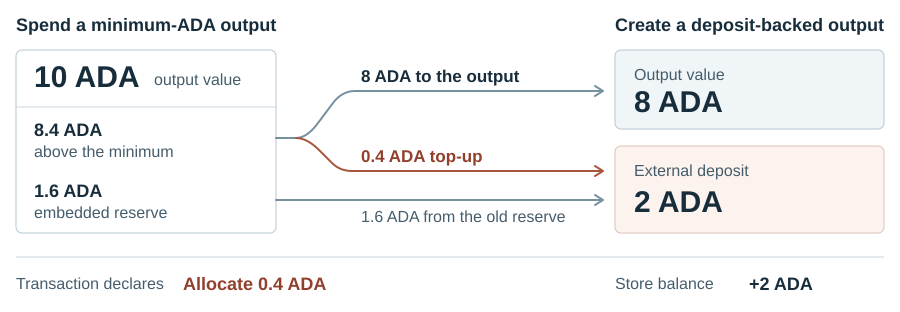

<a id="domain-model" name="domain-model"></a>

# 1. Domain model

[Specification contents](../README.md#table-of-contents) · [Transaction rules →](transaction-rules.md) · [Verification record](../verification.md) · [CIP draft](https://github.com/input-output-hk/arc-cardano-minutxo-alternatives/blob/codex/cip-output-coexistence/CIP-%3F%3F%3F%3F/README.md) · [Latest version of this page](https://github.com/nhenin/cardano-ledger-specs/blob/v2-minutxo/docs/dijkstra-utxo-deposit-rules/chapters/domain-model.md)

Each live output has a **reserve** in ADA. An output's form determines where that ADA is held. Its allocation history determines how much reserve a later transaction can credit when it spends the output.

## Table of contents

<ul type="none"><li>
<div>•&numsp;<a href="#section-1">1.1 Outputs</a></div>
<div>•&numsp;<a href="#section-1-1">1.2 DepositStore</a></div>
<div>•&numsp;<a href="#section-1-4">1.3 Transaction bodies</a></div>
<details>
  <summary><a href="#ds-pricing">1.4 Deposit calculation</a></summary>
  <div><ul type="none"><li>
      <div>•&numsp;<a href="#ds-pricing-p01">1.4.1 P01 - Price each created output</a></div>
      <div>•&numsp;<a href="#ds-pricing-n01">1.4.2 N01 - Count distinct native assets</a></div>
      <div>•&numsp;<a href="#ds-pricing-n02">1.4.3 N02 - Price an applied collateral return</a></div>
      <div>•&numsp;<a href="#ds-pricing-n03">1.4.4 N03 - Measure datum and reference script payloads</a></div>
      <div>•&numsp;<a href="#ds-pricing-n04">1.4.5 N04 - Vary the declaration independently</a></div>
      <div>•&numsp;<a href="#ds-pricing-n05">1.4.6 N05 - Preserve the price across ADA encoding boundaries</a></div>
      <div>•&numsp;<a href="#ds-pricing-n06">1.4.7 N06 - Keep a min-ADA reserve inside its output</a></div>
  </li></ul></div>
</details>
<div>•&numsp;<a href="#ds-pricing-history">1.5 Historical pricing</a></div>
</li></ul>

<a id="section-1" name="section-1"></a>

## 1.1 Outputs

An output occupies space in the **live UTxO set** until a transaction spends it.
The storage formula sets how much ADA must back a new output. Dijkstra supports
two ways to provide that ADA. Suppose a transaction creates an output whose
value is **5 ADA** and whose storage requirement is **2 ADA**. [Deposit calculation](#ds-pricing)

| Output form | Where is the 2 ADA reserve? | ADA committed for this output |
| --- | --- | ---: |
| Minimum-ADA (`MinAdaTxOut`) | Included in the 5 ADA carried by the output. | **5 ADA** |
| Deposit-backed (`DepositBackedTxOut`) | Funded separately. The output carries the full 5 ADA for the application. | **7 ADA** |

Each output has its own reference (transaction ID and output index). If a
transaction creates two identical deposit-backed outputs, it funds both
deposits. Spending one releases only that output’s deposit. [Allocations](ledger-effects.md#ds-state-allocations)

<a id="script-visible-output-value" name="script-visible-output-value"></a>

**What does a script see?** A Plutus V4 validator sees the ADA and native assets
carried by the output, both on creation and when resolving a spending input.
In this example an exact-value check sees **5 ADA** for either form. That value
includes the reserve for the minimum-ADA output. The deposit-backed output’s
2 ADA deposit is outside its serialized value. In the prototype, support for
deposit-backed outputs in Plutus V1–V3 is pending.
[Plutus support by version](../verification.md#plutus-context-status)

<a id="section-1-1" name="section-1-1"></a>

## 1.2 DepositStore

The **DepositStore** (`UTxOStore` in Haskell) keeps every live output, including
minimum-ADA outputs. A spending input supplies a `TxIn` reference. Looking it
up gives the ledger an **`Unspent` entry** with two fields.

- **`output`** is the accepted `TxOut`. It supplies the asset count, datum and reference script used in the [deposit calculation](#ds-pricing).
- **`allocatedAt`** identifies the pricing rules for that output. A new output records the block’s slot as `AtSlot slot`. An output imported at the Dijkstra fork records `AtStoreMigration` and uses the fork’s baseline.

The Store keeps one **pricing history** for all entries. Applying the formula
selected by the origin to the stored output recovers the requirement at that
origin, even after a price change.
[Historical pricing](#ds-pricing-history)

<details>
<summary>Haskell types for the Store and a live entry</summary>

```haskell
data UTxOStore era = UTxOStore
  { depositFormulaHistory :: !DepositFormulaHistory  -- Shared across all entries
  , totalDepositAmount :: !DepositAmount             -- External deposits on live outputs
  , allocations :: !(IndexedUTxOs era)               -- Both output forms, keyed by TxIn
  }

newtype DepositAmount = DepositAmount {toCoin :: Coin}

newtype IndexedUTxOs era = IndexedUTxOs
  { unIndexedUTxOs :: Map TxIn (Unspent (TxOut era))
  }

data Unspent output = Unspent
  { output :: !output
  , allocatedAt :: !AllocatedAt
  }

data AllocatedAt
  = AtStoreMigration  -- Use the migration baseline
  | AtSlot !SlotNo    -- Use the formula in force at this slot

data DepositFormulaHistory = DepositFormulaHistory
  { initialFormula :: !DepositFormula
  , formulaChanges :: !(Map SlotNo DepositFormula)
  }
```

</details>

**How much ADA does an input contribute?** Both outputs above carry 5 ADA
with a historical requirement of 2 ADA. On spend, the builder counts the
reserve toward the transaction’s net change. The Store releases only the
amount it held externally.

| Query | Minimum-ADA output | Deposit-backed output |
| --- | --- | --- |
| **Reserve credited on spend** · `computeDeposit` | **2 ADA.** Take the smaller of the historical requirement and the ADA carried by the output. | **2 ADA.** Use the full historical requirement. |
| **Application assets** · `computeApplicationAssets` | **3 ADA.** Deduct the embedded reserve from the carried ADA. | **5 ADA.** Read the application value directly. |
| **Contribution to the Store balance** · `computeExternalDeposit` | **0 ADA.** The reserve is already in the output value. | **2 ADA.** The deposit is held separately. |

The application-assets query keeps every native asset. It leaves the signed
output intact. If an imported output holds only **1.5 ADA** against a baseline
requirement of **2 ADA**, its reserve is **1.5 ADA** and its application ADA is
**zero**. Spending it brings the 1.5 ADA into the transaction once, through the
input’s value. [Reserve and application-asset queries](../../../eras/dijkstra/impl/src/Cardano/Ledger/Dijkstra/UTxOs/Unspent.hs#L26-L55)

The Store caches the sum of the external deposits on all live outputs.

```math
\text{totalDepositAmount}(S)
= \sum_{u\in\text{allocations}(S)}
\text{computeExternalDeposit}(\text{depositFormulaHistory}(S),u)
```

<details>
<summary>Haskell query signatures and Store updates</summary>

```haskell
-- Reserve used in the transaction's net calculation (specialized to Dijkstra).
computeDeposit ::
  DepositFormulaHistory -> Unspent (TxOut DijkstraEra) -> DepositAmount

-- ADA and native assets available to the application in the accounting view.
computeApplicationAssets ::
  DepositFormulaHistory -> Unspent (TxOut DijkstraEra) -> ApplicationAssets DijkstraEra

-- Amount included in totalDepositAmount.
computeExternalDeposit ::
  EraDepositBackedTxOut era => DepositFormulaHistory -> Unspent (TxOut era) -> Coin
```

`mkUTxOStore history entries` derives the cached total from the entries it
receives. `sumDepositAmounts history entries` sums all their external deposits.
`allocatedDepositTotalAmount history inputs entries` sums just those at the
selected references. Both sums return `DepositAmount`, which exposes its `Coin`
through `toCoin`.

| Operation | Contract |
| --- | --- |
| `allocate slot outputs` | Insert each output at its unused reference with origin `AtSlot slot`, even at a zero price. Keep any entry already present. |
| `release inputs` | Remove each selected live entry and subtract its external deposit from the cached total. |
| `appendFormula slot formula` | Add a change strictly after all previously recorded changes. The first change may start at any slot. |
| `activateNewFormula slot formula` | Return the Store unchanged for the current formula. A new formula must preserve existing allocations’ prices and cannot downgrade V2 to V1. Rates may rise or fall within a version. |

`Store.projectTx slot tx previousStore` selects `projectValidTxBody` for
ordinary execution or `projectInvalidTxBody` for the collateral path of a
TopTx. Both return `TxProjected {updatedStore, consumedOutputs, producedOutputs}`.
Only references actually removed or inserted appear in the result, which also
drives the stake update. The ledger applies SubTxs separately and controls
event emission. [How a transaction updates ledger state](ledger-effects.md#ds-state-representation)

</details>

**At the fork**, the ledger sets the baseline to V1 at the effective protocol
rate. It imports existing minimum-ADA outputs with their ADA intact, so the
initial external balance is zero. For those outputs, the baseline determines
their reserve from the fork onward. Their original creation slot and minimum
are unavailable in the imported data. [Fork translation](ledger-effects.md#ds-state-translation)

Test-network initial funds also use `AtStoreMigration`. Adding them preserves
the supplied Store’s entries and history. A network starting directly in
Dijkstra uses V1 at its genesis rate with no dated changes.

**On restoration**, a Dijkstra snapshot supplies the live entries, their
origins, the pricing history and the cached total. The decoder checks the
entry format, formula tags and ordering of changes. It rejects a total that
differs from the sum of the entries’ external deposits. The pricing history
survives even when the Store is empty. Earlier-era snapshots contain only
output payloads keyed by reference. Their decoder supplies V1 at 4,310 lovelace
per byte by default. `decodeUTxOStoreWithFormula` accepts a caller-supplied baseline.
[Ledger state APIs and snapshots](appendices.md#state-modules-apis-and-encoding)

<a id="section-1-4" name="section-1-4"></a>

## 1.3 Transaction bodies

**What does one body contribute?** The ledger prices each ordinary output under the active formula and looks up the historical reserve of each ordinary spending input. Both minimum-ADA and deposit-backed outputs count. A positive difference means **Allocate**, a negative difference means **Release**, and zero means **No deposit change**.

```math
\text{Body contribution}
= \sum_{\text{new outputs}} \text{required reserve}
- \sum_{\text{spent inputs}} \text{historical reserve}
```

The figure follows 10 ADA from a minimum-ADA input into a deposit-backed output. The fee is funded separately, and its funding input and change have equal reserves. [Mixed-output ledger test](../../../eras/dijkstra/impl/test/Test/Cardano/Ledger/Dijkstra/Imp/DepositStore/TransactionRules/Tx/Accounting/MixedBackingSpec.hs#L46-L53)



An input used only as a **reference** releases no reserve. Collateral inputs and the optional collateral return enter a separate calculation. If the same input serves as both an ordinary input and collateral, the ledger consumes it once, on the path that actually runs. [Collateral rules](transaction-rules.md#ds-collateral) · [Execution outcomes](ledger-effects.md#ds-state-execution)

**What does each declaration cover?** A SubTx declaration gives its **own contribution** and specifies whether the SubTx settles it locally or delegates it to TopTx. A TopTx declaration gives the **batch total**. The ledger calculates that total from the ordinary inputs and outputs of TopTx and every SubTx, counting each body once. It checks each declaration against the amount calculated for its scope. [SubTx accounting](transaction-rules.md#ds-tx-accounting-net-change-subtx) · [TopTx accounting](transaction-rules.md#ds-tx-accounting-net-change-toptx)

Suppose TopTx's own inputs and outputs **release 3 ADA** and its only SubTx **allocates 3 ADA**. TopTx signs **No deposit change** in either case.

| How the SubTx handles its 3 ADA allocation | What TopTx accounts for |
| --- | --- |
| The SubTx funds it locally. | TopTx still accounts for its own 3 ADA release. |
| The SubTx requests funding from TopTx. | TopTx uses its 3 ADA release to cover the requested 3 ADA. Its share is zero. |

In general, TopTx accounts for the **batch total minus the signed contributions settled locally by SubTxs**. When a declaration designates a **settlement output**, the ADA in that output must cover the assigned release. [Attribution](transaction-rules.md#ds-tx-accounting-attribution) · [Settlement](transaction-rules.md#ds-tx-settlement) · [Transaction body fields](appendices.md#transaction-body-fields)

A SubTx using only minimum-ADA inputs and outputs can **omit its declaration**. Its reserve change still counts toward the batch total. If it signs **No deposit change**, the ledger checks that its own contribution is exactly zero. [Declaration requirements](transaction-rules.md#ds-tx-declarations-requirements)

<a id="ds-pricing" name="ds-pricing"></a>

## 1.4 Deposit calculation

**How much ADA does one output require?** Dijkstra starts with a fixed allowance
for the output, adds an allowance for each distinct native asset, then adds the
datum and reference script payload sizes. Multiplying that sum by the effective
byte price (`coinsPerUTxOByte`, written $`p`$) gives the requirement in lovelace.

**V1** applies at the Dijkstra fork and at direct Dijkstra genesis. **V2** is an
experimental version for testing price changes. The constants below are byte
allowances for the output and for each native asset, respectively.

```math
\begin{aligned}
F_{1,p}(o) &= p\,(250 + 74N(o) + D(o) + R(o)) \\
F_{2,p}(o) &= p\,(260 + 80N(o) + D(o) + R(o))
\end{aligned}
```

| Component | Measurement |
| --- | --- |
| $`N(o)`$ | Count each distinct (policy ID, asset name) pair once. ADA contributes zero. |
| $`D(o)`$ | Use the hash length for a datum hash, the original payload length for an inline datum, or zero for an absent datum. |
| $`R(o)`$ | Use the original byte length of the native or Plutus reference script, or zero for an absent script. |

Both output forms use this calculation. A **new minimum-ADA output** must carry the
required ADA in its value. A **new deposit-backed output** requires an external
deposit of that amount. When spending an existing output, use the formula and rate
selected by its allocation origin. This also covers minimum-ADA outputs imported
at the fork. Earlier eras keep their own pricing rules. [Historical pricing](#ds-pricing-history)

<details>
<summary>Haskell · measuring an output and calculating its deposit</summary>

```haskell
computeDeposit ::
  DepositFormula ->        -- version and price per byte
  NativeAssetCount ->      -- distinct (policy ID, asset name) pairs
  DatumBytes ->            -- hash or inline payload length
  ReferenceScriptBytes ->  -- script payload length
  DepositAmount            -- required lovelace before any historical cap
```

Dijkstra's `Deposit.Formula.computeDeposit` reads the three measurements from
a `TxOut`. Each wraps a `Natural`. The shared function above takes these
measurements and returns a `DepositAmount`. [Measuring a TxOut](../../../eras/dijkstra/impl/src/Cardano/Ledger/Dijkstra/UTxOs/Deposit/Formula.hs#L42-L79) · [Shared calculation](../../../libs/cardano-ledger-core/src/Cardano/Ledger/State/Accounting/UTxOs/Deposit.hs#L60-L96)

For a live entry, `Unspent.computeDeposit` selects its historical formula and
caps the reserve of a minimum-ADA output at the ADA it holds. For the Store’s
external deposit total, `computeExternalDeposit` returns zero for a minimum-ADA
output or uses `getDepositTxOut` to return the deposit as a `Coin` for a
deposit-backed output. [Historical reserve](../../../eras/dijkstra/impl/src/Cardano/Ledger/Dijkstra/UTxOs/Unspent.hs#L26-L42) · [External deposit](../../../libs/cardano-ledger-core/src/Cardano/Ledger/State/Accounting/UTxOs/Unspent.hs#L79-L83)

</details>

Transaction bodies keep their `Sized` outputs for serialization. Pricing and the
minimum-coin check use only the measurements above. Address length, application
ADA and enclosing CBOR fields contribute zero bytes to the calculation.
[Minimum-coin check](transaction-rules.md#ds-tx-minimum-coin)

<a id="ds-pricing-p01" name="ds-pricing-p01"></a>

### 1.4.1 P01 - Price each created output

Every deposit-backed output that enters the live set has its own deposit. For
example, under V1 an output with **2 native assets**, a **32-byte datum hash**
and a **173-byte reference script** requires $`250 + 2(74) + 32 + 173 = 603`$
priced bytes. At 3 lovelace per byte its deposit is **1,809 lovelace**, whether
TopTx creates it, a SubTx creates it, or the ledger applies it as a collateral
return. [Reference calculation](../../../libs/cardano-ledger-core/test/Test/Cardano/Ledger/State/Accounting/UTxOs/DepositSpec.hs#L45-L57) · [Checking accepted allocations](ledger-effects.md#ds-state-allocations)

<a id="ds-pricing-n01" name="ds-pricing-n01"></a>

### 1.4.2 N01 - Count distinct native assets

Sending 100 units of a token costs the same deposit as sending 1 unit of that
token. A second asset name under the same policy, or the same name under another
policy, adds one distinct asset. Its additional cost is $`74p`$ in V1 and
$`80p`$ in V2.

<a id="ds-pricing-n02" name="ds-pricing-n02"></a>

### 1.4.3 N02 - Price an applied collateral return

On script success, a proposed collateral return stays unused and incurs no
deposit. On an accepted phase-2 failure, a deposit-backed collateral return
enters the live set and requires the same deposit as an identical ordinary
output created at that price. [Collateral allocations](ledger-effects.md#ds-state-allocations-p02)

<a id="ds-pricing-n03" name="ds-pricing-n03"></a>

### 1.4.4 N03 - Measure datum and reference script payloads

Start with an output with no datum or reference script. Adding a 32-byte datum
hash increases its deposit by $`32p`$. Choosing an inline datum instead adds
$`dp`$ to the original price, where $`d`$ counts the accepted payload bytes.
Adding a reference script adds a further $`rp`$ for its $`r`$ payload bytes,
for both native and Plutus scripts.

<a id="ds-pricing-n04" name="ds-pricing-n04"></a>

### 1.4.5 N04 - Vary the declaration independently

Suppose a standalone TopTx must declare **Allocate 1 ADA**. Changing only the
declaration to **Allocate 2 ADA** leaves every output price unchanged. The
ledger still calculates a net allocation of 1 ADA and rejects the mismatched
declaration. [Net-change rules](transaction-rules.md#ds-tx-accounting-net-change)

<a id="ds-pricing-n05" name="ds-pricing-n05"></a>

### 1.4.6 N05 - Preserve the price across ADA encoding boundaries

Increase the application ADA in a deposit-backed output from 23 to 24 lovelace.
The canonical CBOR encoding of that amount grows from 1 byte to 2. The asset
count, datum and script are identical, so the deposit stays the same. Changing
only the address length also leaves the deposit unchanged.

<a id="ds-pricing-n06" name="ds-pricing-n06"></a>

### 1.4.7 N06 - Keep a min-ADA reserve inside its output

Suppose a minimum-ADA output imported at the fork holds **1 ADA**, and the
migration baseline prices it at **1.0775 ADA**. Spending it credits **1 ADA**
of embedded reserve, leaves **0 application ADA** and releases **0 external ADA**.
In general the embedded reserve is $`\min(C,F_{v,p}(o))`$, where $`C`$ is the
output’s ADA and its origin selects $`v,p`$. Creating a new minimum-ADA output
at that same price requires the full **1.0775 ADA** in its value.
[Reserve and application ADA checks](../../../eras/dijkstra/impl/test/Test/Cardano/Ledger/Dijkstra/Binary/UTxOStoreSpec.hs#L359-L371)

<a id="ds-pricing-history" name="ds-pricing-history"></a>

## 1.5 Historical pricing

> **A price change applies to newly created outputs. Spending an existing output uses the pricing rules associated with its allocation.**

**Which price applies?** The Store starts with a baseline, V1 at the byte price
effective at the Dijkstra fork. It records each subsequent change as an
**activation slot** paired with a **formula version and byte price**. On spend,
the entry’s `allocatedAt` field selects its historical formula $`F_H(u)`$.
[Allocation lookup](../../../libs/cardano-ledger-core/src/Cardano/Ledger/State/Accounting/UTxOs/Unspent.hs#L85-L89)

- **Imported at the fork** (`AtStoreMigration`). Use the fork baseline. The imported minimum-ADA output carries no pre-fork creation slot.
- **Created at slot `s`** (`AtSlot s`). Use the last change effective **at or before** `s`. Use the baseline if no change had taken effect.

In Haskell, `formulaAt s history` looks up the rule for a creation slot. `currentFormula store` returns the latest rule for pricing new outputs. [Historical lookup and pricing periods](../../../libs/cardano-ledger-core/src/Cardano/Ledger/State/Accounting/UTxOs/Deposit.hs#L142-L166) · [Current formula](../../../libs/cardano-ledger-core/src/Cardano/Ledger/State/Accounting/UTxOs/Store.hs#L68-L72)

Applying that formula to the output gives its historical requirement. A
**deposit-backed output** releases the full amount from the Store. A
**minimum-ADA output** credits the smaller of that requirement and the ADA in
its value. That ADA enters the transaction balance through the output’s value.
[Reserve by output form](#section-1-1)

**When does the price change?** A protocol byte-price update takes effect at
the **first slot of the new epoch**, even if the first transaction arrives
later. It retains the active formula version. An explicit version activation
can advance V1 to V2. Each new change must follow the last recorded change.
The Store rejects a downgrade or a change that would reprice a live entry.
Existing outputs and the cached deposit total stay intact
at activation. [Epoch boundary test](ledger-effects.md#ds-state-epoch-n02) · [Activation rules](../../../libs/cardano-ledger-core/src/Cardano/Ledger/State/Accounting/UTxOs/Store.hs#L74-L100)

**Example.** Two identical deposit-backed outputs each carry 2 distinct native
assets, with no datum or reference script. The byte price stays at **4,310
lovelace per byte** as the prototype switches to V2.

| Creation slot | Deposit at creation | Amount released on spend under V2 |
| --- | ---: | ---: |
| Before V2 activation | $`4{,}310 \times (250 + 74 \times 2)`$ | 1,715,380 lovelace |
| From the V2 activation slot | $`4{,}310 \times (260 + 80 \times 2)`$ | 1,810,200 lovelace |

The test restores the snapshot and spends both outputs in one transaction.
Their replacement is a minimum-ADA output, so the Store’s external deposit
balance falls by exactly **3,525,580 lovelace**. [Historical release test](ledger-effects.md#ds-state-balance-p08)
