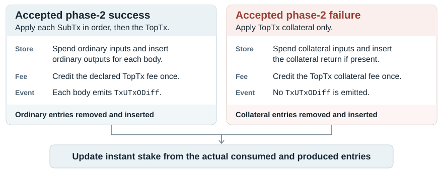

<a id="section-1-3" name="section-1-3"></a><a id="ds-state" name="ds-state"></a>

<a id="ds-state-execution-p01" name="ds-state-execution-p01"></a><a id="ds-state-execution-n01" name="ds-state-execution-n01"></a><a id="ds-state-execution-n04" name="ds-state-execution-n04"></a><a id="ds-state-execution-n02" name="ds-state-execution-n02"></a><a id="ds-state-execution-n03" name="ds-state-execution-n03"></a>

# 3. Ledger effects

[Specification contents](../README.md#table-of-contents) · [← Transaction rules](transaction-rules.md) · [Derived distributions →](derived-distributions.md) · [Verification record](../verification.md) · [CIP draft](https://github.com/input-output-hk/arc-cardano-minutxo-alternatives/blob/codex/cip-output-coexistence/CIP-%3F%3F%3F%3F/README.md) · [Latest version of this page](https://github.com/nhenin/cardano-ledger-specs/blob/v2-minutxo/docs/dijkstra-utxo-deposit-rules/chapters/ledger-effects.md)

An accepted transaction has two possible effects on the live UTxO set. On **ordinary success**, the ledger spends ordinary inputs and adds ordinary outputs. On an **accepted phase-2 failure**, it spends collateral and adds the collateral return if one was supplied. The tables in this chapter use the inputs and outputs actually applied on each path.

Follow one output through a [price change](#state-historical-release), then see how the ledger updates [individual entries](#ds-state-allocations), the [total external deposits](#ds-state-balance) and the [fee pot](#ds-state-fees).

## Table of contents

<ul type="none"><li>
<details>
  <summary><a href="#ds-state-representation">3.1 How a transaction updates ledger state</a></summary>
  <div><ul type="none"><li>
      <div>•&numsp;<a href="#state-layout">3.1.1 Where the ledger keeps an output</a></div>
      <div>•&numsp;<a href="#state-historical-release">3.1.2 Spending an output after a price change</a></div>
      <div>•&numsp;<a href="#applied-inputs-and-outputs">3.1.3 Applying the selected entries</a></div>
  </li></ul></div>
</details>
<details>
  <summary><a href="#ds-state-utxo">3.2 UTxO</a></summary>
  <div><ul type="none"><li>
      <div>•&numsp;<a href="#ds-state-utxo-n01">3.2.1 N01 - Ordinary execution</a></div>
      <div>•&numsp;<a href="#ds-state-utxo-n02">3.2.2 N02 - Successful scripts leave collateral inactive</a></div>
      <div>•&numsp;<a href="#ds-state-utxo-n03">3.2.3 N03 - Failed scripts select collateral</a></div>
      <div>•&numsp;<a href="#ds-state-utxo-n04">3.2.4 N04 - Failed TopTx, inactive SubTxs</a></div>
      <div>•&numsp;<a href="#ds-state-utxo-n05">3.2.5 N05 - One input, two consuming roles</a></div>
  </li></ul></div>
</details>
<details>
  <summary><a href="#ds-state-store">3.3 Store</a></summary>
  <div><ul type="none"><li>
      <details>
        <summary><a href="#ds-state-allocations">3.3.1 Allocations</a></summary>
        <div><ul type="none"><li>
            <div>•&numsp;<a href="#ds-state-allocations-p01">3.3.1.1 P01 - Ordinary records</a></div>
            <div>•&numsp;<a href="#ds-state-allocations-p02">3.3.1.2 P02 - Collateral records</a></div>
            <div>•&numsp;<a href="#ds-state-allocations-p03">3.3.1.3 P03 - Keep the original deposit until the output is spent</a></div>
            <div>•&numsp;<a href="#ds-state-allocations-n01">3.3.1.4 N01 - Zero-priced allocations still have records</a></div>
            <div>•&numsp;<a href="#ds-state-allocations-p04">3.3.1.5 P04 - No ordinary records on failure</a></div>
        </li></ul></div>
      </details>
      <details>
        <summary><a href="#ds-state-balance">3.3.2 Balance</a></summary>
        <div><ul type="none"><li>
            <div>•&numsp;<a href="#ds-state-balance-p01">3.3.2.1 P01 - Ordinary transfer</a></div>
            <div>•&numsp;<a href="#ds-state-balance-p02">3.3.2.2 P02 - Collateral transfer</a></div>
            <div>•&numsp;<a href="#ds-state-balance-p03">3.3.2.3 P03 - Historical release after restoration</a></div>
            <div>•&numsp;<a href="#ds-state-balance-p04">3.3.2.4 P04 - No ordinary transfer on failure</a></div>
            <div>•&numsp;<a href="#ds-state-balance-p05">3.3.2.5 P05 - Refund mixed historical prices</a></div>
            <div>•&numsp;<a href="#ds-state-balance-p06">3.3.2.6 P06 - Restore and refund a child output</a></div>
            <div>•&numsp;<a href="#ds-state-balance-p07">3.3.2.7 P07 - Restore and refund a collateral return</a></div>
            <div>•&numsp;<a href="#ds-state-balance-p08">3.3.2.8 P08 - Refund across formula versions</a></div>
        </li></ul></div>
      </details>
  </li></ul></div>
</details>
<details>
  <summary><a href="#ds-state-fees">3.4 Fees</a></summary>
  <div><ul type="none"><li>
      <div>•&numsp;<a href="#ds-state-fees-p01">3.4.1 P01 - Ordinary fee</a></div>
      <div>•&numsp;<a href="#ds-state-fees-p02">3.4.2 P02 - Collateral fee</a></div>
  </li></ul></div>
</details>
<details>
  <summary><a href="#ds-state-conservation">3.5 Conservation</a></summary>
  <div><ul type="none"><li>
      <div>•&numsp;<a href="#ds-state-conservation-n01">3.5.1 N01 - Count actual ADA once</a></div>
      <div>•&numsp;<a href="#ds-state-conservation-n02">3.5.2 N02 - Ordinary conservation</a></div>
      <div>•&numsp;<a href="#ds-state-conservation-n03">3.5.3 N03 - Collateral conservation</a></div>
  </li></ul></div>
</details>
<details>
  <summary><a href="#ds-state-lifecycle">3.6 Lifecycle</a></summary>
  <div><ul type="none"><li>
      <details>
        <summary><a href="#ds-state-translation">3.6.1 Translation</a></summary>
        <div><ul type="none"><li>
            <div>•&numsp;<a href="#ds-state-translation-n01">3.6.1.1 N01 - Introduce legacy allocations</a></div>
        </li></ul></div>
      </details>
      <details>
        <summary><a href="#ds-state-epoch">3.6.2 Epoch</a></summary>
        <div><ul type="none"><li>
            <div>•&numsp;<a href="#ds-state-epoch-n01">3.6.2.1 N01 - Retain the populated Store</a></div>
            <div>•&numsp;<a href="#ds-state-epoch-n02">3.6.2.2 N02 - Activate the effective price</a></div>
        </li></ul></div>
      </details>
  </li></ul></div>
</details>
</li></ul>

<a id="ds-state-representation" name="ds-state-representation"></a>

## 3.1 How a transaction updates ledger state

A spending input still identifies its output by `TxIn`. In Dijkstra the live
entry also records an **allocation origin**. It tells the ledger which pricing
rules to use to recover the reserve when the output is spent.

<a id="state-layout" name="state-layout"></a>

### 3.1.1 Where the ledger keeps an output

Follow the live map in each tree. In the prototype, `AccountingState` owns the
`UTxOStore`, and governance sits alongside accounting and certificates. Both
output forms use the same map.


The **pricing history** is shared across the Store. Its cached
`totalDepositAmount` counts only external deposits. A minimum-ADA output
already carries its reserve in its value.

<details>
<summary>Full Dijkstra state layout and field names</summary>

```text
LedgerState
├── lsAccountingState
│   ├── asUTxOStore
│   │   ├── allocations            TxIn → Unspent (TxOut era)
│   │   │   ├── output             The signed output
│   │   │   └── allocatedAt        Its allocation origin
│   │   ├── depositFormulaHistory  Shared history of formulas and rates
│   │   └── totalDepositAmount     Total external deposits on live outputs
│   ├── asDeposited                Certificate and governance deposits
│   ├── asFees
│   ├── asInstantStake
│   └── asDonation
├── lsCertState
└── lsGovState
```

[Upstream state layout](https://github.com/IntersectMBO/cardano-ledger/blob/42521e681fc122ac59a9a0e946a1af344e5dbde9/eras/shelley/impl/src/Cardano/Ledger/Shelley/LedgerState/Types.hs#L198-L205) · [Dijkstra accounting fields](../../../libs/cardano-ledger-core/src/Cardano/Ledger/State/Accounting/State.hs#L45-L59) · [Store fields](../../../libs/cardano-ledger-core/src/Cardano/Ledger/State/Accounting/UTxOs/Store/Internals.hs#L68-L74)

</details>

<a id="state-historical-release" name="state-historical-release"></a>

### 3.1.2 Spending an output after a price change

Suppose a deposit-backed output enters the map at slot 100 with a **2 ADA**
deposit. The entry records `AtSlot 100`. Later, the same output would cost
**2.4 ADA** to create. A transaction spends the old output and creates an
identical successor.

| Applied change | Price used | Change in external deposits |
| --- | --- | ---: |
| Remove the old entry | Formula and rate at slot 100 | −2 ADA |
| Insert the successor | Formula and rate at the inclusion slot | +2.4 ADA |

With all other reserves balanced, the transaction declares **Allocate 0.4 ADA**
and funds that difference. An entry imported at the hard fork follows the same
lookup using `AtStoreMigration` to select the migration baseline.
[Historical pricing](domain-model.md#ds-pricing-history)

<a id="applied-inputs-and-outputs" name="applied-inputs-and-outputs"></a>

### 3.1.3 Applying the selected entries

Each Store projection returns a `TxProjected` containing the updated Store and
the entries actually consumed and produced. **Instant stake** uses those two
sets on either path. Reference-only inputs stay live. An input named as both
ordinary and collateral is consumed once on the selected path.



On **ordinary success**, the ledger applies the SubTxs in order, then TopTx’s
own body. Each new output is indexed by the transaction ID of its body and its
output index. Any settlement ADA is already in its signed value. Each applied
body emits `TxUTxODiff consumedOutputs producedOutputs`.
[SubTx application](../../../eras/dijkstra/impl/src/Cardano/Ledger/Dijkstra/Rules/SubUtxo.hs#L269-L287) · [TopTx accounting](../../../eras/dijkstra/impl/src/Cardano/Ledger/Dijkstra/Rules/Utxo.hs#L449-L457)

On **accepted phase-2 failure**, the SubTxs leave the Store untouched.
`Store.projectTx` selects the shared collateral inputs and any collateral
return for TopTx. Those entries update instant stake, and the fee pot receives
the collateral fee. The TopTx rule emits no `TxUTxODiff` on this path.
[Store projection](../../../libs/cardano-ledger-core/src/Cardano/Ledger/State/Accounting/UTxOs/Store.hs#L102-L109) · [Accounting events](../../../eras/alonzo/impl/src/Cardano/Ledger/Alonzo/Rules/Utxo.hs#L253-L260)

<a id="ds-state-execution" name="ds-state-execution"></a><a id="ds-state-utxo" name="ds-state-utxo"></a>

<a id="31-utxo" name="31-utxo"></a>

## 3.2 UTxO

> **Apply exactly the selected inputs and signed outputs.**

```math
\mathit{utxoAfter}
=(\mathit{utxoBefore}\setminus\mathit{consumedInputs})
\cup\mathit{createdOutputs}
```

This map gives the signed output at every live reference, for both min-ADA and
deposit-backed outputs. Remove the inputs consumed on the selected path and add
the outputs it creates. Every other reference keeps its original output.

| Case | Scenario and observation |
| --- | --- |
| <a id="ds-state-utxo-n01" name="ds-state-utxo-n01"></a>**1.&nbsp;[N01](../../../eras/dijkstra/impl/test/Test/Cardano/Ledger/Dijkstra/Imp/DepositStore/LedgerEffects/UTxOSpec.hs#L34)** | **Ordinary execution.** A standalone TopTx or a batch spends ordinary inputs and creates new outputs. Each new output appears at its own body’s transaction ID and output index. |
| <a id="ds-state-utxo-n02" name="ds-state-utxo-n02"></a>**2.&nbsp;[N02](../../../eras/dijkstra/impl/test/Test/Cardano/Ledger/Dijkstra/Imp/DepositStore/LedgerEffects/UTxOSpec.hs#L48)** | **Successful scripts leave collateral inactive.** A successful script applies the ordinary inputs and outputs. Collateral-only and reference-only inputs stay in the UTxO, including when the transaction proposed a min-ADA or deposit-backed collateral return. |
| <a id="ds-state-utxo-n03" name="ds-state-utxo-n03"></a>**3.&nbsp;[N03](../../../eras/dijkstra/impl/test/Test/Cardano/Ledger/Dijkstra/Imp/DepositStore/LedgerEffects/UTxOSpec.hs#L62)** | **Failed scripts select collateral.** A failing script consumes the collateral inputs. An optional return creates one UTxO at the TopTx index immediately after its ordinary outputs. Without a return, the transaction creates no UTxO. Ordinary-only and reference-only inputs survive. |
| <a id="ds-state-utxo-n04" name="ds-state-utxo-n04"></a>**4.&nbsp;[N04](../../../eras/dijkstra/impl/test/Test/Cardano/Ledger/Dijkstra/Imp/DepositStore/LedgerEffects/UTxOSpec.hs#L77)** | **Failed TopTx, inactive SubTxs.** Several SubTxs propose allocations and releases. When the TopTx script fails, the complete UTxO reflects only the collateral inputs and any collateral return. |
| <a id="ds-state-utxo-n05" name="ds-state-utxo-n05"></a>**5.&nbsp;[N05](../../../eras/dijkstra/impl/test/Test/Cardano/Ledger/Dijkstra/Imp/DepositStore/LedgerEffects/UTxOSpec.hs#L95)** | **One input, two consuming roles.** The same deposit-backed input is both an ordinary input and collateral. Either outcome consumes it once. A separate reference-only input survives both outcomes. |

<a id="ds-state-execution-f01" name="ds-state-execution-f01"></a>

<a id="ds-state-execution-p02" name="ds-state-execution-p02"></a>

**Rejected submissions.** A rejected transaction leaves the last accepted state
in place. The failure cases above use a failing TopTx script and an accepted
collateral outcome. [Transaction rules](transaction-rules.md#ds-tx) covers
validation failures that reject the transaction.

<a id="ds-state-store" name="ds-state-store"></a>

<a id="32-store" name="32-store"></a>

## 3.3 Store

The Store indexes every live output by its transaction input reference. Its
`allocations` map retains the output payload and its allocation origin, either
`AtStoreMigration` or `AtSlot slot`. The origin selects the creation-time
formula in `depositFormulaHistory`. The Store also caches the total ADA held
in external deposits as `totalDepositAmount`. [Store fields and historical pricing](domain-model.md#section-1-1)

<a id="ds-state-allocations" name="ds-state-allocations"></a><a id="ds-state-store-allocations" name="ds-state-store-allocations"></a>

<a id="ds-state-allocations-n04" name="ds-state-allocations-n04"></a><a id="ds-state-allocations-n05" name="ds-state-allocations-n05"></a><a id="ds-state-allocations-n02" name="ds-state-allocations-n02"></a><a id="ds-state-allocations-n03" name="ds-state-allocations-n03"></a><a id="ds-state-allocations-n06" name="ds-state-allocations-n06"></a><a id="ds-state-allocations-n07" name="ds-state-allocations-n07"></a><a id="ds-state-allocations-n08" name="ds-state-allocations-n08"></a>

<a id="321-allocations" name="321-allocations"></a>

### 3.3.1 Allocations

> **Each live deposit-backed output has an external deposit amount.**

The tests derive a second view from the Store. For each deposit-backed output,
look up the formula for its allocation origin and calculate its deposit from the
output payload. The maps $`\mathit{recordsBefore}`$ and $`\mathit{recordsAfter}`$ give
those amounts by output reference. A live min-ADA output appears only in the
full UTxO map. A deposit-backed output priced at zero appears in both views,
with an external deposit of zero lovelace. [External deposit calculation in the tests](../../../eras/dijkstra/impl/test/Test/Cardano/Ledger/Dijkstra/Imp/DepositStore/Core/Specs/Store.hs#L100-L110)

For either accepted outcome, $`\mathit{newAllocations}`$ gives the deposits on the
newly created deposit-backed outputs. [Deposit calculation](domain-model.md#ds-pricing)

```math
\begin{aligned}
\mathit{recordsAfter}
&=(\mathit{recordsBefore}\setminus\mathit{consumedInputs})
  \cup\mathit{newAllocations} \\
\mathit{keys}(\mathit{recordsAfter})
&=\{\,\mathit{outputRef}\mid\mathit{utxoAfter}[\mathit{outputRef}]\text{ is Deposit-backed}\,\} \\
\mathit{recordsAfter}[\mathit{outputRef}]&\geq0
\quad\text{for every recorded }\mathit{outputRef}
\end{aligned}
```

The tests compare the expected and observed amounts at each reference. They
also check that the references in the external-deposit view are exactly those
of live deposit-backed outputs.

| Case | Scenario and observation |
| --- | --- |
| <a id="ds-state-allocations-p01" name="ds-state-allocations-p01"></a>**1.&nbsp;[P01](../../../eras/dijkstra/impl/test/Test/Cardano/Ledger/Dijkstra/Imp/DepositStore/LedgerEffects/Store/AllocationsSpec.hs#L84)** | **Ordinary records.** For each new deposit-backed output, the external-deposit view gains its reference and calculated amount. Spending an input removes its entry. Equal-valued outputs at different references remain distinct, including in batches with local or delegated funding. |
| <a id="ds-state-allocations-p02" name="ds-state-allocations-p02"></a>**2.&nbsp;[P02](../../../eras/dijkstra/impl/test/Test/Cardano/Ledger/Dijkstra/Imp/DepositStore/LedgerEffects/Store/AllocationsSpec.hs#L105)** | **Collateral records.** On script success, these transactions remove external deposits only for inputs spent in the ordinary role. On failure, they remove deposits for the collateral spent and add a deposit only for a deposit-backed return. A reference-only input keeps its deposit on both paths. |
| <a id="ds-state-allocations-p03" name="ds-state-allocations-p03"></a>**3.&nbsp;[P03](../../../eras/dijkstra/impl/test/Test/Cardano/Ledger/Dijkstra/Imp/DepositStore/LedgerEffects/Store/AllocationsSpec.hs#L130)** | **Keep the original deposit until the output is spent.** A deposit-backed output is created under V1 with a **0.25 ADA** deposit. Its accepted CBOR encoding is 1 byte longer than its canonical encoding. After restoring the snapshot, the ledger activates V2 and doubles the byte price. Creating the same output now would require **0.52 ADA**.<br>**Reference input.** A transaction reads the original output. It stays in the live UTxO set with its **0.25 ADA** deposit.<br>**Spending input.** A later transaction consumes that output and releases its **0.25 ADA**. Only that output’s entry disappears from the set of external deposits. |
| <a id="ds-state-allocations-n01" name="ds-state-allocations-n01"></a>**4.&nbsp;[N01](../../../eras/dijkstra/impl/test/Test/Cardano/Ledger/Dijkstra/Imp/DepositStore/LedgerEffects/Store/AllocationsSpec.hs#L174)** | **Zero-priced allocations still have records.** The TopTx and a SubTx spend translated min-ADA funding outputs and create deposit-backed outputs at a zero byte price. Each new reference appears in the external-deposit view with an amount of zero lovelace. The min-ADA inputs held their backing in their output values. |
| <a id="ds-state-allocations-p04" name="ds-state-allocations-p04"></a>**5.&nbsp;[P04](../../../eras/dijkstra/impl/test/Test/Cardano/Ledger/Dijkstra/Imp/DepositStore/LedgerEffects/Store/AllocationsSpec.hs#L203)** | **No ordinary records on failure.** A failing TopTx script selects min-ADA collateral while its SubTxs propose ordinary allocations and releases. The collateral inputs leave the live UTxO. The external-deposit view has exactly the same references and amounts before and after. |

Historical release **amounts** are checked separately by [Balance P03](#ds-state-balance-p03).

<a id="ds-state-balance" name="ds-state-balance"></a><a id="ds-state-store-balance" name="ds-state-store-balance"></a>

<a id="322-balance" name="322-balance"></a>

### 3.3.2 Balance

The Store balance, `totalDepositAmount`, is the **ADA held in external deposits**. Creating a deposit-backed output adds its deposit at the price in effect at inclusion. Spending that output releases the original amount.

```math
\begin{aligned}
\mathit{releasedDeposits}
&=\sum_{\mathit{input}\in\mathit{consumedInputs}\cap\mathit{keys}(\mathit{recordsBefore})}
  \mathit{recordsBefore}[\mathit{input}] \\
\mathit{storeBalanceAfter}
&=\mathit{storeBalanceBefore}+\sum\mathit{newAllocations}
  -\mathit{releasedDeposits}
\end{aligned}
```

The signed declaration also counts **embedded reserves**. Suppose a transaction spends a minimum-ADA output with 1.6 ADA of embedded reserve and creates a deposit-backed output requiring 2 ADA. With all other reserves balanced, the builder declares **Allocate 0.4 ADA**. The Store gains **2 ADA** because the input’s 1.6 ADA was held in its output value. On an accepted phase-2 failure, only the collateral inputs and any return enter the Store calculation.
[Transaction net-change rule](transaction-rules.md#ds-tx-accounting-net-change)

<a id="ds-state-balance-n02" name="ds-state-balance-n02"></a>
The tests check the cached total against an independent sum. For each live deposit-backed output, recover the deposit using its allocation origin and the shared pricing history, then add the amounts.

```math
\mathit{storeBalance}=\sum\mathit{records}
```

<a id="ds-state-balance-n01" name="ds-state-balance-n01"></a><a id="ds-state-balance-n03" name="ds-state-balance-n03"></a>

| Case | Scenario and observation |
| --- | --- |
| <a id="ds-state-balance-p01" name="ds-state-balance-p01"></a>**1.&nbsp;[P01](../../../eras/dijkstra/impl/test/Test/Cardano/Ledger/Dijkstra/Imp/DepositStore/LedgerEffects/Store/BalanceSpec.hs#L64)** | **Ordinary transfer.** Read the cached balance before and after applying the batch. It must increase by the deposits for all new deposit-backed outputs and decrease by the original deposits of all deposit-backed inputs spent. This holds when SubTxs settle locally or delegate to TopTx. |
| <a id="ds-state-balance-p02" name="ds-state-balance-p02"></a>**2.&nbsp;[P02](../../../eras/dijkstra/impl/test/Test/Cardano/Ledger/Dijkstra/Imp/DepositStore/LedgerEffects/Store/BalanceSpec.hs#L85)** | **Collateral transfer.** On success, only ordinary inputs can release their deposits. If phase 2 fails, subtract the deposits of spent collateral inputs and add the deposit on the collateral return, if it has one. A reference-only input keeps its deposit on either path. |
| <a id="ds-state-balance-p03" name="ds-state-balance-p03"></a>**3.&nbsp;[P03](../../../eras/dijkstra/impl/test/Test/Cardano/Ledger/Dijkstra/Imp/DepositStore/LedgerEffects/Store/BalanceSpec.hs#L106)** | **Historical release after restoration.** Restore the snapshot and double the byte price. Spending the deposit-backed output and creating a minimum-ADA output reduces the Store balance by the original **0.25 ADA**. The new output carries its reserve in its own value. |
| <a id="ds-state-balance-p04" name="ds-state-balance-p04"></a>**4.&nbsp;[P04](../../../eras/dijkstra/impl/test/Test/Cardano/Ledger/Dijkstra/Imp/DepositStore/LedgerEffects/Store/BalanceSpec.hs#L129)** | **No ordinary transfer on failure.** A TopTx script fails after the batch has proposed SubTx allocations and releases. Only minimum-ADA collateral is applied, so the cached external deposit balance stays the same. |
| <a id="ds-state-balance-p05" name="ds-state-balance-p05"></a>**5.&nbsp;[P05](../../../eras/dijkstra/impl/test/Test/Cardano/Ledger/Dijkstra/Imp/DepositStore/LedgerEffects/Store/BalanceSpec.hs#L143)** | **Mixed historical prices.** After restoring the snapshot, spend outputs whose original deposits were **0.25 ADA** and **0.50 ADA**. Their replacement requires **0.75 ADA** at the new rate. Two old entries leave and one new entry enters. The total external deposit balance stays the same. |
| <a id="ds-state-balance-p06" name="ds-state-balance-p06"></a>**6.&nbsp;[P06](../../../eras/dijkstra/impl/test/Test/Cardano/Ledger/Dijkstra/Imp/DepositStore/LedgerEffects/Store/BalanceSpec.hs#L176)** | **Child output history.** A SubTx creates a deposit-backed output with a **0.25 ADA** deposit. After restoring the snapshot and doubling the rate, spend that output using the SubTx’s own transaction ID and output index. The Store releases **0.25 ADA**. |
| <a id="ds-state-balance-p07" name="ds-state-balance-p07"></a>**7.&nbsp;[P07](../../../eras/dijkstra/impl/test/Test/Cardano/Ledger/Dijkstra/Imp/DepositStore/LedgerEffects/Store/BalanceSpec.hs#L198)** | **Collateral-return history.** An accepted phase-2 failure creates a deposit-backed collateral return. Restore the snapshot and triple the rate. When a later transaction spends the return, the Store releases the deposit allocated when the return was created. |
| <a id="ds-state-balance-p08" name="ds-state-balance-p08"></a>**8.&nbsp;[P08](../../../eras/dijkstra/impl/test/Test/Cardano/Ledger/Dijkstra/Imp/DepositStore/LedgerEffects/Store/BalanceSpec.hs#L226)** | **Across formula versions.** Two identical outputs, each containing 2 distinct native assets, enter the Store at the same byte price. V1 prices the first at **1,715,380 lovelace** and V2 prices the second at **1,810,200 lovelace**. Spending both after restoring the snapshot releases **3,525,580 lovelace** in total. |

<a id="ds-state-solvency" name="ds-state-solvency"></a><a id="34-solvency" name="34-solvency"></a><a id="ds-state-solvency-p01" name="ds-state-solvency-p01"></a><a id="341-p01---keep-every-accepted-state-solvent" name="341-p01---keep-every-accepted-state-solvent"></a><a id="ds-state-solvency-n02" name="ds-state-solvency-n02"></a><a id="344-n02---observes-store-backing-in-the-completed-batch-result-with-local-and-delegated-contributions" name="344-n02---observes-store-backing-in-the-completed-batch-result-with-local-and-delegated-contributions"></a>
`mkUTxOStore` computes the total when it builds a Store. Each allocation or release must preserve the equality above. [Store construction](../../../libs/cardano-ledger-core/src/Cardano/Ledger/State/Accounting/UTxOs/Store.hs#L59-L66)

<a id="ds-state-solvency-n01" name="ds-state-solvency-n01"></a><a id="342-n01---classifies-proposed-states-at-exact-backing-and-one-lovelace-above-as-solvent" name="342-n01---classifies-proposed-states-at-exact-backing-and-one-lovelace-above-as-solvent"></a><a id="ds-state-solvency-f01" name="ds-state-solvency-f01"></a><a id="343-f01---classifies-a-proposed-state-one-lovelace-below-its-independently-calculated-obligations-as-insolvent" name="343-f01---classifies-a-proposed-state-one-lovelace-below-its-independently-calculated-obligations-as-insolvent"></a>
When restoring a Dijkstra snapshot, the decoder recomputes this total from the entries. A discrepancy of even **1 lovelace** in either direction makes the snapshot invalid. [Store decoder](../../../libs/cardano-ledger-core/src/Cardano/Ledger/State/Accounting/UTxOs/Store/Internals.hs#L253-L264)

<a id="ds-collateral-surplus" name="ds-collateral-surplus"></a>
<a id="224-surplus" name="224-surplus"></a>
<a id="ds-state-fees" name="ds-state-fees"></a>
<a id="38-fees" name="38-fees"></a>

<a id="ds-collateral-surplus-n01" name="ds-collateral-surplus-n01"></a><a id="2241-n01---credits-excess-released-utxo-capacity-deposits-to-fees-rather-than-the-treasury" name="2241-n01---credits-excess-released-utxo-capacity-deposits-to-fees-rather-than-the-treasury"></a><a id="ds-state-fees-n01" name="ds-state-fees-n01"></a><a id="381-n01---credits-excess-released-utxo-capacity-deposits-to-fees-rather-than-the-treasury" name="381-n01---credits-excess-released-utxo-capacity-deposits-to-fees-rather-than-the-treasury"></a><a id="341-n01---credits-excess-released-utxo-capacity-deposits-to-fees-rather-than-the-treasury" name="341-n01---credits-excess-released-utxo-capacity-deposits-to-fees-rather-than-the-treasury"></a><a id="ds-collateral-surplus-p01" name="ds-collateral-surplus-p01"></a><a id="2242-p01---released-surplus-reaches-fees" name="2242-p01---released-surplus-reaches-fees"></a><a id="382-p01---released-surplus-reaches-fees" name="382-p01---released-surplus-reaches-fees"></a><a id="342-p01---released-surplus-reaches-fees" name="342-p01---released-surplus-reaches-fees"></a><a id="ds-collateral-surplus-p02" name="ds-collateral-surplus-p02"></a><a id="2243-p02---treasury-remains-unchanged" name="2243-p02---treasury-remains-unchanged"></a><a id="383-p02---treasury-remains-unchanged" name="383-p02---treasury-remains-unchanged"></a><a id="343-p02---treasury-remains-unchanged" name="343-p02---treasury-remains-unchanged"></a>

<a id="33-fees" name="33-fees"></a>

## 3.4 Fees

On ordinary success, the fee pot receives the fee declared by TopTx. On accepted
phase-2 failure, it receives the collateral fee. The ledger uses the ADA carried
by the collateral inputs and any signed return, plus the **historical external
deposits** released by those inputs. A deposit-backed return needs a new deposit
at the current price. An absent or minimum-ADA return needs zero external deposit.

```math
\begin{aligned}
\mathit{additionalDeposit}&=\max(0,\mathit{returnDeposit}-\mathit{releasedDeposits})\\
\mathit{releasedSurplus}&=\max(0,\mathit{releasedDeposits}-\mathit{returnDeposit})\\
\mathit{collateralCoinFee}&=\mathit{inputCoins}-\mathit{returnCoins}-\mathit{additionalDeposit}
\end{aligned}
```

| Accepted outcome | $`\mathit{feesAfter}-\mathit{feesBefore}`$ |
| --- | --- |
| Ordinary success | $`\mathit{txFee}`$ |
| Phase-2 failure | $`\mathit{collateralCoinFee}+\mathit{releasedSurplus}`$ |

Released deposits cover the return’s external deposit first. Input ADA must
fund any shortfall and the collateral minimum. For example, suppose a collateral
input carries 5 ADA and releases a 2 ADA external deposit. A minimum-ADA return
of 4 ADA leaves 1 ADA towards the collateral minimum. If that covers the minimum,
the fee pot gains 3 ADA, including the 2 ADA release. The treasury stays unchanged
across either transaction outcome.
[Collateral settlement](../../../eras/dijkstra/impl/src/Cardano/Ledger/Dijkstra/Rules/DepositStore/Accounting.hs#L366-L388) · [Collateral funding](transaction-rules.md#ds-collateral-funding)

| Case | Scenario and observation |
| --- | --- |
| <a id="ds-state-fees-p01" name="ds-state-fees-p01"></a>**1.&nbsp;[P01](../../../eras/dijkstra/impl/test/Test/Cardano/Ledger/Dijkstra/Imp/DepositStore/LedgerEffects/FeesSpec.hs#L29)** | **Ordinary fee.** Local and delegated ordinary Store operations, plus real successful scripts with collateral proposals, credit only the declared transaction fee. |
| <a id="ds-state-fees-p02" name="ds-state-fees-p02"></a>**2.&nbsp;[P02](../../../eras/dijkstra/impl/test/Test/Cardano/Ledger/Dijkstra/Imp/DepositStore/LedgerEffects/FeesSpec.hs#L53)** | **Collateral fee.** Real failing scripts credit the application-coin fee plus unused recorded deposits. Cover absent returns, mixed inputs, deposit shortfall/equality/surplus and a changed byte price. |

[Allocations](#ds-state-allocations) and [Balance](#ds-state-balance) cover the
corresponding changes to the Store.

<a id="ds-state-conservation" name="ds-state-conservation"></a>

<a id="34-conservation" name="34-conservation"></a>

## 3.5 Conservation

An accepted transaction can move ADA between outputs, the Store and fees while
preserving the total. Count the full ADA of each minimum-ADA output, including
its embedded reserve. For a deposit-backed output, count its application ADA in
`outputAda` and its external deposit in `storeBalance`. The `deposited` term
is a separate pot, `AccountingState.asDeposited`, for certificate and governance
deposits.

```math
\begin{aligned}
\mathit{actualAda}
&=\mathit{outputAda}+\mathit{storeBalance}+\mathit{fees}
  +\mathit{deposited}\\
&\quad+\mathit{rewards}+\mathit{treasury}+\mathit{reserves}
  +\mathit{donations}
\end{aligned}
```

```math
\begin{aligned}
\mathit{actualAdaAfter}&=\mathit{actualAdaBefore} \\
\mathit{totalAdaES}(\mathit{state})+\mathit{donations}(\mathit{state})&=\mathit{actualAda}(\mathit{state})
\quad\text{for }\mathit{state}\in\{\mathit{before},\mathit{after}\}
\end{aligned}
```

The tests read the pots before and after submission and calculate the external
deposits from the live entries and their pricing history. The production
`totalAdaES` uses the Store’s cached total and the sum of certificate and
governance obligations, which equals `asDeposited` in a consistent state.
Adding the separate donation pot makes the two totals comparable. N01 uses
positive external deposits and donations so both amounts affect the comparison.
[Independent sum](../../../eras/dijkstra/impl/test/Test/Cardano/Ledger/Dijkstra/Imp/DepositStore/Core/Specs/LedgerEffects/ADA.hs#L23-L32) · [Production pots](../../../eras/shelley/impl/src/Cardano/Ledger/Shelley/AdaPots.hs#L60-L75) · [Production total](../../../eras/shelley/impl/src/Cardano/Ledger/Shelley/AdaPots.hs#L87-L98)

<a id="ds-collateral-conservation" name="ds-collateral-conservation"></a><a id="227-conservation" name="227-conservation"></a><a id="ds-collateral-conservation-n01" name="ds-collateral-conservation-n01"></a><a id="2271-n01---conserves-ada-for-mixed-collateral-inputs-when-return-storage-needs-an-additional-deposit" name="2271-n01---conserves-ada-for-mixed-collateral-inputs-when-return-storage-needs-an-additional-deposit"></a><a id="ds-collateral-conservation-p01" name="ds-collateral-conservation-p01"></a><a id="2272-p01---collateral-settlement-conserves-ada" name="2272-p01---collateral-settlement-conserves-ada"></a><a id="351-n01---still-counts-store-ada-in-total-monetary-conservation" name="351-n01---still-counts-store-ada-in-total-monetary-conservation"></a>

| Case | Scenario and observation |
| --- | --- |
| <a id="ds-state-conservation-n01" name="ds-state-conservation-n01"></a>**1.&nbsp;[N01](../../../eras/dijkstra/impl/test/Test/Cardano/Ledger/Dijkstra/Imp/DepositStore/LedgerEffects/ConservationSpec.hs#L38)** | **Count actual ADA once.** Use positive allocation records and nonzero donations. Before and after an accepted transaction, compare the production total plus donations with the independent sum of actual pots. |
| <a id="ds-state-conservation-n02" name="ds-state-conservation-n02"></a>**2.&nbsp;[N02](../../../eras/dijkstra/impl/test/Test/Cardano/Ledger/Dijkstra/Imp/DepositStore/LedgerEffects/ConservationSpec.hs#L60)** | **Ordinary conservation.** Compare independent actual-ADA sums immediately before and after accepted standalone and multi-SubTx transactions, with local or delegated funding. |
| <a id="ds-state-conservation-n03" name="ds-state-conservation-n03"></a>**3.&nbsp;[N03](../../../eras/dijkstra/impl/test/Test/Cardano/Ledger/Dijkstra/Imp/DepositStore/LedgerEffects/ConservationSpec.hs#L72)** | **Collateral conservation.** Repeat that comparison around real accepted phase-2 failures: mixed inputs, absent returns, and return deposits smaller than, equal to or greater than the recorded releases. |

On accepted phase-2 failure, all ADA from collateral inputs and released
external deposits goes into the return, its external deposit or the fee pot.

```math
\mathit{collateralInputCoins}+\mathit{releasedDeposits}
=\mathit{returnCoins}+\mathit{returnDeposit}+\mathit{collateralFee}
```

<a id="ds-state-lifecycle" name="ds-state-lifecycle"></a>

<a id="35-lifecycle" name="35-lifecycle"></a>

## 3.6 Lifecycle

The Conway-to-Dijkstra fork gives existing outputs an allocation origin. Later
epoch boundaries can change the price of new allocations while preserving the
amount recoverable from each live output.

<a id="ds-state-initialization" name="ds-state-initialization"></a><a id="36-initialization" name="36-initialization"></a><a id="ds-state-translation" name="ds-state-translation"></a>

<a id="351-translation" name="351-translation"></a>

### 3.6.1 Translation

Every Conway output enters the Dijkstra Store as a minimum-ADA output under
its existing input reference. Its ADA stays in the output. At the fork, the
Store therefore contains all the live outputs and holds zero external deposits.

```math
\begin{aligned}
\mathit{outputReferencesAfter}&=\mathit{outputReferencesBefore} \\
\mathit{outputPayloadsAfter}&=\mathit{outputPayloadsBefore} \\
\mathit{externalDepositRecordsAfter}&=\varnothing \\
\mathit{existingMonetaryPotsAfter}&=\mathit{existingMonetaryPotsBefore}
\end{aligned}
```

History begins with V1 at the effective fork byte price and has no dated changes.
Each imported entry receives the origin `AtStoreMigration`. When it is later
spent, the ledger calculates its embedded reserve from that baseline and the
output’s contents, capped at the ADA the output carries.
[Store migration](../../../eras/dijkstra/impl/src/Cardano/Ledger/Dijkstra/Translation.hs#L237-L244) · [Historical pricing](domain-model.md#ds-pricing-history)

N01 translates a complete Conway `NewEpochState`. It checks each output’s
reference, address, value, datum and reference script, then compares treasury,
reserves, fees, deposited ADA, donations and each account’s rewards and deposit.

| Case | Contract | Scenario axes |
| --- | --- | --- |
| <a id="ds-state-translation-n01" name="ds-state-translation-n01"></a><a id="ds-state-initialization-n01" name="ds-state-initialization-n01"></a><a id="361-n01---preserves-existing-output-references-addresses-values-datums-and-reference-scripts-and-keeps-those-outputs-implicit" name="361-n01---preserves-existing-output-references-addresses-values-datums-and-reference-scripts-and-keeps-those-outputs-implicit"></a><a id="ds-state-initialization-n02" name="ds-state-initialization-n02"></a><a id="362-n02---initializes-store-balance-and-utxo-capacity-deposit-obligations-to-zero" name="362-n02---initializes-store-balance-and-utxo-capacity-deposit-obligations-to-zero"></a><a id="ds-state-initialization-n03" name="ds-state-initialization-n03"></a><a id="363-n03---does-not-transfer-funds-from-another-ledger-pot-during-initialization" name="363-n03---does-not-transfer-funds-from-another-ledger-pot-during-initialization"></a>**1.&nbsp;[N01](../../../eras/dijkstra/impl/test/Test/Cardano/Ledger/Dijkstra/Imp/DepositStore/LedgerEffects/Lifecycle/TranslationSpec.hs#L38)** | **Introduce legacy allocations.** Apply the real era translation; compare the listed fields independently with their source values, require one legacy allocation per output and assert a zero cached total and empty external-deposit view. | Each generated pair has zero and distinct positive pots. Ten outputs cover absent/hash/inline datums × absent/native/Plutus reference scripts, plus identical payloads at distinct indices. Compare full asset values, datum semantics and script identity. |

<a id="ds-state-epoch" name="ds-state-epoch"></a>

<a id="352-epoch" name="352-epoch"></a>

### 3.6.2 Epoch

Crossing an epoch boundary leaves live entries and their external deposits
intact. If the byte price changes, the Store appends a dated formula using the
version already active. Reapplying the same formula leaves history unchanged.

```math
\mathit{recordsAfter}=\mathit{recordsBefore}
\implies \mathit{storeBalanceAfter}=\mathit{storeBalanceBefore}
```

| Case | Contract | Scenario axes |
| --- | --- | --- |
| <a id="ds-state-epoch-n01" name="ds-state-epoch-n01"></a><a id="ds-state-solvency-n03" name="ds-state-solvency-n03"></a><a id="345-n03---preserve-solvency-across-epochs" name="345-n03---preserve-solvency-across-epochs"></a>**1.&nbsp;[N01](../../../eras/dijkstra/impl/test/Test/Cardano/Ledger/Dijkstra/Imp/DepositStore/LedgerEffects/Lifecycle/EpochSpec.hs#L37)** | **Retain the populated Store.** Cross actual epoch boundaries and compare the complete allocation map. | Fund one to five live allocations through an accepted transaction and cross two successive boundaries. Verify each epoch advanced and protocol parameters stayed unchanged; the cached balance and all historical metadata are preserved. |
| <a id="ds-state-epoch-n02" name="ds-state-epoch-n02"></a>**2.&nbsp;[N02](../../../eras/dijkstra/impl/test/Test/Cardano/Ledger/Dijkstra/Imp/DepositStore/LedgerEffects/Lifecycle/EpochSpec.hs#L59)** | **Activate the effective price.** A scheduled parameter update changes the current rate without repricing live entries. | Cross real epoch boundaries with V1 and V2 selected. Compare the effective parameters, current formula, complete allocation map and cached total. |

N02 selects a formula version $`V`$ and schedules a byte-price increase to
$`r'`$. The change takes effect at $`s'`$, the new epoch’s first slot. The test
checks the old formula at the preceding slot and $`V(r')`$ at $`s'`$. Entries
allocated before the boundary keep the formula selected by their origins.
[Parameter activation](../../../eras/dijkstra/impl/src/Cardano/Ledger/Dijkstra/UTxOs/Deposit.hs#L15-L25)

```math
\begin{aligned}
\text{currentFormulaAfter} &= V(r') \\
\text{allocationsAfter} &= \text{allocationsBefore} \\
\text{totalDepositAmountAfter} &= \text{totalDepositAmountBefore}
\end{aligned}
```

<a id="ds-state-recovery" name="ds-state-recovery"></a><a id="37-recovery" name="37-recovery"></a><a id="ds-state-recovery-n01" name="ds-state-recovery-n01"></a><a id="371-n01---preserves-the-complete-ledger-state-through-serialization-and-restoration-including-outputs-allocated-records-and-store-surplus" name="371-n01---preserves-the-complete-ledger-state-through-serialization-and-restoration-including-outputs-allocated-records-and-store-surplus"></a>
**Snapshot restoration.** Dijkstra’s binary suite checks that `AccountingState`,
`LedgerState`, `EpochState` and `NewEpochState` survive encoding and decoding.
The generators cover both output forms. [Dijkstra test suite](../../../eras/dijkstra/impl/test/Main.hs#L55-L56) · [Accounting and ledger states](../../../eras/shelley/impl/testlib/Test/Cardano/Ledger/Shelley/Binary/RoundTrip.hs#L67-L69) · [Epoch states](../../../eras/shelley/impl/testlib/Test/Cardano/Ledger/Shelley/Binary/RoundTrip.hs#L99-L100) · [Output generator](../../../eras/dijkstra/impl/testlib/Test/Cardano/Ledger/Dijkstra/Arbitrary.hs#L70-L77)

Allocations P03 submits an output whose accepted CBOR is one byte longer than
its canonical encoding, restores the accounting state, switches from V1 to V2
and doubles the byte price. Referencing the output preserves the allocation.
Spending it removes the entry. Balance P03 checks the amount debited from the
Store after restoration and a price increase. It equals the original deposit.
[Allocations P03](#ds-state-allocations-p03) · [Balance P03](#ds-state-balance-p03)

<a id="ds-state-recovery-n02" name="ds-state-recovery-n02"></a><a id="372-n02---restores-the-complete-prior-ledger-state-on-rollback-after-ordinary-success-or-accepted-phase-2-failure" name="372-n02---restores-the-complete-prior-ledger-state-on-rollback-after-ordinary-success-or-accepted-phase-2-failure"></a>
**Rollback and replay.** A consensus integration test is still needed. It must
roll back an ordinary success and an accepted phase-2 failure, verify the
complete state at the earlier chain point, then replay each transition and
check that it reproduces the original result.
