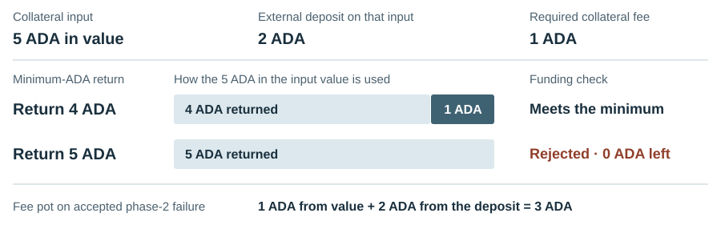

<a id="transaction-rules" name="transaction-rules"></a>

# 2. Transaction rules

[Specification contents](../README.md#table-of-contents) · [← Domain model](domain-model.md) · [Ledger effects →](ledger-effects.md) · [Verification record](../verification.md) · [CIP draft](https://github.com/input-output-hk/arc-cardano-minutxo-alternatives/blob/codex/cip-output-coexistence/CIP-%3F%3F%3F%3F/README.md) · [Latest version of this page](https://github.com/nhenin/cardano-ledger-specs/blob/v2-minutxo/docs/dijkstra-utxo-deposit-rules/chapters/transaction-rules.md)

A transaction signs the ordinary outputs it wants to create and, when required, a **net reserve change**. The ledger resolves the spending inputs and calculates that change independently. If a TopTx or SubTx uses a redeemer, the ledger also checks the collateral offered by TopTx for the whole batch.

An incorrect deposit declaration **rejects the transaction**. An **accepted phase-2 script failure** has a different result. The ordinary declarations and applicable collateral checks passed, so the ledger can spend the collateral and create any collateral return. [Applying the outcome](ledger-effects.md#ds-state-execution)

## Table of contents

Expand a rule to find its examples and tests. The complete index of SubTx and TopTx net-change cases is in [Appendix B](appendices.md#net-change-conformance-cases).

<ul type="none"><li>
<details open>
  <summary><a href="#ds-tx">2.1 Tx</a></summary>
  <div><ul type="none"><li>
      <details>
        <summary><a href="#ds-tx-declarations">2.1.1 Declarations</a></summary>
        <div><ul type="none"><li>
            <details>
              <summary><a href="#ds-tx-declarations-grammar">2.1.1.1 Grammar</a></summary>
              <div><ul type="none"><li>
                  <details>
                    <summary><a href="#ds-tx-declarations-grammar-toptx">2.1.1.1.1 TopTx</a></summary>
                    <div><ul type="none"><li>
                        <details>
                          <summary><a href="#ds-tx-declarations-grammar-toptx-amounts">2.1.1.1.1.1 Amounts</a></summary>
                          <div><ul type="none"><li>
                              <div>•&numsp;<a href="#ds-tx-declarations-grammar-p01">2.1.1.1.1.1.1 P01 - Positive amounts survive encoding</a></div>
                              <div>•&numsp;<a href="#ds-tx-declarations-grammar-f01">2.1.1.1.1.1.2 F01 - Zero operation amount</a></div>
                              <div>•&numsp;<a href="#ds-tx-declarations-grammar-f12">2.1.1.1.1.1.3 F12 - Negative operation amount</a></div>
                              <div>•&numsp;<a href="#ds-tx-declarations-grammar-f13">2.1.1.1.1.1.4 F13 - Overflowing operation amount</a></div>
                          </li></ul></div>
                        </details>
                        <details>
                          <summary><a href="#ds-tx-declarations-grammar-toptx-absence">2.1.1.1.1.2 Absence</a></summary>
                          <div><ul type="none"><li>
                              <div>•&numsp;<a href="#ds-tx-declarations-grammar-n03">2.1.1.1.1.2.1 N03 - Absence remains distinct from zero</a></div>
                          </li></ul></div>
                        </details>
                        <details>
                          <summary><a href="#ds-tx-declarations-grammar-toptx-forms">2.1.1.1.1.3 Forms</a></summary>
                          <div><ul type="none"><li>
                              <div>•&numsp;<a href="#ds-tx-declarations-grammar-n05">2.1.1.1.1.3.1 N05 - Every TopTx declaration form</a></div>
                              <div>•&numsp;<a href="#ds-tx-declarations-grammar-f06">2.1.1.1.1.3.2 F06 - Funding request in TopTx</a></div>
                          </li></ul></div>
                        </details>
                        <details>
                          <summary><a href="#ds-tx-declarations-grammar-toptx-structure">2.1.1.1.1.4 Structure</a></summary>
                          <div><ul type="none"><li>
                              <div>•&numsp;<a href="#ds-tx-declarations-grammar-f02">2.1.1.1.1.4.1 F02 - Malformed declarations</a></div>
                          </li></ul></div>
                        </details>
                        <details>
                          <summary><a href="#ds-tx-declarations-grammar-toptx-destinations">2.1.1.1.1.5 Destinations</a></summary>
                          <div><ul type="none"><li>
                              <div>•&numsp;<a href="#ds-tx-declarations-grammar-f04">2.1.1.1.1.5.1 F04 - Malformed release settlements</a></div>
                              <div>•&numsp;<a href="#ds-tx-declarations-grammar-f14">2.1.1.1.1.5.2 F14 - Negative output index</a></div>
                              <div>•&numsp;<a href="#ds-tx-declarations-grammar-f15">2.1.1.1.1.5.3 F15 - Overflowing output index</a></div>
                          </li></ul></div>
                        </details>
                    </li></ul></div>
                  </details>
                  <details>
                    <summary><a href="#ds-tx-declarations-grammar-subtx">2.1.1.1.2 SubTx</a></summary>
                    <div><ul type="none"><li>
                        <details>
                          <summary><a href="#ds-tx-declarations-grammar-subtx-amounts">2.1.1.1.2.1 Amounts</a></summary>
                          <div><ul type="none"><li>
                              <div>•&numsp;<a href="#ds-tx-declarations-grammar-p02">2.1.1.1.2.1.1 P02 - Positive amounts survive encoding</a></div>
                              <div>•&numsp;<a href="#ds-tx-declarations-grammar-f07">2.1.1.1.2.1.2 F07 - Zero operation amount</a></div>
                              <div>•&numsp;<a href="#ds-tx-declarations-grammar-f08">2.1.1.1.2.1.3 F08 - Negative operation amount</a></div>
                              <div>•&numsp;<a href="#ds-tx-declarations-grammar-f09">2.1.1.1.2.1.4 F09 - Overflowing operation amount</a></div>
                          </li></ul></div>
                        </details>
                        <details>
                          <summary><a href="#ds-tx-declarations-grammar-subtx-absence">2.1.1.1.2.2 Absence</a></summary>
                          <div><ul type="none"><li>
                              <div>•&numsp;<a href="#ds-tx-declarations-grammar-n04">2.1.1.1.2.2.1 N04 - Absence remains distinct from zero</a></div>
                          </li></ul></div>
                        </details>
                        <details>
                          <summary><a href="#ds-tx-declarations-grammar-subtx-forms">2.1.1.1.2.3 Forms</a></summary>
                          <div><ul type="none"><li>
                              <div>•&numsp;<a href="#ds-tx-declarations-grammar-n06">2.1.1.1.2.3.1 N06 - Every SubTx declaration form</a></div>
                          </li></ul></div>
                        </details>
                        <details>
                          <summary><a href="#ds-tx-declarations-grammar-subtx-structure">2.1.1.1.2.4 Structure</a></summary>
                          <div><ul type="none"><li>
                              <div>•&numsp;<a href="#ds-tx-declarations-grammar-f03">2.1.1.1.2.4.1 F03 - Malformed declarations</a></div>
                          </li></ul></div>
                        </details>
                        <details>
                          <summary><a href="#ds-tx-declarations-grammar-subtx-destinations">2.1.1.1.2.5 Destinations</a></summary>
                          <div><ul type="none"><li>
                              <div>•&numsp;<a href="#ds-tx-declarations-grammar-f05">2.1.1.1.2.5.1 F05 - Malformed release targets</a></div>
                              <div>•&numsp;<a href="#ds-tx-declarations-grammar-f10">2.1.1.1.2.5.2 F10 - Negative output index</a></div>
                              <div>•&numsp;<a href="#ds-tx-declarations-grammar-f11">2.1.1.1.2.5.3 F11 - Overflowing output index</a></div>
                          </li></ul></div>
                        </details>
                    </li></ul></div>
                  </details>
              </li></ul></div>
            </details>
            <details>
              <summary><a href="#ds-tx-declarations-requirements">2.1.1.2 Requirements</a></summary>
              <div><ul type="none"><li>
                  <details>
                    <summary><a href="#ds-tx-declarations-requirements-operations">2.1.1.2.1 Operations</a></summary>
                    <div><ul type="none"><li>
                        <div>•&numsp;<a href="#ds-tx-declarations-requirements-operations-p01">2.1.1.2.1.1 P01 - Every body requiring a Store operation declares</a></div>
                        <details>
                          <summary><a href="#ds-tx-declarations-requirements-operations-allocation">2.1.1.2.1.2 Allocation</a></summary>
                          <div><ul type="none"><li>
                              <div>•&numsp;<a href="#ds-tx-declarations-requirements-operations-allocation-n01">2.1.1.2.1.2.1 N01 - Every explicit declaration satisfies allocation presence</a></div>
                              <div>•&numsp;<a href="#ds-tx-declarations-requirements-operations-allocation-n02">2.1.1.2.1.2.2 N02 - Absence satisfies allocation presence for empty or implicit-only own outputs</a></div>
                              <div>•&numsp;<a href="#ds-tx-declarations-requirements-operations-allocation-f01">2.1.1.2.1.2.3 F01 - Missing declaration fails allocation presence at every own-output position</a></div>
                              <div>•&numsp;<a href="#ds-tx-declarations-requirements-operations-allocation-n03">2.1.1.2.1.2.4 N03 - accepts a TopTx creating only min-ADA outputs without a declaration</a></div>
                              <div>•&numsp;<a href="#ds-tx-declarations-requirements-operations-allocation-n04">2.1.1.2.1.2.5 N04 - accepts a SubTx creating only min-ADA outputs without either body's declaration</a></div>
                              <div>•&numsp;<a href="#ds-tx-declarations-requirements-operations-allocation-n05">2.1.1.2.1.2.6 N05 - Standalone TopTx, exact allocation declaration</a></div>
                              <div>•&numsp;<a href="#ds-tx-declarations-requirements-operations-allocation-f02">2.1.1.2.1.2.7 F02 - Standalone TopTx, allocation without a declaration</a></div>
                              <div>•&numsp;<a href="#ds-tx-declarations-requirements-operations-allocation-f03">2.1.1.2.1.2.8 F03 - rejects a SubTx creating a deposit-backed output without its own declaration</a></div>
                              <div>•&numsp;<a href="#ds-tx-declarations-requirements-operations-allocation-f04">2.1.1.2.1.2.9 F04 - rejects a TopTx creating a deposit-backed output without its own declaration even when phase 2 fails</a></div>
                              <div>•&numsp;<a href="#ds-tx-declarations-requirements-operations-allocation-f05">2.1.1.2.1.2.10 F05 - rejects a SubTx creating a deposit-backed output without its own declaration even when phase 2 fails</a></div>
                              <div>•&numsp;<a href="#ds-tx-declarations-requirements-operations-allocation-f06">2.1.1.2.1.2.11 F06 - rejects a missing own declaration when spending a translated min-ADA output to create deposit-backed outputs</a></div>
                              <div>•&numsp;<a href="#ds-tx-declarations-requirements-operations-allocation-n06">2.1.1.2.1.2.12 N06 - SubTx outputs do not trigger TopTx allocation presence</a></div>
                              <div>•&numsp;<a href="#ds-tx-declarations-requirements-operations-allocation-n07">2.1.1.2.1.2.13 N07 - Collateral return does not trigger allocation presence</a></div>
                              <div>•&numsp;<a href="#ds-tx-declarations-requirements-operations-allocation-n08">2.1.1.2.1.2.14 N08 - Reference and collateral input identifiers do not trigger allocation presence</a></div>
                              <div>•&numsp;<a href="#ds-tx-declarations-requirements-operations-allocation-f07">2.1.1.2.1.2.15 F07 - A SubTx declaration cannot satisfy TopTx allocation presence</a></div>
                              <div>•&numsp;<a href="#ds-tx-declarations-requirements-operations-allocation-f08">2.1.1.2.1.2.16 F08 - TopTx zero cannot satisfy its allocating SubTx's declaration requirement</a></div>
                              <div>•&numsp;<a href="#ds-tx-declarations-requirements-operations-allocation-n09">2.1.1.2.1.2.17 N09 - TopTx and SubTx allocate deposits, each with an exact declaration</a></div>
                          </li></ul></div>
                        </details>
                        <details>
                          <summary><a href="#ds-tx-declarations-requirements-operations-release">2.1.1.2.1.3 Release</a></summary>
                          <div><ul type="none"><li>
                              <div>•&numsp;<a href="#ds-tx-declarations-requirements-operations-release-n01">2.1.1.2.1.3.1 N01 - Standalone TopTx, any output form</a></div>
                              <div>•&numsp;<a href="#ds-tx-declarations-requirements-operations-release-n02">2.1.1.2.1.3.2 N02 - Standalone TopTx, only min-ADA outputs</a></div>
                              <div>•&numsp;<a href="#ds-tx-declarations-requirements-operations-release-n03">2.1.1.2.1.3.3 N03 - One SubTx releases its deposit into its own output</a></div>
                              <div>•&numsp;<a href="#ds-tx-declarations-requirements-operations-release-f01">2.1.1.2.1.3.4 F01 - Standalone TopTx, release without its own declaration</a></div>
                              <div>•&numsp;<a href="#ds-tx-declarations-requirements-operations-release-f02">2.1.1.2.1.3.5 F02 - SubTx release without its own declaration, despite TopTx declaring</a></div>
                              <div>•&numsp;<a href="#ds-tx-declarations-requirements-operations-release-n04">2.1.1.2.1.3.6 N04 - Phase 2 fails with valid declarations</a></div>
                              <div>•&numsp;<a href="#ds-tx-declarations-requirements-operations-release-f03">2.1.1.2.1.3.7 F03 - Missing release declaration in a phase-2-invalid proposal</a></div>
                              <div>•&numsp;<a href="#ds-tx-declarations-requirements-operations-release-n05">2.1.1.2.1.3.8 N05 - Several SubTxs release their deposits</a></div>
                              <div>•&numsp;<a href="#ds-tx-declarations-requirements-operations-release-f04">2.1.1.2.1.3.9 F04 - One SubTx releasing deposits omits its declaration</a></div>
                              <div>•&numsp;<a href="#ds-tx-declarations-requirements-operations-release-n06">2.1.1.2.1.3.10 N06 - Only some SubTxs release Store deposits</a></div>
                              <div>•&numsp;<a href="#ds-tx-declarations-requirements-operations-release-n07">2.1.1.2.1.3.11 N07 - TopTx and several SubTxs release deposits</a></div>
                              <div>•&numsp;<a href="#ds-tx-declarations-requirements-operations-release-n08">2.1.1.2.1.3.12 N08 - Phase 2 fails with several proposed SubTx releases</a></div>
                              <div>•&numsp;<a href="#ds-tx-declarations-requirements-operations-release-f05">2.1.1.2.1.3.13 F05 - One SubTx declaration is missing in a phase-2-invalid proposal</a></div>
                              <div>•&numsp;<a href="#ds-tx-declarations-requirements-operations-release-n09">2.1.1.2.1.3.14 N09 - Standalone TopTx, reference-only Store access</a></div>
                              <div>•&numsp;<a href="#ds-tx-declarations-requirements-operations-release-n10">2.1.1.2.1.3.15 N10 - Standalone TopTx, collateral-only Store operations</a></div>
                              <div>•&numsp;<a href="#ds-tx-declarations-requirements-operations-release-f06">2.1.1.2.1.3.16 F06 - A SubTx declaration cannot satisfy TopTx release presence</a></div>
                          </li></ul></div>
                        </details>
                        <details>
                          <summary><a href="#ds-tx-declarations-requirements-operations-zero-net-change">2.1.1.2.1.4 Zero net change</a></summary>
                          <div><ul type="none"><li>
                              <div>•&numsp;<a href="#ds-tx-declarations-requirements-operations-zero-net-change-n01">2.1.1.2.1.4.1 N01 - Standalone TopTx, equal allocations and releases with explicit zero</a></div>
                              <div>•&numsp;<a href="#ds-tx-declarations-requirements-operations-zero-net-change-f01">2.1.1.2.1.4.2 F01 - Standalone TopTx, equal allocations and releases without a declaration</a></div>
                              <div>•&numsp;<a href="#ds-tx-declarations-requirements-operations-zero-net-change-n02">2.1.1.2.1.4.3 N02 - One SubTx replaces its deposit with explicit zero</a></div>
                              <div>•&numsp;<a href="#ds-tx-declarations-requirements-operations-zero-net-change-f02">2.1.1.2.1.4.4 F02 - One active SubTx omits its declaration</a></div>
                              <div>•&numsp;<a href="#ds-tx-declarations-requirements-operations-zero-net-change-f03">2.1.1.2.1.4.5 F03 - TopTx omits the declaration required by its child</a></div>
                              <div>•&numsp;<a href="#ds-tx-declarations-requirements-operations-zero-net-change-n03">2.1.1.2.1.4.6 N03 - Several SubTxs each replace their deposits</a></div>
                              <div>•&numsp;<a href="#ds-tx-declarations-requirements-operations-zero-net-change-f04">2.1.1.2.1.4.7 F04 - One of several active SubTxs omits its declaration</a></div>
                              <div>•&numsp;<a href="#ds-tx-declarations-requirements-operations-zero-net-change-n04">2.1.1.2.1.4.8 N04 - Only some SubTxs replace Store deposits</a></div>
                              <div>•&numsp;<a href="#ds-tx-declarations-requirements-operations-zero-net-change-f05">2.1.1.2.1.4.9 F05 - One active SubTx omits its declaration among inactive siblings</a></div>
                              <div>•&numsp;<a href="#ds-tx-declarations-requirements-operations-zero-net-change-n05">2.1.1.2.1.4.10 N05 - TopTx and several SubTxs each replace their deposits</a></div>
                              <div>•&numsp;<a href="#ds-tx-declarations-requirements-operations-zero-net-change-f06">2.1.1.2.1.4.11 F06 - Active TopTx omits its own declaration</a></div>
                              <div>•&numsp;<a href="#ds-tx-declarations-requirements-operations-zero-net-change-n06">2.1.1.2.1.4.12 N06 - Phase 2 fails with explicit zero at every active body</a></div>
                              <div>•&numsp;<a href="#ds-tx-declarations-requirements-operations-zero-net-change-f07">2.1.1.2.1.4.13 F07 - One SubTx declaration is missing in a phase-2-invalid proposal</a></div>
                              <div>•&numsp;<a href="#ds-tx-declarations-requirements-operations-zero-net-change-f08">2.1.1.2.1.4.14 F08 - TopTx's own declaration is missing in a phase-2-invalid proposal</a></div>
                          </li></ul></div>
                        </details>
                    </li></ul></div>
                  </details>
                  <details>
                    <summary><a href="#ds-tx-declarations-requirements-subtx-declarations">2.1.1.2.2 SubTx declarations</a></summary>
                    <div><ul type="none"><li>
                        <details>
                          <summary><a href="#ds-tx-declarations-requirements-subtx-declarations-c01">2.1.1.2.2.1 TopTx requirement</a></summary>
                          <div><ul type="none"><li>
                              <div>•&numsp;<a href="#ds-tx-declarations-requirements-subtx-declarations-c01-p01">2.1.1.2.2.1.1 P01 - SubTx declarations require TopTx's declaration</a></div>
                          </li></ul></div>
                        </details>
                        <details>
                          <summary><a href="#ds-tx-declarations-requirements-subtx-declarations-c02">2.1.1.2.2.2 Absence and explicit zero</a></summary>
                          <div><ul type="none"><li>
                              <div>•&numsp;<a href="#ds-tx-declarations-requirements-subtx-declarations-c02-n01">2.1.1.2.2.2.1 N01 - accepts absent declarations at both levels</a></div>
                              <div>•&numsp;<a href="#ds-tx-declarations-requirements-subtx-declarations-c02-n02">2.1.1.2.2.2.2 N02 - accepts explicit zero at both levels</a></div>
                              <div>•&numsp;<a href="#ds-tx-declarations-requirements-subtx-declarations-c02-n03">2.1.1.2.2.2.3 N03 - accepts TopTx zero without a SubTx declaration</a></div>
                              <div>•&numsp;<a href="#ds-tx-declarations-requirements-subtx-declarations-c02-f01">2.1.1.2.2.2.4 F01 - rejects SubTx zero without a TopTx declaration</a></div>
                          </li></ul></div>
                        </details>
                        <details>
                          <summary><a href="#ds-tx-declarations-requirements-subtx-declarations-c03">2.1.1.2.2.3 Offsetting SubTx contributions</a></summary>
                          <div><ul type="none"><li>
                              <div>•&numsp;<a href="#ds-tx-declarations-requirements-subtx-declarations-c03-n01">2.1.1.2.2.3.1 N01 - passes declaration presence with TopTx declaring the zero net amount</a></div>
                              <div>•&numsp;<a href="#ds-tx-declarations-requirements-subtx-declarations-c03-f01">2.1.1.2.2.3.2 F01 - rejects an absent TopTx declaration despite the zero net amount</a></div>
                          </li></ul></div>
                        </details>
                        <details>
                          <summary><a href="#ds-tx-declarations-requirements-subtx-declarations-c04">2.1.1.2.2.4 Local and delegated accounting</a></summary>
                          <div><ul type="none"><li>
                              <div>•&numsp;<a href="#ds-tx-declarations-requirements-subtx-declarations-c04-n01">2.1.1.2.2.4.1 N01 - passes declaration presence with TopTx zero for every explicit SubTx form</a></div>
                              <div>•&numsp;<a href="#ds-tx-declarations-requirements-subtx-declarations-c04-f01">2.1.1.2.2.4.2 F01 - rejects an absent TopTx declaration for every explicit SubTx form</a></div>
                          </li></ul></div>
                        </details>
                        <details>
                          <summary><a href="#ds-tx-declarations-requirements-subtx-declarations-c05">2.1.1.2.2.5 Phase-2 failure</a></summary>
                          <div><ul type="none"><li>
                              <div>•&numsp;<a href="#ds-tx-declarations-requirements-subtx-declarations-c05-n01">2.1.1.2.2.5.1 N01 - accepts zero declarations at both levels on the phase-2 failure path</a></div>
                              <div>•&numsp;<a href="#ds-tx-declarations-requirements-subtx-declarations-c05-f01">2.1.1.2.2.5.2 F01 - rejects SubTx zero without a TopTx declaration on the phase-2 failure path</a></div>
                          </li></ul></div>
                        </details>
                    </li></ul></div>
                  </details>
              </li></ul></div>
            </details>
        </li></ul></div>
      </details>
      <details>
        <summary><a href="#ds-tx-accounting">2.1.2 Accounting</a></summary>
        <div><ul type="none"><li>
            <details>
              <summary><a href="#ds-tx-accounting-net-change">2.1.2.1 Net change</a></summary>
              <div><ul type="none"><li>
                  <details>
                    <summary><a href="#ds-tx-accounting-net-change-subtx">2.1.2.1.1 SubTx</a></summary>
                    <div><ul type="none"><li>
                        <div>•&numsp;<a href="appendices.md#subtx-net-change-test-cases">SubTx conformance cases and tests</a></div>
                    </li></ul></div>
                  </details>
                  <details>
                    <summary><a href="#ds-tx-accounting-net-change-toptx">2.1.2.1.2 TopTx</a></summary>
                    <div><ul type="none"><li>
                        <div>•&numsp;<a href="appendices.md#toptx-net-change-test-cases">TopTx conformance cases and tests</a></div>
                    </li></ul></div>
                  </details>
              </li></ul></div>
            </details>
            <details>
              <summary><a href="#ds-tx-accounting-attribution">2.1.2.2 Attribution</a></summary>
              <div><ul type="none"><li>
                  <div>•&numsp;<a href="#ds-tx-accounting-attribution-p01">2.1.2.2.1 P01 - Local and delegated contributions determine TopTx's share</a></div>
                  <div>•&numsp;<a href="#ds-tx-accounting-attribution-p02">2.1.2.2.2 P02 - Delegation moves the signed contribution to TopTx</a></div>
                  <div>•&numsp;<a href="#ds-tx-accounting-attribution-n01">2.1.2.2.3 N01 - Explicit zero adds no delegated contribution</a></div>
              </li></ul></div>
            </details>
            <details>
              <summary><a href="#ds-tx-accounting-balance">2.1.2.3 Balance</a></summary>
              <div><ul type="none"><li>
                  <div>•&numsp;<a href="#ds-tx-accounting-balance-p01">2.1.2.3.1 P01 - The transaction conserves value when phase 2 is valid</a></div>
                  <div>•&numsp;<a href="#ds-tx-accounting-balance-p02">2.1.2.3.2 P02 - Complete balance determines acceptance</a></div>
                  <div>•&numsp;<a href="#ds-tx-accounting-balance-n01">2.1.2.3.3 N01 - Fund a net allocation once</a></div>
                  <div>•&numsp;<a href="#ds-tx-accounting-balance-n02">2.1.2.3.4 N02 - Use a net release once</a></div>
                  <div>•&numsp;<a href="#ds-tx-accounting-balance-n03">2.1.2.3.5 N03 - One SubTx funds another</a></div>
                  <div>•&numsp;<a href="#ds-tx-accounting-balance-n04">2.1.2.3.6 N04 - A SubTx funds TopTx fees</a></div>
                  <div>•&numsp;<a href="#ds-tx-accounting-balance-f01">2.1.2.3.7 F01 - One-lovelace deficit or surplus</a></div>
                  <div>•&numsp;<a href="#ds-tx-accounting-balance-f02">2.1.2.3.8 F02 - Native-asset quantity or identity mismatch</a></div>
                  <div>•&numsp;<a href="#ds-tx-accounting-balance-f03">2.1.2.3.9 F03 - An exact delegated allocation lacks funding</a></div>
                  <div>•&numsp;<a href="#ds-tx-accounting-balance-n05">2.1.2.3.10 N05 - Equal delegated allocations and releases</a></div>
                  <div>•&numsp;<a href="#ds-tx-accounting-balance-n06">2.1.2.3.11 N06 - Ten input ADA plus two released ADA</a></div>
                  <div>•&numsp;<a href="#ds-tx-accounting-balance-n07">2.1.2.3.12 N07 - Released ADA contributes to TopTx fees</a></div>
                  <div>•&numsp;<a href="#ds-tx-accounting-balance-f04">2.1.2.3.13 F04 - Released ADA cannot disappear</a></div>
                  <div>•&numsp;<a href="#ds-tx-accounting-balance-n08">2.1.2.3.14 N08 - Balanced proposal, failed phase 2</a></div>
              </li></ul></div>
            </details>
        </li></ul></div>
      </details>
      <details>
        <summary><a href="#ds-tx-authorization">2.1.3 Authorization</a></summary>
        <div><ul type="none"><li>
            <div>•&numsp;<a href="#ds-tx-authorization-n01">2.1.3.1 N01 - Bob spends an output funded by Alice</a></div>
            <div>•&numsp;<a href="#ds-tx-authorization-f01">2.1.3.2 F01 - Alice's signature cannot replace Bob's</a></div>
        </li></ul></div>
      </details>
      <details>
        <summary><a href="#ds-tx-settlement">2.1.4 Settlement</a></summary>
        <div><ul type="none"><li>
            <details>
              <summary><a href="#ds-tx-settlement-designation">2.1.4.1 Designation</a></summary>
              <div><ul type="none"><li>
                  <div>•&numsp;<a href="#ds-tx-settlement-designation-p01">2.1.4.1.1 P01 - Designation follows TopTx's release share</a></div>
                  <div>•&numsp;<a href="#ds-tx-settlement-designation-n01">2.1.4.1.2 N01 - SubTxs settle the entire release</a></div>
                  <div>•&numsp;<a href="#ds-tx-settlement-designation-n02">2.1.4.1.3 N02 - Standalone TopTx settles its release</a></div>
                  <div>•&numsp;<a href="#ds-tx-settlement-designation-n03">2.1.4.1.4 N03 - TopTx and SubTxs each settle a share</a></div>
                  <div>•&numsp;<a href="#ds-tx-settlement-designation-n04">2.1.4.1.5 N04 - TopTx's share exceeds the transaction release</a></div>
                  <div>•&numsp;<a href="#ds-tx-settlement-designation-f01">2.1.4.1.6 F01 - TopTx omits a required output</a></div>
                  <div>•&numsp;<a href="#ds-tx-settlement-designation-f02">2.1.4.1.7 F02 - TopTx designates an unnecessary output</a></div>
                  <div>•&numsp;<a href="#ds-tx-settlement-designation-n05">2.1.4.1.8 N05 - Net allocation, even though TopTx releases</a></div>
                  <div>•&numsp;<a href="#ds-tx-settlement-designation-n06">2.1.4.1.9 N06 - Explicit-zero total, even though TopTx releases</a></div>
                  <div>•&numsp;<a href="#ds-tx-settlement-designation-n07">2.1.4.1.10 N07 - Net release, while TopTx allocates</a></div>
                  <div>•&numsp;<a href="#ds-tx-settlement-designation-n08">2.1.4.1.11 N08 - Valid designation when phase 2 fails</a></div>
                  <div>•&numsp;<a href="#ds-tx-settlement-designation-f03">2.1.4.1.12 F03 - Invalid designation when phase 2 fails</a></div>
              </li></ul></div>
            </details>
            <details>
              <summary><a href="#ds-tx-settlement-output-index">2.1.4.2 Output index</a></summary>
              <div><ul type="none"><li>
                  <div>•&numsp;<a href="#ds-tx-settlement-output-index-p01">2.1.4.2.1 P01 - The index belongs to the declaring body</a></div>
                  <div>•&numsp;<a href="#ds-tx-settlement-output-index-f01">2.1.4.2.2 F01 - The first missing own index is rejected</a></div>
                  <div>•&numsp;<a href="#ds-tx-settlement-output-index-f02">2.1.4.2.3 F02 - A SubTx cannot select TopTx's output</a></div>
                  <div>•&numsp;<a href="#ds-tx-settlement-output-index-f03">2.1.4.2.4 F03 - Collateral return is outside the ordinary output sequence</a></div>
                  <div>•&numsp;<a href="#ds-tx-settlement-output-index-f04">2.1.4.2.5 F04 - A SubTx without outputs cannot settle locally</a></div>
                  <div>•&numsp;<a href="#ds-tx-settlement-output-index-n01">2.1.4.2.6 N01 - The first and last own outputs are valid</a></div>
                  <div>•&numsp;<a href="#ds-tx-settlement-output-index-f05">2.1.4.2.7 F05 - TopTx cannot select a SubTx's output</a></div>
                  <div>•&numsp;<a href="#ds-tx-settlement-output-index-f06">2.1.4.2.8 F06 - A SubTx cannot select a sibling's output</a></div>
                  <div>•&numsp;<a href="#ds-tx-settlement-output-index-n02">2.1.4.2.9 N02 - Valid output indices when phase 2 fails</a></div>
                  <div>•&numsp;<a href="#ds-tx-settlement-output-index-f07">2.1.4.2.10 F07 - An invalid output index still fails when phase 2 fails</a></div>
                  <div>•&numsp;<a href="#ds-tx-settlement-output-index-n03">2.1.4.2.11 N03 - A SubTx without outputs delegates its final release</a></div>
              </li></ul></div>
            </details>
            <details>
              <summary><a href="#ds-tx-settlement-output-coin">2.1.4.3 Output coin</a></summary>
              <div><ul type="none"><li>
                  <div>•&numsp;<a href="#ds-tx-settlement-output-coin-p01">2.1.4.3.1 P01 - Output ADA must cover the required share</a></div>
                  <div>•&numsp;<a href="#ds-tx-settlement-output-coin-f01">2.1.4.3.2 F01 - Min-ADA output, one lovelace short</a></div>
                  <div>•&numsp;<a href="#ds-tx-settlement-output-coin-n01">2.1.4.3.3 N01 - Min-ADA output, exact amount</a></div>
                  <div>•&numsp;<a href="#ds-tx-settlement-output-coin-n02">2.1.4.3.4 N02 - Min-ADA output, extra ADA</a></div>
                  <div>•&numsp;<a href="#ds-tx-settlement-output-coin-f02">2.1.4.3.5 F02 - An external deposit cannot fill the ADA shortfall</a></div>
                  <div>•&numsp;<a href="#ds-tx-settlement-output-coin-n03">2.1.4.3.6 N03 - Deposit-backed output, exact application ADA</a></div>
                  <div>•&numsp;<a href="#ds-tx-settlement-output-coin-n04">2.1.4.3.7 N04 - TopTx's share is smaller than the transaction release</a></div>
                  <div>•&numsp;<a href="#ds-tx-settlement-output-coin-n05">2.1.4.3.8 N05 - Exact output ADA when phase 2 fails</a></div>
                  <div>•&numsp;<a href="#ds-tx-settlement-output-coin-f03">2.1.4.3.9 F03 - One lovelace short when phase 2 fails</a></div>
                  <div>•&numsp;<a href="#ds-tx-settlement-output-coin-f04">2.1.4.3.10 F04 - The transaction release is smaller than TopTx's share</a></div>
              </li></ul></div>
            </details>
        </li></ul></div>
      </details>
      <details>
        <summary><a href="#ds-tx-minimum-coin">2.1.5 Minimum coin</a></summary>
        <div><ul type="none"><li>
            <div>•&numsp;<a href="#ds-tx-minimum-coin-n01">2.1.5.1 N01 - Native assets without ADA</a></div>
            <div>•&numsp;<a href="#ds-tx-minimum-coin-n02">2.1.5.2 N02 - Datum or reference script without assets</a></div>
            <div>•&numsp;<a href="#ds-tx-minimum-coin-n03">2.1.5.3 N03 - Address-only output</a></div>
            <div>•&numsp;<a href="#ds-tx-minimum-coin-n04">2.1.5.4 N04 - Exact minimum for a min-ADA output</a></div>
            <div>•&numsp;<a href="#ds-tx-minimum-coin-f01">2.1.5.5 F01 - Min-ADA output one lovelace short</a></div>
        </li></ul></div>
      </details>
  </li></ul></div>
</details>
<details open>
  <summary><a href="#ds-collateral">2.2 Collateral</a></summary>
  <div><ul type="none"><li>
      <div>•&numsp;<a href="#ds-collateral-existing-rules">Existing collateral rules</a></div>
      <details>
        <summary><a href="#ds-collateral-funding">2.2.1 Funding</a></summary>
        <div><ul type="none"><li>
            <div>•&numsp;<a href="#ds-collateral-funding-n01">2.2.1.1 N01 - Funded collateral</a></div>
            <div>•&numsp;<a href="#ds-collateral-funding-f01">2.2.1.2 F01 - Underfunded collateral</a></div>
            <div>•&numsp;<a href="#ds-collateral-funding-p02">2.2.1.3 P02 - Independent ordinary declarations</a></div>
            <div>•&numsp;<a href="#ds-collateral-funding-p03">2.2.1.4 P03 - Min-ADA return at the active minimum</a></div>
        </li></ul></div>
      </details>
      <details>
        <summary><a href="#ds-collateral-total">2.2.2 Total</a></summary>
        <div><ul type="none"><li>
            <div>•&numsp;<a href="#ds-collateral-total-n01">2.2.2.1 N01 - Absent or exact total</a></div>
            <div>•&numsp;<a href="#ds-collateral-total-f01">2.2.2.2 F01 - Incorrect total</a></div>
        </li></ul></div>
      </details>
      <details>
        <summary><a href="#ds-collateral-assets">2.2.3 Assets</a></summary>
        <div><ul type="none"><li>
            <div>•&numsp;<a href="#ds-collateral-assets-n01">2.2.3.1 N01 - Exact asset map</a></div>
            <div>•&numsp;<a href="#ds-collateral-assets-f01">2.2.3.2 F01 - Missing or altered assets</a></div>
        </li></ul></div>
      </details>
  </li></ul></div>
</details>
</li></ul>

<a id="section-1-2" name="section-1-2"></a>
<a id="ds-tx" name="ds-tx"></a>

## 2.1 Tx

For **ordinary accounting**, the ledger uses the spending inputs and regular outputs of TopTx and each SubTx. It recovers each input’s reserve from the UTxO state at the start of the batch and prices new outputs under the active formula and byte price. [Output forms and historical reserves](domain-model.md#section-1-1)

| Rule | What the ledger checks |
| --- | --- |
| [Declarations](#ds-tx-declarations) | Does each body that must declare carry a valid declaration, including when its net is zero? |
| [Accounting](#ds-tx-accounting) | Does each declared amount match the inputs and outputs within its scope? On ordinary success, does the whole batch balance? |
| [Authorization](#ds-tx-authorization) | Does the transaction satisfy the spending credential of the output whose deposit it releases? |
| [Settlement](#ds-tx-settlement) | Where a release needs a destination, does the index identify an output in the correct body with enough ADA? |
| [Minimum coin](#ds-tx-minimum-coin) | Does each new minimum-ADA output carry its required reserve in its value? |

**Which checks still matter if a script fails?** The ledger checks declaration presence, exact amounts, settlement, and the minimum on proposed outputs for either script outcome. It checks ordinary whole-batch value conservation only on the phase-2-valid path. Collateral has its own funding, total and asset checks whenever any body supplies a redeemer. With all applicable checks satisfied, the script outcome determines which inputs are consumed. [Deposit checks](../../../eras/dijkstra/impl/src/Cardano/Ledger/Dijkstra/Rules/DepositStore.hs#L57-L74) · [Ordinary value conservation](../../../eras/dijkstra/impl/src/Cardano/Ledger/Dijkstra/Rules/Utxo.hs#L396-L419)

<a id="ds-tx-declarations" name="ds-tx-declarations"></a>

<a id="211-declarations" name="211-declarations"></a>

<a id="211-toptx-and-subtx-deposit-declarations-in-dijkstra" name="211-toptx-and-subtx-deposit-declarations-in-dijkstra"></a>

### 2.1.1 TopTx and SubTx deposit declarations

A **TopTx declaration** states the reserve change for the entire batch. A **SubTx declaration** states the change attributable to that SubTx and, for a nonzero amount, who will fund or settle it.

The ledger asks three questions. Can it decode the declaration? Does every body that needs a declaration supply one? Does each declared amount match the reserves on the actual inputs and outputs? The checks are defined in [Grammar](#ds-tx-declarations-grammar), [Declaration requirements](#ds-tx-declarations-requirements) and [Accounting](#ds-tx-accounting-net-change).

<a id="ds-tx-grammar" name="ds-tx-grammar"></a>
<a id="ds-tx-declarations-grammar" name="ds-tx-declarations-grammar"></a>

#### 2.1.1.1 Grammar

Decoding identifies the operation, amount and release destination from the body alone. For example, an output index of 5 is representable. Whether the body contains a sixth output is a [settlement check](#ds-tx-settlement-output-index).

| Body field | TopTx meaning | SubTx meaning |
| --- | --- | --- |
| Omitted | No batch change declared. | No contribution declared. |
| Explicit zero | The **batch total** is zero. | This **SubTx's own change** is zero. |
| Allocate | The batch requires additional reserve. | This SubTx accounts for its allocation locally. |
| Request funding | Only a SubTx can request funding. | TopTx funds the SubTx's allocation. |
| Release | The batch releases reserve. TopTx either names its own settlement output or declares `NoTopTxSettlement`. | The SubTx settles its release in one of its own outputs or delegates it to TopTx. |

An amount-bearing form carries **1 to $`2^{64}-1`$ lovelace**. The operation gives the amount its direction. Explicit zero has its own representation. A local settlement index is an unsigned integer from **0 to 65,535**.

**Encoding.** Decoding an encoded declaration must recover the same form, amount and target. The whole-body tests also check the surrounding fields. CBOR requires a known tag and the exact number of fields at every supported Dijkstra version. JSON requires a known operation kind and its required fields, and permits extra object keys. The tests cover both formats unless a case specifies one. [Body field 28 and wire formats](appendices.md#declaration-encoding)

<a id="ds-tx-grammar-n02" name="ds-tx-grammar-n02"></a>
<a id="ds-tx-declarations-grammar-n02" name="ds-tx-declarations-grammar-n02"></a>

The Haskell type `StrictlyPositiveCoin` enforces the amount bounds. The declaration tests also pass raw, malformed amounts directly to each decoder. [Scalar constructor and codec tests](../../../libs/cardano-ledger-core/test/Test/Cardano/Ledger/StrictlyPositiveCoinSpec.hs)

For each body, the cases cover **amounts**, **absence**, **forms**, **structure** and **destinations**. Each case identifier links to its executable check.

<a id="ds-tx-grammar-toptx" name="ds-tx-grammar-toptx"></a>
<a id="ds-tx-declarations-grammar-toptx" name="ds-tx-declarations-grammar-toptx"></a>

##### 2.1.1.1.1 TopTx

TopTx can declare zero, an allocation or a release for the batch. On a release, the declaration specifies whether TopTx designates one of its outputs.

<a id="ds-tx-grammar-amounts" name="ds-tx-grammar-amounts"></a>
<a id="ds-tx-declarations-grammar-amounts" name="ds-tx-declarations-grammar-amounts"></a>

<a id="ds-tx-grammar-toptx-amounts" name="ds-tx-grammar-toptx-amounts"></a>
<a id="ds-tx-declarations-grammar-toptx-amounts" name="ds-tx-declarations-grammar-toptx-amounts"></a>

**2.1.1.1.1.1 Amounts**

> **Allocation and release carry a strictly positive amount.**

| Case | Scenario | Expected result |
| :---: | --- | --- |
| <a id="ds-tx-grammar-p01" name="ds-tx-grammar-p01"></a><a id="ds-tx-declarations-grammar-p01" name="ds-tx-declarations-grammar-p01"></a>**1.&nbsp;[P01](../../../eras/dijkstra/impl/test/Test/Cardano/Ledger/Dijkstra/Imp/DepositStore/TransactionRules/Tx/Declarations/Grammar/TopTxSpec.hs#L36)** | **Positive amounts survive encoding.** A generated `StrictlyPositiveCoin` in every amount-bearing form. | Preserve the operation, amount and settlement through both codecs. |
| <a id="ds-tx-grammar-f01" name="ds-tx-grammar-f01"></a><a id="ds-tx-declarations-grammar-f01" name="ds-tx-declarations-grammar-f01"></a>**2.&nbsp;[F01](../../../eras/dijkstra/impl/test/Test/Cardano/Ledger/Dijkstra/Imp/DepositStore/TransactionRules/Tx/Declarations/Grammar/TopTxSpec.hs#L40)** | **Zero operation amount.** Raw $`\text{amount}=0`$. | Reject decoding. Explicit zero has its own form. |
| <a id="ds-tx-grammar-f12" name="ds-tx-grammar-f12"></a><a id="ds-tx-declarations-grammar-f12" name="ds-tx-declarations-grammar-f12"></a>**3.&nbsp;[F12](../../../eras/dijkstra/impl/test/Test/Cardano/Ledger/Dijkstra/Imp/DepositStore/TransactionRules/Tx/Declarations/Grammar/TopTxSpec.hs#L43)** | **Negative operation amount.** Raw $`\text{amount}=-1`$. | Reject the negative amount. |
| <a id="ds-tx-grammar-f13" name="ds-tx-grammar-f13"></a><a id="ds-tx-declarations-grammar-f13" name="ds-tx-declarations-grammar-f13"></a>**4.&nbsp;[F13](../../../eras/dijkstra/impl/test/Test/Cardano/Ledger/Dijkstra/Imp/DepositStore/TransactionRules/Tx/Declarations/Grammar/TopTxSpec.hs#L46)** | **Overflowing operation amount.** Raw $`\text{amount}=2^{64}`$. | Reject decoding without truncation or wrapping. |

Every generated set includes allocation, release without TopTx settlement, and
local release at indices $`0`$, $`65535`$ and one generated interior index. Thus each
amount is checked in **five declarations per codec**, with valid destinations.
The three rejection cases fix the amount at the stated boundary value while
varying the surrounding declaration. Explicit zero uses a separate form, not an
allocation or release of zero.

<a id="ds-tx-grammar-absence" name="ds-tx-grammar-absence"></a>
<a id="ds-tx-declarations-grammar-absence" name="ds-tx-declarations-grammar-absence"></a>

<a id="ds-tx-grammar-toptx-absence" name="ds-tx-grammar-toptx-absence"></a>
<a id="ds-tx-declarations-grammar-toptx-absence" name="ds-tx-declarations-grammar-toptx-absence"></a>

**2.1.1.1.1.2 Absence**

> **Declaring zero is different from declaring nothing.**

| Case | Scenario | Expected result |
| :---: | --- | --- |
| <a id="ds-tx-grammar-n03" name="ds-tx-grammar-n03"></a><a id="ds-tx-declarations-grammar-n03" name="ds-tx-declarations-grammar-n03"></a>**1.&nbsp;[N03](../../../eras/dijkstra/impl/test/Test/Cardano/Ledger/Dijkstra/Imp/DepositStore/TransactionRules/Tx/Declarations/Grammar/TopTxSpec.hs#L51)** | **Absence remains distinct from zero.** Two otherwise identical complete bodies, differing only in their declaration. | Distinct encodings; decoding preserves each complete body. |

The two bodies have identical spending inputs, reference inputs and auxiliary-data hash. Omitting the field and explicitly declaring zero must produce distinct encodings. Decoding either must recover the original body.

<a id="ds-tx-grammar-forms" name="ds-tx-grammar-forms"></a>
<a id="ds-tx-declarations-grammar-forms" name="ds-tx-declarations-grammar-forms"></a>

<a id="ds-tx-grammar-toptx-forms" name="ds-tx-grammar-toptx-forms"></a>
<a id="ds-tx-declarations-grammar-toptx-forms" name="ds-tx-declarations-grammar-toptx-forms"></a>

**2.1.1.1.1.3 Forms**

> **Preserve every TopTx form; keep funding requests specific to SubTx.**

| Case | Scenario | Expected result |
| :---: | --- | --- |
| <a id="ds-tx-grammar-n05" name="ds-tx-grammar-n05"></a><a id="ds-tx-declarations-grammar-n05" name="ds-tx-declarations-grammar-n05"></a>**1.&nbsp;[N05](../../../eras/dijkstra/impl/test/Test/Cardano/Ledger/Dijkstra/Imp/DepositStore/TransactionRules/Tx/Declarations/Grammar/TopTxSpec.hs#L58)** | **Every TopTx declaration form.** Explicit zero and all amount-bearing forms at both amount bounds. | Preserve each form, amount and settlement. |
| <a id="ds-tx-grammar-f06" name="ds-tx-grammar-f06"></a><a id="ds-tx-declarations-grammar-f06" name="ds-tx-declarations-grammar-f06"></a>**2.&nbsp;[F06](../../../eras/dijkstra/impl/test/Test/Cardano/Ledger/Dijkstra/Imp/DepositStore/TransactionRules/Tx/Declarations/Grammar/TopTxSpec.hs#L62)** | **Funding request in TopTx.** A valid SubTx funding request is passed to the TopTx decoder. | SubTx preserves the request in both codecs; TopTx rejects its JSON representation. |

N05 includes explicit zero and every amount-bearing variant at **both** positive
bounds, $`1`$ and $`2^{64}-1`$: eleven declarations per draw. Release variants include
`NoTopTxSettlement` and `TopTxSettlementOutput` at indices $`0`$, $`65535`$ and a
generated interior index. No output needs to exist at those indices for decoding.

**Funding-request example**

| Input | SubTx decoder | TopTx decoder |
| --- | --- | --- |
| JSON `{"kind":"requestUTxODepositFromTopTx","amount":1}` | Decoded as a funding request. | Rejected: unavailable TopTx operation. |

F06 also round-trips the valid SubTx request through CBOR. Its cross-level rejection
assertion is specifically a **JSON** check.

<a id="ds-tx-grammar-structure" name="ds-tx-grammar-structure"></a>
<a id="ds-tx-declarations-grammar-structure" name="ds-tx-declarations-grammar-structure"></a>

<a id="ds-tx-grammar-toptx-structure" name="ds-tx-grammar-toptx-structure"></a>
<a id="ds-tx-declarations-grammar-toptx-structure" name="ds-tx-declarations-grammar-toptx-structure"></a>

**2.1.1.1.1.4 Structure**

> **A recognized operation must carry exactly its required CBOR fields, or all required JSON fields.**

| Case | Scenario | Expected result |
| :---: | --- | --- |
| <a id="ds-tx-grammar-f02" name="ds-tx-grammar-f02"></a><a id="ds-tx-declarations-grammar-f02" name="ds-tx-declarations-grammar-f02"></a>**1.&nbsp;[F02](../../../eras/dijkstra/impl/test/Test/Cardano/Ledger/Dijkstra/Imp/DepositStore/TransactionRules/Tx/Declarations/Grammar/TopTxSpec.hs#L68)** | **Malformed declarations.** Invalid containers, unknown operations, missing required fields or extra CBOR fields. | Reject each malformed input in its own format. |

**Representative invalid inputs**

| Defect | Example | Why it fails |
| --- | --- | --- |
| Wrong container or empty declaration | CBOR `0` or `[]`; JSON `null` or `{}`. | No complete operation is represented. |
| Unknown operation | JSON `{"kind":"unknown"}`. | The kind does not identify a TopTx operation. |
| Missing amount | CBOR `[0]`; JSON `{"kind":"allocate"}`. | Allocation requires an amount. Releases also require one. |
| Missing settlement | CBOR `[1,1]`. | Release carries both an amount and a settlement form. |
| Extra CBOR fields | `[2,0]` or `[0,1,0]`. | Explicit zero has no payload; allocation has only an amount. |

Every draw covers seven CBOR and seven JSON defects. Amounts and any supplied
valid fields remain well formed, isolating structure as the reason for rejection.
Extra JSON keys are permitted and are not among these defects.

<a id="ds-tx-grammar-destinations" name="ds-tx-grammar-destinations"></a>
<a id="ds-tx-declarations-grammar-destinations" name="ds-tx-declarations-grammar-destinations"></a>

<a id="ds-tx-grammar-toptx-destinations" name="ds-tx-grammar-toptx-destinations"></a>
<a id="ds-tx-declarations-grammar-toptx-destinations" name="ds-tx-declarations-grammar-toptx-destinations"></a>

**2.1.1.1.1.5 Destinations**

> **A release names no TopTx settlement, or a representable own output index.**

| Valid form | Payload |
| --- | --- |
| `NoTopTxSettlement` | No index. |
| `TopTxSettlementOutput outputIndex` | $`0\le\text{outputIndex}\le65535`$. |

| Case | Scenario | Expected result |
| :---: | --- | --- |
| <a id="ds-tx-grammar-f04" name="ds-tx-grammar-f04"></a><a id="ds-tx-declarations-grammar-f04" name="ds-tx-declarations-grammar-f04"></a>**1.&nbsp;[F04](../../../eras/dijkstra/impl/test/Test/Cardano/Ledger/Dijkstra/Imp/DepositStore/TransactionRules/Tx/Declarations/Grammar/TopTxSpec.hs#L73)** | **Malformed release settlements.** Wrong container, unknown form, missing local index or extra CBOR fields. | Reject decoding with otherwise valid indices. |
| <a id="ds-tx-grammar-f14" name="ds-tx-grammar-f14"></a><a id="ds-tx-declarations-grammar-f14" name="ds-tx-declarations-grammar-f14"></a>**2.&nbsp;[F14](../../../eras/dijkstra/impl/test/Test/Cardano/Ledger/Dijkstra/Imp/DepositStore/TransactionRules/Tx/Declarations/Grammar/TopTxSpec.hs#L76)** | **Negative output index.** Generated $`\text{outputIndex}\lt 0`$, favouring $`-1`$. | Reject the local settlement in both codecs. |
| <a id="ds-tx-grammar-f15" name="ds-tx-grammar-f15"></a><a id="ds-tx-declarations-grammar-f15" name="ds-tx-declarations-grammar-f15"></a>**3.&nbsp;[F15](../../../eras/dijkstra/impl/test/Test/Cardano/Ledger/Dijkstra/Imp/DepositStore/TransactionRules/Tx/Declarations/Grammar/TopTxSpec.hs#L80)** | **Overflowing output index.** Generated $`\text{outputIndex}\gt 65535`$, favouring $`65536`$. | Reject the settlement without truncation or wrapping. |

F04 covers six CBOR and five JSON structural defects per draw: invalid containers,
unknown forms, missing local indices and extra CBOR fields. Examples include CBOR
`[0,1]` (an index on the no-settlement form) and `[1]` (a local form without its
index). Any supplied local index remains within range.

F14 and F15 generate values throughout their respective invalid ranges, favouring
$`-1`$ and $`65536`$. Shrinking keeps a counterexample in the same invalid range.
[N05](#ds-tx-declarations-grammar-n05) supplies the valid $`0`$ and $`65535`$ controls.
[Settlement](#ds-tx-settlement-output-index) separately checks that the index names
an existing output in TopTx.

<a id="ds-tx-grammar-subtx" name="ds-tx-grammar-subtx"></a>
<a id="ds-tx-declarations-grammar-subtx" name="ds-tx-declarations-grammar-subtx"></a>

##### 2.1.1.1.2 SubTx

A SubTx can declare zero, allocate locally, request funding from TopTx, or release
to its own output or TopTx. Encoding preserves which choice it made.

<a id="ds-tx-grammar-subtx-amounts" name="ds-tx-grammar-subtx-amounts"></a>
<a id="ds-tx-declarations-grammar-subtx-amounts" name="ds-tx-declarations-grammar-subtx-amounts"></a>

**2.1.1.1.2.1 Amounts**

> **Allocation, funding requests and releases carry a strictly positive amount.**

| Case | Scenario | Expected result |
| :---: | --- | --- |
| <a id="ds-tx-grammar-p02" name="ds-tx-grammar-p02"></a><a id="ds-tx-declarations-grammar-p02" name="ds-tx-declarations-grammar-p02"></a>**1.&nbsp;[P02](../../../eras/dijkstra/impl/test/Test/Cardano/Ledger/Dijkstra/Imp/DepositStore/TransactionRules/Tx/Declarations/Grammar/SubTxSpec.hs#L33)** | **Positive amounts survive encoding.** A generated `StrictlyPositiveCoin` in every amount-bearing form. | Preserve the operation, amount and target through both codecs. |
| <a id="ds-tx-grammar-f07" name="ds-tx-grammar-f07"></a><a id="ds-tx-declarations-grammar-f07" name="ds-tx-declarations-grammar-f07"></a>**2.&nbsp;[F07](../../../eras/dijkstra/impl/test/Test/Cardano/Ledger/Dijkstra/Imp/DepositStore/TransactionRules/Tx/Declarations/Grammar/SubTxSpec.hs#L37)** | **Zero operation amount.** Raw $`\text{amount}=0`$. | Reject decoding. An amount-bearing operation cannot stand in for explicit zero. |
| <a id="ds-tx-grammar-f08" name="ds-tx-grammar-f08"></a><a id="ds-tx-declarations-grammar-f08" name="ds-tx-declarations-grammar-f08"></a>**3.&nbsp;[F08](../../../eras/dijkstra/impl/test/Test/Cardano/Ledger/Dijkstra/Imp/DepositStore/TransactionRules/Tx/Declarations/Grammar/SubTxSpec.hs#L40)** | **Negative operation amount.** Raw $`\text{amount}=-1`$. | Reject the negative amount. |
| <a id="ds-tx-grammar-f09" name="ds-tx-grammar-f09"></a><a id="ds-tx-declarations-grammar-f09" name="ds-tx-declarations-grammar-f09"></a>**4.&nbsp;[F09](../../../eras/dijkstra/impl/test/Test/Cardano/Ledger/Dijkstra/Imp/DepositStore/TransactionRules/Tx/Declarations/Grammar/SubTxSpec.hs#L43)** | **Overflowing operation amount.** Raw $`\text{amount}=2^{64}`$. | Reject decoding without truncation or wrapping. |

F07–F09 generate declaration payloads around the **fixed raw amount shown**;
they do not generate arbitrary negative or overflowing amounts. Each draw covers
six declarations per codec: allocation, request, delegated release, and local
release at $`0`$, $`65535`$ and a generated index in $`1\ldots65534`$.

<a id="ds-tx-grammar-subtx-absence" name="ds-tx-grammar-subtx-absence"></a>
<a id="ds-tx-declarations-grammar-subtx-absence" name="ds-tx-declarations-grammar-subtx-absence"></a>

**2.1.1.1.2.2 Absence**

> **Declaring zero is different from declaring nothing.**

| Case | Scenario | Expected result |
| :---: | --- | --- |
| <a id="ds-tx-grammar-n04" name="ds-tx-grammar-n04"></a><a id="ds-tx-declarations-grammar-n04" name="ds-tx-declarations-grammar-n04"></a>**1.&nbsp;[N04](../../../eras/dijkstra/impl/test/Test/Cardano/Ledger/Dijkstra/Imp/DepositStore/TransactionRules/Tx/Declarations/Grammar/SubTxSpec.hs#L48)** | **Absence remains distinct from zero.** The same complete body, differing only in its declaration. | Distinct CBOR and JSON representations; decoding preserves each complete body. |

The two bodies have identical spending inputs, reference inputs and auxiliary-data hash. Omitting the field and explicitly declaring zero must produce distinct encodings. Decoding either must recover the original body.

<a id="ds-tx-grammar-subtx-forms" name="ds-tx-grammar-subtx-forms"></a>
<a id="ds-tx-declarations-grammar-subtx-forms" name="ds-tx-declarations-grammar-subtx-forms"></a>

**2.1.1.1.2.3 Forms**

> **Preserve every SubTx form, including explicit funding requests.**

| Case | Scenario | Expected result |
| :---: | --- | --- |
| <a id="ds-tx-grammar-n06" name="ds-tx-grammar-n06"></a><a id="ds-tx-declarations-grammar-n06" name="ds-tx-declarations-grammar-n06"></a>**1.&nbsp;[N06](../../../eras/dijkstra/impl/test/Test/Cardano/Ledger/Dijkstra/Imp/DepositStore/TransactionRules/Tx/Declarations/Grammar/SubTxSpec.hs#L55)** | **Every SubTx declaration form.** Explicit zero and every amount-bearing form at both amount bounds. | Preserve each form, amount and target through both codecs. |

The amount bounds are $`1`$ and $`2^{64}-1`$. Local releases use $`0`$, $`65535`$ and a
generated interior index in $`1\ldots65534`$. Together with explicit zero, these
produce thirteen declarations per draw. P02 varies the amount across its valid
range; N06 always includes both bounds.

<a id="ds-tx-grammar-subtx-structure" name="ds-tx-grammar-subtx-structure"></a>
<a id="ds-tx-declarations-grammar-subtx-structure" name="ds-tx-declarations-grammar-subtx-structure"></a>

**2.1.1.1.2.4 Structure**

> **A recognized operation must carry exactly its required CBOR fields, or all required JSON fields.**

| Case | Scenario | Expected result |
| :---: | --- | --- |
| <a id="ds-tx-grammar-f03" name="ds-tx-grammar-f03"></a><a id="ds-tx-declarations-grammar-f03" name="ds-tx-declarations-grammar-f03"></a>**1.&nbsp;[F03](../../../eras/dijkstra/impl/test/Test/Cardano/Ledger/Dijkstra/Imp/DepositStore/TransactionRules/Tx/Declarations/Grammar/SubTxSpec.hs#L61)** | **Malformed declarations.** Invalid containers, unknown operations, missing required fields or extra CBOR fields. | Reject each malformed input in its own format. |

**Representative invalid inputs**

| Defect | Example | Why it fails |
| --- | --- | --- |
| Wrong container or empty declaration | CBOR `0` or `[]`; JSON `null` or `{}`. | No complete operation is represented. |
| Unknown operation | JSON `{"kind":"unknown"}`. | The kind does not identify a SubTx operation. |
| Missing amount | CBOR `[0]` or `[2]`. | Allocation and funding requests require an amount. Releases also require one. |
| Missing target | CBOR `[1,1]`; JSON `{"kind":"release","amount":1}`. | Release carries both an amount and a target. |
| Extra CBOR fields | `[3,0]`, `[0,1,0]` or `[2,1,0]`. | Explicit zero has no payload; allocation and funding request have only an amount. |

Every draw covers nine CBOR and eight JSON defects. Amounts and any supplied
valid fields remain well formed, isolating structure as the reason for rejection.
Extra JSON keys are permitted and are not among these defects.

<a id="ds-tx-grammar-subtx-destinations" name="ds-tx-grammar-subtx-destinations"></a>
<a id="ds-tx-declarations-grammar-subtx-destinations" name="ds-tx-declarations-grammar-subtx-destinations"></a>

**2.1.1.1.2.5 Destinations**

> **A release delegates to TopTx, or names a representable own output index.**

| Valid form | Payload |
| --- | --- |
| `DelegateToTopTx` | No local index. |
| `SubTxSettlementOutput outputIndex` | $`0\le\text{outputIndex}\le65535`$. |

| Case | Scenario | Expected result |
| :---: | --- | --- |
| <a id="ds-tx-grammar-f05" name="ds-tx-grammar-f05"></a><a id="ds-tx-declarations-grammar-f05" name="ds-tx-declarations-grammar-f05"></a>**1.&nbsp;[F05](../../../eras/dijkstra/impl/test/Test/Cardano/Ledger/Dijkstra/Imp/DepositStore/TransactionRules/Tx/Declarations/Grammar/SubTxSpec.hs#L66)** | **Malformed release targets.** Wrong container, unknown target, missing local index or extra CBOR fields. | Reject decoding with otherwise valid indices. |
| <a id="ds-tx-grammar-f10" name="ds-tx-grammar-f10"></a><a id="ds-tx-declarations-grammar-f10" name="ds-tx-declarations-grammar-f10"></a>**2.&nbsp;[F10](../../../eras/dijkstra/impl/test/Test/Cardano/Ledger/Dijkstra/Imp/DepositStore/TransactionRules/Tx/Declarations/Grammar/SubTxSpec.hs#L69)** | **Negative output index.** Generated $`\text{outputIndex}\lt 0`$, favouring $`-1`$. | Reject a local target carrying that index in both codecs. |
| <a id="ds-tx-grammar-f11" name="ds-tx-grammar-f11"></a><a id="ds-tx-declarations-grammar-f11" name="ds-tx-declarations-grammar-f11"></a>**3.&nbsp;[F11](../../../eras/dijkstra/impl/test/Test/Cardano/Ledger/Dijkstra/Imp/DepositStore/TransactionRules/Tx/Declarations/Grammar/SubTxSpec.hs#L73)** | **Overflowing output index.** Generated $`\text{outputIndex}\gt 65535`$, favouring $`65536`$. | Reject the target without truncation or wrapping. |

F05 covers six CBOR and five JSON structural defects per draw: invalid containers,
unknown forms, missing local indices and extra CBOR fields. Examples include CBOR
`[1,0]` (an index attached to delegation) and `[0]` (a local target without its
index). Any supplied local index remains within range.

F10 and F11 generate values throughout their respective invalid ranges, favouring
$`-1`$ and $`65536`$. Shrinking keeps a counterexample in the same invalid range.
[N06](#ds-tx-declarations-grammar-n06) supplies the valid $`0`$ and $`65535`$ controls.
[Settlement](#ds-tx-settlement-output-index) separately checks that the index names
an existing output in this SubTx.

<a id="ds-tx-presence" name="ds-tx-presence"></a>
<a id="ds-tx-required-declarations" name="ds-tx-required-declarations"></a>
<a id="ds-tx-declarations-requirements" name="ds-tx-declarations-requirements"></a>

#### 2.1.1.2 Requirements

Two independent rules determine which declaration fields must be present.

| What the ledger finds | Which body must declare? |
| --- | --- |
| An ordinary output created or spent by this body has the deposit-backed form. | **That body** must declare, including when the deposit is priced at zero or its allocations and releases cancel. |
| Any SubTx has an explicit declaration, including zero. | **TopTx** must also declare, even if all its own inputs and outputs use minimum ADA. |

For example, consider a SubTx that replaces a deposit-backed output with an identical output at the same price. The SubTx declares **zero** because it spends and creates deposit-backed outputs. If TopTx has no other operations or reserve change, it also declares **zero** because its SubTx declared. A missing field at either level is a separate failure.

The ledger checks these ordinary declarations even when the signed phase-2 outcome selects collateral. A correctly declared proposal with a failing script can take the collateral path. A missing mandatory field rejects the transaction in phase 1. [Execution outcomes](ledger-effects.md#ds-state-execution)

<a id="ds-tx-presence-activity" name="ds-tx-presence-activity"></a>
<a id="ds-tx-presence-activity-scope" name="ds-tx-presence-activity-scope"></a>
<a id="ds-tx-presence-operations-scope" name="ds-tx-presence-operations-scope"></a>
<a id="ds-tx-presence-operations" name="ds-tx-presence-operations"></a>
<a id="ds-tx-required-declarations-operations" name="ds-tx-required-declarations-operations"></a>
<a id="ds-tx-declarations-requirements-operations" name="ds-tx-declarations-requirements-operations"></a>

##### 2.1.1.2.1 Operations

Inspect one body's **own ordinary outputs** and resolve its **own spending inputs** against the UTxO before the transaction. The deposit-backed constructor (`DepositBackedTxOut`) triggers the field requirement as soon as it appears on either side. This check uses the output form and needs no price or amount. A reference-only input, an input used only as collateral, a collateral return or a nested body's output introduces no ordinary operation for this body. [Declaration implementation](../../../eras/dijkstra/impl/src/Cardano/Ledger/Dijkstra/Rules/DepositStore/Declaration.hs#L49-L114)

| This body's ordinary inputs and outputs | May it omit its field under the own-operations rule? |
| --- | --- |
| Empty or minimum-ADA only on both sides | Yes. An explicit child declaration can still require the TopTx field. |
| Creates at least one deposit-backed output | No. The body proposes an allocation. |
| Spends at least one deposit-backed output | No. The body proposes a release. |

Any explicit form, including zero or a SubTx funding request, satisfies **presence**. To check **exactness**, the ledger includes both [embedded minimum-ADA reserves and external deposits](domain-model.md#section-1-1) in the net. A body that spends a deposit-backed input can therefore declare Allocate, Release or zero, depending on the reserves its new outputs require. [Net-change calculation](#ds-tx-accounting-net-change)

The [body-field reference](appendices.md#transaction-body-fields) names the TopTx and SubTx fields. The [SubTx declaration rule](#ds-tx-declarations-requirements-subtx-declarations) explains when a child's field also requires one in its parent.

<a id="ds-tx-presence-activity-p01" name="ds-tx-presence-activity-p01"></a>
<a id="ds-tx-presence-operations-p01" name="ds-tx-presence-operations-p01"></a>
<a id="ds-tx-required-declarations-operations-p01" name="ds-tx-required-declarations-operations-p01"></a>
<a id="ds-tx-declarations-requirements-operations-p01" name="ds-tx-declarations-requirements-operations-p01"></a>

**2.1.1.2.1.1 [P01](../../../eras/dijkstra/impl/test/Test/Cardano/Ledger/Dijkstra/Imp/DepositStore/TransactionRules/Tx/Declarations/Requirements/OperationsSpec.hs#L44) - Every body requiring a Store operation declares**

Set the byte price to zero. Generate a TopTx with zero to four SubTxs, independently choosing the form of each body's funded inputs and new outputs. Every computed amount is zero. A body still requires a field wherever it spends or creates a deposit-backed output.

| Submission | Required outcome |
| --- | --- |
| All bodies declare zero. | The ledger accepts the control. |
| Remove only an active TopTx's declaration and re-sign. | Rejection includes `MissingUTxODepositDeclaration`. |
| Remove only one active SubTx's declaration and re-sign. | Rejection includes `SubMissingUTxODepositDeclaration` for each child tried. |

Test each active body separately on ordinary success and with a failing script marked phase-2 invalid. The test identifies active bodies independently from the resolved input and proposed output forms, then submits the fully declared control.

<a id="ds-tx-presence-activity-creation" name="ds-tx-presence-activity-creation"></a>
<a id="ds-tx-presence-operations-allocation" name="ds-tx-presence-operations-allocation"></a>
<a id="ds-tx-required-declarations-operations-allocation" name="ds-tx-required-declarations-operations-allocation"></a>
<a id="ds-tx-declarations-requirements-operations-allocation" name="ds-tx-declarations-requirements-operations-allocation"></a>

**2.1.1.2.1.2 Allocation**

**Check each new ordinary output in this body.** A single deposit-backed output anywhere in the sequence requires the body to declare. This rule can be checked directly from the body. Output values, the deposit price and other bodies’ output sequences are immaterial.

The isolated checks distinguish field presence from transaction acceptance. An exact, funded transaction can be submitted to the ledger. In the submission tests, removing a required field must produce the named declaration failure even if other rules fail too.

<a id="ds-tx-presence-activity-creation-n01" name="ds-tx-presence-activity-creation-n01"></a>
<a id="ds-tx-presence-operations-allocation-n01" name="ds-tx-presence-operations-allocation-n01"></a>
<a id="ds-tx-required-declarations-operations-allocation-n01" name="ds-tx-required-declarations-operations-allocation-n01"></a>
<a id="ds-tx-declarations-requirements-operations-allocation-n01" name="ds-tx-declarations-requirements-operations-allocation-n01"></a>

**2.1.1.2.1.2.1 [N01](../../../eras/dijkstra/impl/test/Test/Cardano/Ledger/Dijkstra/Imp/DepositStore/TransactionRules/Tx/Declarations/Requirements/Operations/AllocationSpec.hs#L60) - Every explicit declaration satisfies allocation presence**

Put a deposit-backed output in a TopTx or SubTx. Each supported explicit declaration passes the body's allocation-presence check, including zero and a SubTx request for TopTx funding. Accounting verifies the amount and destination separately.

<a id="ds-tx-presence-activity-creation-n02" name="ds-tx-presence-activity-creation-n02"></a>
<a id="ds-tx-presence-operations-allocation-n02" name="ds-tx-presence-operations-allocation-n02"></a>
<a id="ds-tx-required-declarations-operations-allocation-n02" name="ds-tx-required-declarations-operations-allocation-n02"></a>
<a id="ds-tx-declarations-requirements-operations-allocation-n02" name="ds-tx-declarations-requirements-operations-allocation-n02"></a>

**2.1.1.2.1.2.2 [N02](../../../eras/dijkstra/impl/test/Test/Cardano/Ledger/Dijkstra/Imp/DepositStore/TransactionRules/Tx/Declarations/Requirements/Operations/AllocationSpec.hs#L77) - Absence satisfies allocation presence for empty or implicit-only own outputs**

Leave the field absent and try an empty output sequence and a sequence containing only minimum-ADA outputs. Both the TopTx and SubTx allocation checks pass. Spending inputs and child declarations are checked separately.

<a id="ds-tx-presence-activity-creation-f01" name="ds-tx-presence-activity-creation-f01"></a>
<a id="ds-tx-presence-operations-allocation-f01" name="ds-tx-presence-operations-allocation-f01"></a>
<a id="ds-tx-required-declarations-operations-allocation-f01" name="ds-tx-required-declarations-operations-allocation-f01"></a>
<a id="ds-tx-declarations-requirements-operations-allocation-f01" name="ds-tx-declarations-requirements-operations-allocation-f01"></a>

**2.1.1.2.1.2.3 [F01](../../../eras/dijkstra/impl/test/Test/Cardano/Ledger/Dijkstra/Imp/DepositStore/TransactionRules/Tx/Declarations/Requirements/Operations/AllocationSpec.hs#L86) - Missing declaration fails allocation presence at every own-output position**

Insert one deposit-backed output at each possible position among minimum-ADA outputs and omit the field. Both isolated validators return `MissingBodyUTxODepositDeclaration` at every position.

<a id="ds-tx-presence-activity-creation-n03" name="ds-tx-presence-activity-creation-n03"></a>
<a id="ds-tx-presence-operations-allocation-n03" name="ds-tx-presence-operations-allocation-n03"></a>
<a id="ds-tx-required-declarations-operations-allocation-n03" name="ds-tx-required-declarations-operations-allocation-n03"></a>
<a id="ds-tx-declarations-requirements-operations-allocation-n03" name="ds-tx-declarations-requirements-operations-allocation-n03"></a>

**2.1.1.2.1.2.4 [N03](../../../eras/dijkstra/impl/test/Test/Cardano/Ledger/Dijkstra/Imp/DepositStore/TransactionRules/Tx/Declarations/Requirements/Operations/AllocationSpec.hs#L96) - accepts a TopTx creating only min-ADA outputs without a declaration**

A funded, witnessed TopTx spends ordinary minimum-ADA inputs, creates only minimum-ADA outputs and omits its field. The ledger accepts it.

<a id="ds-tx-presence-activity-creation-n04" name="ds-tx-presence-activity-creation-n04"></a>
<a id="ds-tx-presence-operations-allocation-n04" name="ds-tx-presence-operations-allocation-n04"></a>
<a id="ds-tx-required-declarations-operations-allocation-n04" name="ds-tx-required-declarations-operations-allocation-n04"></a>
<a id="ds-tx-declarations-requirements-operations-allocation-n04" name="ds-tx-declarations-requirements-operations-allocation-n04"></a>

**2.1.1.2.1.2.5 [N04](../../../eras/dijkstra/impl/test/Test/Cardano/Ledger/Dijkstra/Imp/DepositStore/TransactionRules/Tx/Declarations/Requirements/Operations/AllocationSpec.hs#L100) - accepts a SubTx creating only min-ADA outputs without either body's declaration**

A SubTx creates only minimum-ADA outputs. Neither it nor its parent has an operation that requires a field. The funded, witnessed batch is accepted with both declarations absent.

<a id="ds-tx-presence-activity-creation-n05" name="ds-tx-presence-activity-creation-n05"></a>
<a id="ds-tx-presence-operations-allocation-n05" name="ds-tx-presence-operations-allocation-n05"></a>
<a id="ds-tx-required-declarations-operations-allocation-n05" name="ds-tx-required-declarations-operations-allocation-n05"></a>
<a id="ds-tx-declarations-requirements-operations-allocation-n05" name="ds-tx-declarations-requirements-operations-allocation-n05"></a>

**2.1.1.2.1.2.6 [N05](../../../eras/dijkstra/impl/test/Test/Cardano/Ledger/Dijkstra/Imp/DepositStore/TransactionRules/Tx/Declarations/Requirements/Operations/AllocationSpec.hs#L115) - Standalone TopTx, exact allocation declaration**

A standalone TopTx creates one to five outputs with different application amounts. At least one output is deposit-backed. The fee input and change have equal embedded reserves. In this fixture the exact declaration is the sum of the active reserve requirements on the generated outputs, including the minimum-ADA outputs. The ledger accepts the transaction with its output values, external deposits and fee fully funded.

<a id="ds-tx-presence-activity-creation-f02" name="ds-tx-presence-activity-creation-f02"></a>
<a id="ds-tx-presence-operations-allocation-f02" name="ds-tx-presence-operations-allocation-f02"></a>
<a id="ds-tx-required-declarations-operations-allocation-f02" name="ds-tx-required-declarations-operations-allocation-f02"></a>
<a id="ds-tx-declarations-requirements-operations-allocation-f02" name="ds-tx-declarations-requirements-operations-allocation-f02"></a>

**2.1.1.2.1.2.7 [F02](../../../eras/dijkstra/impl/test/Test/Cardano/Ledger/Dijkstra/Imp/DepositStore/TransactionRules/Tx/Declarations/Requirements/Operations/AllocationSpec.hs#L130) - Standalone TopTx, allocation without a declaration**

Remove only the declaration from [N05](#ds-tx-declarations-requirements-operations-allocation-n05), re-sign and submit without rebalancing. The ledger rejects it with `MissingUTxODepositDeclaration` and accepts the original signed control.

<a id="ds-tx-presence-activity-creation-f03" name="ds-tx-presence-activity-creation-f03"></a>
<a id="ds-tx-presence-operations-allocation-f03" name="ds-tx-presence-operations-allocation-f03"></a>
<a id="ds-tx-required-declarations-operations-allocation-f03" name="ds-tx-required-declarations-operations-allocation-f03"></a>
<a id="ds-tx-declarations-requirements-operations-allocation-f03" name="ds-tx-declarations-requirements-operations-allocation-f03"></a>

**2.1.1.2.1.2.8 [F03](../../../eras/dijkstra/impl/test/Test/Cardano/Ledger/Dijkstra/Imp/DepositStore/TransactionRules/Tx/Declarations/Requirements/Operations/AllocationSpec.hs#L144) - rejects a SubTx creating a deposit-backed output without its own declaration**

The SubTx creates a deposit-backed output and omits its field. The ledger reports `SubMissingUTxODepositDeclaration` and leaves the state unchanged.

<a id="ds-tx-presence-activity-creation-f04" name="ds-tx-presence-activity-creation-f04"></a>
<a id="ds-tx-presence-operations-allocation-f04" name="ds-tx-presence-operations-allocation-f04"></a>
<a id="ds-tx-required-declarations-operations-allocation-f04" name="ds-tx-required-declarations-operations-allocation-f04"></a>
<a id="ds-tx-declarations-requirements-operations-allocation-f04" name="ds-tx-declarations-requirements-operations-allocation-f04"></a>

**2.1.1.2.1.2.9 [F04](../../../eras/dijkstra/impl/test/Test/Cardano/Ledger/Dijkstra/Imp/DepositStore/TransactionRules/Tx/Declarations/Requirements/Operations/AllocationSpec.hs#L148) - rejects a TopTx creating a deposit-backed output without its own declaration even when phase 2 fails**

A phase-2-invalid transaction proposes a deposit-backed TopTx output and omits TopTx's field. The failing script and its collateral are present. The ledger rejects the proposal in phase 1 with `MissingUTxODepositDeclaration` and leaves the state unchanged.

<a id="ds-tx-presence-activity-creation-f05" name="ds-tx-presence-activity-creation-f05"></a>
<a id="ds-tx-presence-operations-allocation-f05" name="ds-tx-presence-operations-allocation-f05"></a>
<a id="ds-tx-required-declarations-operations-allocation-f05" name="ds-tx-required-declarations-operations-allocation-f05"></a>
<a id="ds-tx-declarations-requirements-operations-allocation-f05" name="ds-tx-declarations-requirements-operations-allocation-f05"></a>

**2.1.1.2.1.2.10 [F05](../../../eras/dijkstra/impl/test/Test/Cardano/Ledger/Dijkstra/Imp/DepositStore/TransactionRules/Tx/Declarations/Requirements/Operations/AllocationSpec.hs#L152) - rejects a SubTx creating a deposit-backed output without its own declaration even when phase 2 fails**

Move the proposed deposit-backed output to a SubTx and omit that SubTx's declaration. The ledger rejects the phase-2-invalid proposal with `SubMissingUTxODepositDeclaration` and leaves the state unchanged.

<a id="ds-tx-presence-activity-creation-f06" name="ds-tx-presence-activity-creation-f06"></a>
<a id="ds-tx-presence-operations-allocation-f06" name="ds-tx-presence-operations-allocation-f06"></a>
<a id="ds-tx-required-declarations-operations-allocation-f06" name="ds-tx-required-declarations-operations-allocation-f06"></a>
<a id="ds-tx-declarations-requirements-operations-allocation-f06" name="ds-tx-declarations-requirements-operations-allocation-f06"></a>

**2.1.1.2.1.2.11 [F06](../../../eras/dijkstra/impl/test/Test/Cardano/Ledger/Dijkstra/Imp/DepositStore/TransactionRules/Tx/Declarations/Requirements/Operations/AllocationSpec.hs#L160) - rejects a missing own declaration when spending a translated min-ADA output to create deposit-backed outputs**

Convert a Conway minimum-ADA output to Dijkstra, fund it on the ledger, then spend its reference to create one to five outputs, including a deposit-backed output. The conversion retains the address, value and output form. The exact signed change credits the input's historical reserve up to the ADA it holds.

The ledger rejects the re-signed version with TopTx's field omitted and accepts the original control. This test exercises the production output conversion and a subsequent transaction. [Fork translation](ledger-effects.md#ds-state-translation) covers the whole state.

<a id="ds-tx-presence-activity-scope-n01" name="ds-tx-presence-activity-scope-n01"></a>
<a id="ds-tx-presence-operations-scope-n01" name="ds-tx-presence-operations-scope-n01"></a>
<a id="ds-tx-presence-operations-allocation-n06" name="ds-tx-presence-operations-allocation-n06"></a>
<a id="ds-tx-required-declarations-operations-allocation-n06" name="ds-tx-required-declarations-operations-allocation-n06"></a>
<a id="ds-tx-declarations-requirements-operations-allocation-n06" name="ds-tx-declarations-requirements-operations-allocation-n06"></a>

**2.1.1.2.1.2.12 [N06](../../../eras/dijkstra/impl/test/Test/Cardano/Ledger/Dijkstra/Imp/DepositStore/TransactionRules/Tx/Declarations/Requirements/Operations/AllocationSpec.hs#L176) - SubTx outputs do not trigger TopTx allocation presence**

TopTx has no own outputs. Its child creates a deposit-backed output and declares zero. The isolated **TopTx allocation check passes** with an absent parent field. Submitting that batch would still fail the [child-to-parent requirement](#ds-tx-declarations-requirements-subtx-declarations).

<a id="ds-tx-presence-activity-scope-n02" name="ds-tx-presence-activity-scope-n02"></a>
<a id="ds-tx-presence-operations-scope-n02" name="ds-tx-presence-operations-scope-n02"></a>
<a id="ds-tx-presence-operations-allocation-n07" name="ds-tx-presence-operations-allocation-n07"></a>
<a id="ds-tx-required-declarations-operations-allocation-n07" name="ds-tx-required-declarations-operations-allocation-n07"></a>
<a id="ds-tx-declarations-requirements-operations-allocation-n07" name="ds-tx-declarations-requirements-operations-allocation-n07"></a>

**2.1.1.2.1.2.13 [N07](../../../eras/dijkstra/impl/test/Test/Cardano/Ledger/Dijkstra/Imp/DepositStore/TransactionRules/Tx/Declarations/Requirements/Operations/AllocationSpec.hs#L186) - Collateral return does not trigger allocation presence**

Put a deposit-backed output only in the collateral-return field. TopTx's ordinary allocation check passes with no declaration. The return’s funding is checked under [Collateral](#ds-collateral).

<a id="ds-tx-presence-activity-scope-n03" name="ds-tx-presence-activity-scope-n03"></a>
<a id="ds-tx-presence-operations-scope-n03" name="ds-tx-presence-operations-scope-n03"></a>
<a id="ds-tx-presence-operations-allocation-n08" name="ds-tx-presence-operations-allocation-n08"></a>
<a id="ds-tx-required-declarations-operations-allocation-n08" name="ds-tx-required-declarations-operations-allocation-n08"></a>
<a id="ds-tx-declarations-requirements-operations-allocation-n08" name="ds-tx-declarations-requirements-operations-allocation-n08"></a>

**2.1.1.2.1.2.14 [N08](../../../eras/dijkstra/impl/test/Test/Cardano/Ledger/Dijkstra/Imp/DepositStore/TransactionRules/Tx/Declarations/Requirements/Operations/AllocationSpec.hs#L192) - Reference and collateral input identifiers do not trigger allocation presence**

TopTx has no regular outputs and uses the same identifier as a reference input and a collateral input. The ordinary allocation check passes without a declaration. It inspects the output sequence and never needs to resolve that identifier.

<a id="ds-tx-presence-activity-scope-f01" name="ds-tx-presence-activity-scope-f01"></a>
<a id="ds-tx-presence-operations-scope-f01" name="ds-tx-presence-operations-scope-f01"></a>
<a id="ds-tx-presence-operations-allocation-f07" name="ds-tx-presence-operations-allocation-f07"></a>
<a id="ds-tx-required-declarations-operations-allocation-f07" name="ds-tx-required-declarations-operations-allocation-f07"></a>
<a id="ds-tx-declarations-requirements-operations-allocation-f07" name="ds-tx-declarations-requirements-operations-allocation-f07"></a>

**2.1.1.2.1.2.15 [F07](../../../eras/dijkstra/impl/test/Test/Cardano/Ledger/Dijkstra/Imp/DepositStore/TransactionRules/Tx/Declarations/Requirements/Operations/AllocationSpec.hs#L198) - A SubTx declaration cannot satisfy TopTx allocation presence**

TopTx and its child both create deposit-backed outputs. The child declares zero and TopTx omits its field. Checking TopTx on its own returns `MissingBodyUTxODepositDeclaration`.

<a id="ds-tx-presence-activity-scope-f02" name="ds-tx-presence-activity-scope-f02"></a>
<a id="ds-tx-presence-operations-scope-f02" name="ds-tx-presence-operations-scope-f02"></a>
<a id="ds-tx-presence-operations-allocation-f08" name="ds-tx-presence-operations-allocation-f08"></a>
<a id="ds-tx-required-declarations-operations-allocation-f08" name="ds-tx-required-declarations-operations-allocation-f08"></a>
<a id="ds-tx-declarations-requirements-operations-allocation-f08" name="ds-tx-declarations-requirements-operations-allocation-f08"></a>

**2.1.1.2.1.2.16 [F08](../../../eras/dijkstra/impl/test/Test/Cardano/Ledger/Dijkstra/Imp/DepositStore/TransactionRules/Tx/Declarations/Requirements/Operations/AllocationSpec.hs#L210) - TopTx zero cannot satisfy its allocating SubTx's declaration requirement**

TopTx declares zero while its child creates a deposit-backed output and omits its own field. The ledger must report `SubMissingUTxODepositDeclaration`. TopTx’s zero also understates the positive funding requirement, so an amount error alone would miss the defect under test.

<a id="ds-tx-presence-activity-scope-n06" name="ds-tx-presence-activity-scope-n06"></a>
<a id="ds-tx-presence-operations-scope-n06" name="ds-tx-presence-operations-scope-n06"></a>
<a id="ds-tx-presence-operations-allocation-n09" name="ds-tx-presence-operations-allocation-n09"></a>
<a id="ds-tx-required-declarations-operations-allocation-n09" name="ds-tx-required-declarations-operations-allocation-n09"></a>
<a id="ds-tx-declarations-requirements-operations-allocation-n09" name="ds-tx-declarations-requirements-operations-allocation-n09"></a>

**2.1.1.2.1.2.17 [N09](../../../eras/dijkstra/impl/test/Test/Cardano/Ledger/Dijkstra/Imp/DepositStore/TransactionRules/Tx/Declarations/Requirements/Operations/AllocationSpec.hs#L221) - TopTx and SubTx allocate deposits, each with an exact declaration**

TopTx and one SubTx each spend minimum-ADA inputs and create one to five outputs of varying forms, including a deposit-backed output in each body. Each body's contribution is its newly required reserve minus its historical input reserve. The SubTx declares its own change and TopTx signs their sum.

The child's input funds its output values and external deposits. TopTx provides the remaining funding and the fee. The ledger accepts the batch with both declarations.

<a id="ds-tx-presence-activity-spending" name="ds-tx-presence-activity-spending"></a>
<a id="ds-tx-presence-operations-release" name="ds-tx-presence-operations-release"></a>
<a id="ds-tx-required-declarations-operations-release" name="ds-tx-required-declarations-operations-release"></a>
<a id="ds-tx-declarations-requirements-operations-release" name="ds-tx-declarations-requirements-operations-release"></a>

**2.1.1.2.1.3 Release**

**Resolve the body's ordinary spending inputs against the UTxO before the transaction.** Spending any deposit-backed output requires that body's declaration, including when its external deposit is zero. Reading it as a reference input leaves it live. An input used only as collateral belongs to the collateral rules.

The following submission tests fund their sources on the ledger. Historical releases come from those spent entries alone. The tests match each new minimum-ADA reserve with an equal embedded input reserve, so the signed net in these examples is **new external deposits minus released external deposits**. Other combinations follow the [mixed-output rule](#ds-tx-accounting-net-change).

For a batch, a child that settles its release locally names an index in its own outputs. TopTx declares the batch total, including that child's release once. Whether TopTx needs a settlement output depends on the share left for TopTx. [Settlement](#ds-tx-settlement)

<a id="ds-tx-presence-activity-spending-n01" name="ds-tx-presence-activity-spending-n01"></a>
<a id="ds-tx-presence-operations-release-n01" name="ds-tx-presence-operations-release-n01"></a>
<a id="ds-tx-required-declarations-operations-release-n01" name="ds-tx-required-declarations-operations-release-n01"></a>
<a id="ds-tx-declarations-requirements-operations-release-n01" name="ds-tx-declarations-requirements-operations-release-n01"></a>

**2.1.1.2.1.3.1 [N01](../../../eras/dijkstra/impl/test/Test/Cardano/Ledger/Dijkstra/Imp/DepositStore/TransactionRules/Tx/Declarations/Requirements/Operations/ReleaseSpec.hs#L61) - Standalone TopTx, any output form**

A standalone TopTx spends funded deposit-backed inputs. Its new outputs may use either form. The test prices the new outputs, credits the historical input reserves, inserts the resulting declaration, signs and submits. All three signs are possible even though the transaction releases an input deposit.

| New external deposits | External deposits spent | Exact TopTx declaration |
| ---: | ---: | --- |
| 5 ADA | 2 ADA | Allocate 3 ADA. |
| 2 ADA | 2 ADA | Explicit zero. |
| 0 ADA | 2 ADA | Release 2 ADA to TopTx output 0. |

The ledger accepts the funded, signed transaction. Embedded reserves cancel in this fixture and fees are funded separately.

<a id="ds-tx-presence-activity-spending-n02" name="ds-tx-presence-activity-spending-n02"></a>
<a id="ds-tx-presence-operations-release-n02" name="ds-tx-presence-operations-release-n02"></a>
<a id="ds-tx-required-declarations-operations-release-n02" name="ds-tx-required-declarations-operations-release-n02"></a>
<a id="ds-tx-declarations-requirements-operations-release-n02" name="ds-tx-declarations-requirements-operations-release-n02"></a>

**2.1.1.2.1.3.2 [N02](../../../eras/dijkstra/impl/test/Test/Cardano/Ledger/Dijkstra/Imp/DepositStore/TransactionRules/Tx/Declarations/Requirements/Operations/ReleaseSpec.hs#L84) - Standalone TopTx, only min-ADA outputs**

TopTx spends deposit-backed inputs and creates only minimum-ADA outputs. The matched embedded reserves cancel, leaving the whole historical external deposit as the net release. TopTx names its own output 0.

For example, a source supplies **10 ADA** of application value and **2 ADA** of external deposit. With the fee funded separately, the settlement output carries **12 ADA**. TopTx declares **Release 2 ADA** and the ledger accepts it.

<a id="ds-tx-presence-activity-spending-n03" name="ds-tx-presence-activity-spending-n03"></a>
<a id="ds-tx-presence-operations-release-n03" name="ds-tx-presence-operations-release-n03"></a>
<a id="ds-tx-required-declarations-operations-release-n03" name="ds-tx-required-declarations-operations-release-n03"></a>
<a id="ds-tx-declarations-requirements-operations-release-n03" name="ds-tx-declarations-requirements-operations-release-n03"></a>

**2.1.1.2.1.3.3 [N03](../../../eras/dijkstra/impl/test/Test/Cardano/Ledger/Dijkstra/Imp/DepositStore/TransactionRules/Tx/Declarations/Requirements/Operations/ReleaseSpec.hs#L98) - One SubTx releases its deposit into its own output**

One SubTx spends a funded deposit-backed input and settles its release in its own minimum-ADA output 0. That output receives the input’s application ADA plus the historical deposit. TopTx has no own Store operations.

| Body | Signed declaration |
| --- | --- |
| SubTx | Release the historical deposit to SubTx output 0. |
| TopTx | Declare the same batch release with `NoTopTxSettlement`. |

The ledger accepts both declarations. There is **one release**, settled entirely by the SubTx. [F02](#ds-tx-declarations-requirements-operations-release-f02) omits the child's field.

<a id="ds-tx-presence-activity-spending-f01" name="ds-tx-presence-activity-spending-f01"></a>
<a id="ds-tx-presence-operations-release-f01" name="ds-tx-presence-operations-release-f01"></a>
<a id="ds-tx-required-declarations-operations-release-f01" name="ds-tx-required-declarations-operations-release-f01"></a>
<a id="ds-tx-declarations-requirements-operations-release-f01" name="ds-tx-declarations-requirements-operations-release-f01"></a>

**2.1.1.2.1.3.4 [F01](../../../eras/dijkstra/impl/test/Test/Cardano/Ledger/Dijkstra/Imp/DepositStore/TransactionRules/Tx/Declarations/Requirements/Operations/ReleaseSpec.hs#L110) - Standalone TopTx, release without its own declaration**

Prepare the funded standalone TopTx from [N02](#ds-tx-declarations-requirements-operations-release-n02), with one to five deposit-backed inputs and only minimum-ADA outputs. Remove its declaration, keep its proposed settlement output and re-sign. With no children or deposit-backed outputs, only its own spending inputs can require the field. The rejection must include `MissingUTxODepositDeclaration`.

<a id="ds-tx-presence-activity-spending-f02" name="ds-tx-presence-activity-spending-f02"></a>
<a id="ds-tx-presence-operations-release-f02" name="ds-tx-presence-operations-release-f02"></a>
<a id="ds-tx-required-declarations-operations-release-f02" name="ds-tx-required-declarations-operations-release-f02"></a>
<a id="ds-tx-declarations-requirements-operations-release-f02" name="ds-tx-declarations-requirements-operations-release-f02"></a>

**2.1.1.2.1.3.5 [F02](../../../eras/dijkstra/impl/test/Test/Cardano/Ledger/Dijkstra/Imp/DepositStore/TransactionRules/Tx/Declarations/Requirements/Operations/ReleaseSpec.hs#L126) - SubTx release without its own declaration, despite TopTx declaring**

Prepare [N03](#ds-tx-declarations-requirements-operations-release-n03) with TopTx declaring the full release and the child omitting its field **before signing**. The child still spends the deposit-backed input and proposes its own settlement output. The rejection must include `SubMissingUTxODepositDeclaration`. TopTx supplied its own declaration, so the missing field is the child's.

<a id="ds-tx-presence-activity-spending-n04" name="ds-tx-presence-activity-spending-n04"></a>
<a id="ds-tx-presence-operations-release-n04" name="ds-tx-presence-operations-release-n04"></a>
<a id="ds-tx-required-declarations-operations-release-n04" name="ds-tx-required-declarations-operations-release-n04"></a>
<a id="ds-tx-declarations-requirements-operations-release-n04" name="ds-tx-declarations-requirements-operations-release-n04"></a>

**2.1.1.2.1.3.6 [N04](../../../eras/dijkstra/impl/test/Test/Cardano/Ledger/Dijkstra/Imp/DepositStore/TransactionRules/Tx/Declarations/Requirements/Operations/ReleaseSpec.hs#L139) - Phase 2 fails with valid declarations**

Add a failing script, valid minimum-ADA collateral and a minimum-ADA return to an otherwise valid release. Try the same funded source first in a standalone TopTx and then in a SubTx settling locally. Both correctly declared transactions are accepted as phase-2 invalid. Only the collateral path executes. [Execution outcomes](ledger-effects.md#ds-state-execution)

<a id="ds-tx-presence-activity-spending-f03" name="ds-tx-presence-activity-spending-f03"></a>
<a id="ds-tx-presence-operations-release-f03" name="ds-tx-presence-operations-release-f03"></a>
<a id="ds-tx-required-declarations-operations-release-f03" name="ds-tx-required-declarations-operations-release-f03"></a>
<a id="ds-tx-declarations-requirements-operations-release-f03" name="ds-tx-declarations-requirements-operations-release-f03"></a>

**2.1.1.2.1.3.7 [F03](../../../eras/dijkstra/impl/test/Test/Cardano/Ledger/Dijkstra/Imp/DepositStore/TransactionRules/Tx/Declarations/Requirements/Operations/ReleaseSpec.hs#L154) - Missing release declaration in a phase-2-invalid proposal**

For both owners in N04, remove only the releasing body's declaration. Phase 1 rejects the standalone case with `MissingUTxODepositDeclaration` and the child case with `SubMissingUTxODepositDeclaration`.

<a id="ds-tx-presence-activity-spending-n05" name="ds-tx-presence-activity-spending-n05"></a>
<a id="ds-tx-presence-operations-release-n05" name="ds-tx-presence-operations-release-n05"></a>
<a id="ds-tx-required-declarations-operations-release-n05" name="ds-tx-required-declarations-operations-release-n05"></a>
<a id="ds-tx-declarations-requirements-operations-release-n05" name="ds-tx-declarations-requirements-operations-release-n05"></a>

**2.1.1.2.1.3.8 [N05](../../../eras/dijkstra/impl/test/Test/Cardano/Ledger/Dijkstra/Imp/DepositStore/TransactionRules/Tx/Declarations/Requirements/Operations/ReleaseSpec.hs#L180) - Several SubTxs release their deposits**

Each of two to five SubTxs spends its own funded deposit-backed input. Its minimum-ADA output 0 receives the input's application ADA and its released deposit. TopTx covers the fee separately, declares the sum of the releases and chooses `NoTopTxSettlement`. All releases have local destinations, and the ledger accepts the batch.

<a id="ds-tx-presence-activity-spending-f04" name="ds-tx-presence-activity-spending-f04"></a>
<a id="ds-tx-presence-operations-release-f04" name="ds-tx-presence-operations-release-f04"></a>
<a id="ds-tx-required-declarations-operations-release-f04" name="ds-tx-required-declarations-operations-release-f04"></a>
<a id="ds-tx-declarations-requirements-operations-release-f04" name="ds-tx-declarations-requirements-operations-release-f04"></a>

**2.1.1.2.1.3.9 [F04](../../../eras/dijkstra/impl/test/Test/Cardano/Ledger/Dijkstra/Imp/DepositStore/TransactionRules/Tx/Declarations/Requirements/Operations/ReleaseSpec.hs#L198) - One SubTx releasing deposits omits its declaration**

Starting with N05, remove one child's declaration, re-sign and submit. Repeat for every child position, keeping TopTx's exact total and every sibling declaration. Each submission must report `SubMissingUTxODepositDeclaration`. The fully declared control is accepted.

<a id="ds-tx-presence-activity-spending-n06" name="ds-tx-presence-activity-spending-n06"></a>
<a id="ds-tx-presence-operations-release-n06" name="ds-tx-presence-operations-release-n06"></a>
<a id="ds-tx-required-declarations-operations-release-n06" name="ds-tx-required-declarations-operations-release-n06"></a>
<a id="ds-tx-declarations-requirements-operations-release-n06" name="ds-tx-declarations-requirements-operations-release-n06"></a>

**2.1.1.2.1.3.10 [N06](../../../eras/dijkstra/impl/test/Test/Cardano/Ledger/Dijkstra/Imp/DepositStore/TransactionRules/Tx/Declarations/Requirements/Operations/ReleaseSpec.hs#L222) - Only some SubTxs release Store deposits**

Mix children that spend deposit-backed inputs with children that spend only minimum-ADA inputs. Both groups are present and their positions vary. All ordinary outputs use minimum ADA.

| Child spends | Declaration | Where its ADA goes |
| --- | --- | --- |
| A deposit-backed input | Release its historical deposit. | Its own output carries the input’s application ADA plus the release. |
| Only minimum-ADA inputs | Omitted. | The child carries its input value forward. |

TopTx declares the total of the local releases with `NoTopTxSettlement`. The ledger accepts the batch with the minimum-ADA-only children’s fields absent.

<a id="ds-tx-presence-activity-spending-n07" name="ds-tx-presence-activity-spending-n07"></a>
<a id="ds-tx-presence-operations-release-n07" name="ds-tx-presence-operations-release-n07"></a>
<a id="ds-tx-required-declarations-operations-release-n07" name="ds-tx-required-declarations-operations-release-n07"></a>
<a id="ds-tx-declarations-requirements-operations-release-n07" name="ds-tx-declarations-requirements-operations-release-n07"></a>

**2.1.1.2.1.3.11 [N07](../../../eras/dijkstra/impl/test/Test/Cardano/Ledger/Dijkstra/Imp/DepositStore/TransactionRules/Tx/Declarations/Requirements/Operations/ReleaseSpec.hs#L243) - TopTx and several SubTxs release deposits**

TopTx and at least two SubTxs each spend a deposit-backed input and settle locally in their respective minimum-ADA outputs 0. Each child declares its own release. TopTx declares the sum of **all** releases and names its own output 0, which covers **only TopTx's share**. Fees are funded separately. The ledger accepts the batch.

<a id="ds-tx-presence-activity-spending-n08" name="ds-tx-presence-activity-spending-n08"></a>
<a id="ds-tx-presence-operations-release-n08" name="ds-tx-presence-operations-release-n08"></a>
<a id="ds-tx-required-declarations-operations-release-n08" name="ds-tx-required-declarations-operations-release-n08"></a>
<a id="ds-tx-declarations-requirements-operations-release-n08" name="ds-tx-declarations-requirements-operations-release-n08"></a>

**2.1.1.2.1.3.12 [N08](../../../eras/dijkstra/impl/test/Test/Cardano/Ledger/Dijkstra/Imp/DepositStore/TransactionRules/Tx/Declarations/Requirements/Operations/ReleaseSpec.hs#L261) - Phase 2 fails with several proposed SubTx releases**

Keep N05's exact parent and child declarations and all their ordinary settlement outputs. Add a failing Plutus V4 script, a phase-2-invalid flag, and separately funded minimum-ADA collateral and return. The ledger accepts the transaction on the collateral path. The proposed ordinary releases do not execute.

<a id="ds-tx-presence-activity-spending-f05" name="ds-tx-presence-activity-spending-f05"></a>
<a id="ds-tx-presence-operations-release-f05" name="ds-tx-presence-operations-release-f05"></a>
<a id="ds-tx-required-declarations-operations-release-f05" name="ds-tx-required-declarations-operations-release-f05"></a>
<a id="ds-tx-declarations-requirements-operations-release-f05" name="ds-tx-declarations-requirements-operations-release-f05"></a>

**2.1.1.2.1.3.13 [F05](../../../eras/dijkstra/impl/test/Test/Cardano/Ledger/Dijkstra/Imp/DepositStore/TransactionRules/Tx/Declarations/Requirements/Operations/ReleaseSpec.hs#L279) - One SubTx declaration is missing in a phase-2-invalid proposal**

From N08's signed batch, omit each child's declaration in turn and re-sign. Each variant keeps the failing script, collateral, other children’s declarations and TopTx total. Phase 1 must report `SubMissingUTxODepositDeclaration` each time. The original batch is accepted on the collateral path.

<a id="ds-tx-presence-activity-scope-n04" name="ds-tx-presence-activity-scope-n04"></a>
<a id="ds-tx-presence-operations-scope-n04" name="ds-tx-presence-operations-scope-n04"></a>
<a id="ds-tx-presence-operations-release-n09" name="ds-tx-presence-operations-release-n09"></a>
<a id="ds-tx-required-declarations-operations-release-n09" name="ds-tx-required-declarations-operations-release-n09"></a>
<a id="ds-tx-declarations-requirements-operations-release-n09" name="ds-tx-declarations-requirements-operations-release-n09"></a>

**2.1.1.2.1.3.14 [N09](../../../eras/dijkstra/impl/test/Test/Cardano/Ledger/Dijkstra/Imp/DepositStore/TransactionRules/Tx/Declarations/Requirements/Operations/ReleaseSpec.hs#L303) - Standalone TopTx, reference-only Store access**

TopTx reads one to five funded deposit-backed outputs as reference inputs. Its ordinary inputs and outputs use minimum ADA, and it has no SubTxs. The ledger accepts the funded, witnessed transaction with the declaration absent. Reading those outputs leaves their deposits in place.

<a id="ds-tx-presence-activity-scope-n05" name="ds-tx-presence-activity-scope-n05"></a>
<a id="ds-tx-presence-operations-scope-n05" name="ds-tx-presence-operations-scope-n05"></a>
<a id="ds-tx-presence-operations-release-n10" name="ds-tx-presence-operations-release-n10"></a>
<a id="ds-tx-required-declarations-operations-release-n10" name="ds-tx-required-declarations-operations-release-n10"></a>
<a id="ds-tx-declarations-requirements-operations-release-n10" name="ds-tx-declarations-requirements-operations-release-n10"></a>

**2.1.1.2.1.3.15 [N10](../../../eras/dijkstra/impl/test/Test/Cardano/Ledger/Dijkstra/Imp/DepositStore/TransactionRules/Tx/Declarations/Requirements/Operations/ReleaseSpec.hs#L312) - Standalone TopTx, collateral-only Store operations**

TopTx spends and creates only minimum-ADA outputs on the ordinary path and has no SubTxs. Test three placements of a deposit-backed output on the collateral path.

| Collateral input | Collateral return |
| --- | --- |
| Deposit-backed | Minimum-ADA |
| Minimum-ADA | Deposit-backed |
| Deposit-backed | Deposit-backed |

Fund the collateral coin, the return, any additional return deposit and the required fee. For each placement the ledger accepts a successful script and a correctly marked failing script, both with **no ordinary declaration**. Only the failing case applies the collateral operations.

<a id="ds-tx-presence-activity-scope-f03" name="ds-tx-presence-activity-scope-f03"></a>
<a id="ds-tx-presence-operations-scope-f03" name="ds-tx-presence-operations-scope-f03"></a>
<a id="ds-tx-presence-operations-release-f06" name="ds-tx-presence-operations-release-f06"></a>
<a id="ds-tx-required-declarations-operations-release-f06" name="ds-tx-required-declarations-operations-release-f06"></a>
<a id="ds-tx-declarations-requirements-operations-release-f06" name="ds-tx-declarations-requirements-operations-release-f06"></a>

**2.1.1.2.1.3.16 [F06](../../../eras/dijkstra/impl/test/Test/Cardano/Ledger/Dijkstra/Imp/DepositStore/TransactionRules/Tx/Declarations/Requirements/Operations/ReleaseSpec.hs#L321) - A SubTx declaration cannot satisfy TopTx release presence**

TopTx and two to five SubTxs each spend a deposit-backed input and settle their releases in their own minimum-ADA outputs. Omit only the parent's declaration and re-sign. The ledger must report `MissingUTxODepositDeclaration` for TopTx’s own spending inputs. The absent parent can also fail the child-to-parent rule. The original signed control is accepted.

<a id="ds-tx-presence-operations-zero-net-change" name="ds-tx-presence-operations-zero-net-change"></a>
<a id="ds-tx-required-declarations-operations-zero-net-change" name="ds-tx-required-declarations-operations-zero-net-change"></a>
<a id="ds-tx-declarations-requirements-operations-zero-net-change" name="ds-tx-declarations-requirements-operations-zero-net-change"></a>

**2.1.1.2.1.4 Zero net change**

**Replacing an output can leave the reserve unchanged.** Suppose an input releases a 3 ADA external deposit and its replacement requires 3 ADA. The body spends and creates a deposit-backed output, so it must declare. The exact change is **zero**. A SubTx signs zero for its own contribution. TopTx signs zero when the whole batch balances.

In these cases, each **active body** spends a funded deposit-backed output and copies its payload into a new output at the same price. Each **inactive child** spends and creates a minimum-ADA output with equal embedded reserve. Fees are funded separately. Unrelated live inputs contribute nothing. The tests identify active children from their inputs and outputs, independently of the declarations supplied.

Each rejection test starts from a fully prepared transaction, removes just the selected declaration and re-signs without rebalancing. It then submits the original control and requires acceptance. [Offsetting child contributions](#ds-tx-declarations-requirements-subtx-declarations-c03) covers a different way to get a zero batch total, where each child has a nonzero contribution.

<a id="ds-tx-presence-operations-zero-net-change-n01" name="ds-tx-presence-operations-zero-net-change-n01"></a>
<a id="ds-tx-required-declarations-operations-zero-net-change-n01" name="ds-tx-required-declarations-operations-zero-net-change-n01"></a>
<a id="ds-tx-declarations-requirements-operations-zero-net-change-n01" name="ds-tx-declarations-requirements-operations-zero-net-change-n01"></a>

**2.1.1.2.1.4.1 [N01](../../../eras/dijkstra/impl/test/Test/Cardano/Ledger/Dijkstra/Imp/DepositStore/TransactionRules/Tx/Declarations/Requirements/Operations/ZeroNetChangeSpec.hs#L42) - Standalone TopTx, equal allocations and releases with explicit zero**

Standalone TopTx replaces a funded deposit-backed output with an equal-priced output and signs explicit zero. The ledger accepts it.

<a id="ds-tx-presence-operations-zero-net-change-f01" name="ds-tx-presence-operations-zero-net-change-f01"></a>
<a id="ds-tx-required-declarations-operations-zero-net-change-f01" name="ds-tx-required-declarations-operations-zero-net-change-f01"></a>
<a id="ds-tx-declarations-requirements-operations-zero-net-change-f01" name="ds-tx-declarations-requirements-operations-zero-net-change-f01"></a>

**2.1.1.2.1.4.2 [F01](../../../eras/dijkstra/impl/test/Test/Cardano/Ledger/Dijkstra/Imp/DepositStore/TransactionRules/Tx/Declarations/Requirements/Operations/ZeroNetChangeSpec.hs#L53) - Standalone TopTx, equal allocations and releases without a declaration**

Omit TopTx's zero from N01. Its ordinary input and output still require the field. Rejection must include `MissingUTxODepositDeclaration`.

<a id="ds-tx-required-declarations-operations-zero-net-change-n02" name="ds-tx-required-declarations-operations-zero-net-change-n02"></a>
<a id="ds-tx-declarations-requirements-operations-zero-net-change-n02" name="ds-tx-declarations-requirements-operations-zero-net-change-n02"></a>

**2.1.1.2.1.4.3 [N02](../../../eras/dijkstra/impl/test/Test/Cardano/Ledger/Dijkstra/Imp/DepositStore/TransactionRules/Tx/Declarations/Requirements/Operations/ZeroNetChangeSpec.hs#L72) - One SubTx replaces its deposit with explicit zero**

The only SubTx replaces its funded deposit-backed output, and TopTx has no own Store operations. The ledger accepts explicit zero at both levels. The child's field covers its own operations and the parent's covers the batch.

<a id="ds-tx-required-declarations-operations-zero-net-change-f02" name="ds-tx-required-declarations-operations-zero-net-change-f02"></a>
<a id="ds-tx-declarations-requirements-operations-zero-net-change-f02" name="ds-tx-declarations-requirements-operations-zero-net-change-f02"></a>

**2.1.1.2.1.4.4 [F02](../../../eras/dijkstra/impl/test/Test/Cardano/Ledger/Dijkstra/Imp/DepositStore/TransactionRules/Tx/Declarations/Requirements/Operations/ZeroNetChangeSpec.hs#L83) - One active SubTx omits its declaration**

Omit the child's zero from N02 while keeping the parent's. The child's replacement still requires its own field. The ledger rejects the batch with `SubMissingUTxODepositDeclaration`.

<a id="ds-tx-required-declarations-operations-zero-net-change-f03" name="ds-tx-required-declarations-operations-zero-net-change-f03"></a>
<a id="ds-tx-declarations-requirements-operations-zero-net-change-f03" name="ds-tx-declarations-requirements-operations-zero-net-change-f03"></a>

**2.1.1.2.1.4.5 [F03](../../../eras/dijkstra/impl/test/Test/Cardano/Ledger/Dijkstra/Imp/DepositStore/TransactionRules/Tx/Declarations/Requirements/Operations/ZeroNetChangeSpec.hs#L98) - TopTx omits the declaration required by its child**

Omit the parent's zero from N02 while keeping the child's. TopTx has no own Store operations. The explicit child declaration requires its parent's field, so rejection must include `MissingTopTxUTxODepositDeclaration`.

<a id="ds-tx-required-declarations-operations-zero-net-change-n03" name="ds-tx-required-declarations-operations-zero-net-change-n03"></a>
<a id="ds-tx-declarations-requirements-operations-zero-net-change-n03" name="ds-tx-declarations-requirements-operations-zero-net-change-n03"></a>

**2.1.1.2.1.4.6 [N03](../../../eras/dijkstra/impl/test/Test/Cardano/Ledger/Dijkstra/Imp/DepositStore/TransactionRules/Tx/Declarations/Requirements/Operations/ZeroNetChangeSpec.hs#L112) - Several SubTxs each replace their deposits**

Each of two to five SubTxs replaces its own funded deposit-backed output. TopTx has no own Store operations. The net is zero **for each child** and for the batch. The ledger accepts explicit zero at every level.

<a id="ds-tx-required-declarations-operations-zero-net-change-f04" name="ds-tx-required-declarations-operations-zero-net-change-f04"></a>
<a id="ds-tx-declarations-requirements-operations-zero-net-change-f04" name="ds-tx-declarations-requirements-operations-zero-net-change-f04"></a>

**2.1.1.2.1.4.7 [F04](../../../eras/dijkstra/impl/test/Test/Cardano/Ledger/Dijkstra/Imp/DepositStore/TransactionRules/Tx/Declarations/Requirements/Operations/ZeroNetChangeSpec.hs#L123) - One of several active SubTxs omits its declaration**

Omit each child’s zero in turn from N03, keeping the parent and sibling declarations. Each variant must be rejected with `SubMissingUTxODepositDeclaration`.

<a id="ds-tx-required-declarations-operations-zero-net-change-n04" name="ds-tx-required-declarations-operations-zero-net-change-n04"></a>
<a id="ds-tx-declarations-requirements-operations-zero-net-change-n04" name="ds-tx-declarations-requirements-operations-zero-net-change-n04"></a>

**2.1.1.2.1.4.8 [N04](../../../eras/dijkstra/impl/test/Test/Cardano/Ledger/Dijkstra/Imp/DepositStore/TransactionRules/Tx/Declarations/Requirements/Operations/ZeroNetChangeSpec.hs#L138) - Only some SubTxs replace Store deposits**

Generate two to five SubTxs with both active and inactive children in varying positions. Only the active children replace deposit-backed outputs. They and TopTx declare zero. The ledger accepts the batch with every inactive child’s field absent.

<a id="ds-tx-required-declarations-operations-zero-net-change-f05" name="ds-tx-required-declarations-operations-zero-net-change-f05"></a>
<a id="ds-tx-declarations-requirements-operations-zero-net-change-f05" name="ds-tx-declarations-requirements-operations-zero-net-change-f05"></a>

**2.1.1.2.1.4.9 [F05](../../../eras/dijkstra/impl/test/Test/Cardano/Ledger/Dijkstra/Imp/DepositStore/TransactionRules/Tx/Declarations/Requirements/Operations/ZeroNetChangeSpec.hs#L153) - One active SubTx omits its declaration among inactive siblings**

Omit the field of one active child at a time from N04. Keep the other active children’s zeros and the inactive children’s fields absent. Rejection must include `SubMissingUTxODepositDeclaration` for each active position tried.

<a id="ds-tx-required-declarations-operations-zero-net-change-n05" name="ds-tx-required-declarations-operations-zero-net-change-n05"></a>
<a id="ds-tx-declarations-requirements-operations-zero-net-change-n05" name="ds-tx-declarations-requirements-operations-zero-net-change-n05"></a>

**2.1.1.2.1.4.10 [N05](../../../eras/dijkstra/impl/test/Test/Cardano/Ledger/Dijkstra/Imp/DepositStore/TransactionRules/Tx/Declarations/Requirements/Operations/ZeroNetChangeSpec.hs#L172) - TopTx and several SubTxs each replace their deposits**

TopTx and two to five SubTxs each replace a deposit-backed output. The ledger accepts explicit zero in every body. TopTx needs its field both for its own operations and for the declaring children.

<a id="ds-tx-required-declarations-operations-zero-net-change-f06" name="ds-tx-required-declarations-operations-zero-net-change-f06"></a>
<a id="ds-tx-declarations-requirements-operations-zero-net-change-f06" name="ds-tx-declarations-requirements-operations-zero-net-change-f06"></a>

**2.1.1.2.1.4.11 [F06](../../../eras/dijkstra/impl/test/Test/Cardano/Ledger/Dijkstra/Imp/DepositStore/TransactionRules/Tx/Declarations/Requirements/Operations/ZeroNetChangeSpec.hs#L183) - Active TopTx omits its own declaration**

Omit TopTx’s field from N05. Rejection must include `MissingUTxODepositDeclaration` for the parent’s own operations, even if the declaring children also trigger a missing-parent error.

<a id="ds-tx-required-declarations-operations-zero-net-change-n06" name="ds-tx-required-declarations-operations-zero-net-change-n06"></a>
<a id="ds-tx-declarations-requirements-operations-zero-net-change-n06" name="ds-tx-declarations-requirements-operations-zero-net-change-n06"></a>

**2.1.1.2.1.4.12 [N06](../../../eras/dijkstra/impl/test/Test/Cardano/Ledger/Dijkstra/Imp/DepositStore/TransactionRules/Tx/Declarations/Requirements/Operations/ZeroNetChangeSpec.hs#L198) - Phase 2 fails with explicit zero at every active body**

Add a failing TopTx Plutus V4 script, valid collateral and a phase-2-invalid flag to N05. Every active body still declares zero. The ledger accepts the transaction on the collateral path.

<a id="ds-tx-required-declarations-operations-zero-net-change-f07" name="ds-tx-required-declarations-operations-zero-net-change-f07"></a>
<a id="ds-tx-declarations-requirements-operations-zero-net-change-f07" name="ds-tx-declarations-requirements-operations-zero-net-change-f07"></a>

**2.1.1.2.1.4.13 [F07](../../../eras/dijkstra/impl/test/Test/Cardano/Ledger/Dijkstra/Imp/DepositStore/TransactionRules/Tx/Declarations/Requirements/Operations/ZeroNetChangeSpec.hs#L210) - One SubTx declaration is missing in a phase-2-invalid proposal**

Omit one child’s zero at a time from N06. The failing script and valid collateral stay in the proposal. Each variant must fail in phase 1 with `SubMissingUTxODepositDeclaration`.

<a id="ds-tx-required-declarations-operations-zero-net-change-f08" name="ds-tx-required-declarations-operations-zero-net-change-f08"></a>
<a id="ds-tx-declarations-requirements-operations-zero-net-change-f08" name="ds-tx-declarations-requirements-operations-zero-net-change-f08"></a>

**2.1.1.2.1.4.14 [F08](../../../eras/dijkstra/impl/test/Test/Cardano/Ledger/Dijkstra/Imp/DepositStore/TransactionRules/Tx/Declarations/Requirements/Operations/ZeroNetChangeSpec.hs#L226) - TopTx's own declaration is missing in a phase-2-invalid proposal**

Omit only TopTx’s zero from N06, keeping every child declaration. TopTx's own replacement requires its field. Phase 1 must report `MissingUTxODepositDeclaration`.

<a id="ds-tx-presence-dependency" name="ds-tx-presence-dependency"></a>
<a id="ds-tx-presence-subtx-declarations" name="ds-tx-presence-subtx-declarations"></a>
<a id="ds-tx-required-declarations-subtx-declarations" name="ds-tx-required-declarations-subtx-declarations"></a>
<a id="ds-tx-declarations-requirements-subtx-declarations" name="ds-tx-declarations-requirements-subtx-declarations"></a>

##### 2.1.1.2.2 SubTx declarations

**An explicit SubTx declaration requires a TopTx declaration.** The child may declare zero, spend a release locally, ask TopTx to fund an allocation or delegate a release. In each case TopTx signs the total for the batch. [Executable declaration checks](../../../eras/dijkstra/impl/test/Test/Cardano/Ledger/Dijkstra/Imp/DepositStore/TransactionRules/Tx/Declarations/Requirements/SubTxDeclarationsSpec.hs)

The next cases distinguish the **isolated validator** from a **ledger submission**. The isolated validator checks field presence only. On submission the ledger also checks the declared amounts, settlement and other transaction rules.

<a id="ds-tx-presence-dependency-c01" name="ds-tx-presence-dependency-c01"></a>
<a id="ds-tx-presence-subtx-declarations-c01" name="ds-tx-presence-subtx-declarations-c01"></a>
<a id="ds-tx-required-declarations-subtx-declarations-c01" name="ds-tx-required-declarations-subtx-declarations-c01"></a>
<a id="ds-tx-declarations-requirements-subtx-declarations-c01" name="ds-tx-declarations-requirements-subtx-declarations-c01"></a>

**2.1.1.2.2.1 TopTx requirement**

Inspect the field of each SubTx. If any child declares a change, the parent must supply a field. If all children omit theirs, TopTx can still require a field because of its own inputs or outputs. [Own operations](#ds-tx-declarations-requirements-operations)

<a id="ds-tx-presence-dependency-c01-p01" name="ds-tx-presence-dependency-c01-p01"></a>
<a id="ds-tx-presence-subtx-declarations-c01-p01" name="ds-tx-presence-subtx-declarations-c01-p01"></a>
<a id="ds-tx-required-declarations-subtx-declarations-c01-p01" name="ds-tx-required-declarations-subtx-declarations-c01-p01"></a>
<a id="ds-tx-declarations-requirements-subtx-declarations-c01-p01" name="ds-tx-declarations-requirements-subtx-declarations-c01-p01"></a>

**2.1.1.2.2.1.1 [P01](../../../eras/dijkstra/impl/test/Test/Cardano/Ledger/Dijkstra/Imp/DepositStore/TransactionRules/Tx/Declarations/Requirements/SubTxDeclarationsSpec.hs#L61) - SubTx declarations require TopTx's declaration**

The isolated validator reports `MissingTopTxDeclaration` exactly when at least one child declares and its parent omits the field. The property checks all forms, no children, a single declaring child at each of four positions, and combinations with several declarations. [Dependency check](../../../eras/dijkstra/impl/src/Cardano/Ledger/Dijkstra/Rules/DepositStore/Declaration.hs#L125-L136)

<a id="ds-tx-presence-dependency-c02" name="ds-tx-presence-dependency-c02"></a>
<a id="ds-tx-presence-subtx-declarations-c02" name="ds-tx-presence-subtx-declarations-c02"></a>
<a id="ds-tx-required-declarations-subtx-declarations-c02" name="ds-tx-required-declarations-subtx-declarations-c02"></a>
<a id="ds-tx-declarations-requirements-subtx-declarations-c02" name="ds-tx-declarations-requirements-subtx-declarations-c02"></a>

**2.1.1.2.2.2 Absence and explicit zero**

A funded, phase-2-valid batch consists of TopTx and one SubTx. All ordinary inputs and outputs use minimum ADA, and the reserves balance. With no external deposit operations, only the relationship between the two fields matters.

| TopTx field | SubTx omits its field | SubTx declares zero |
| --- | --- | --- |
| Omitted | Accepted (N01) | Rejected (F01) |
| Explicit zero | Accepted (N03) | Accepted (N02) |

<a id="ds-tx-presence-dependency-c02-n01" name="ds-tx-presence-dependency-c02-n01"></a>
<a id="ds-tx-presence-subtx-declarations-c02-n01" name="ds-tx-presence-subtx-declarations-c02-n01"></a>
<a id="ds-tx-required-declarations-subtx-declarations-c02-n01" name="ds-tx-required-declarations-subtx-declarations-c02-n01"></a>
<a id="ds-tx-declarations-requirements-subtx-declarations-c02-n01" name="ds-tx-declarations-requirements-subtx-declarations-c02-n01"></a>

**2.1.1.2.2.2.1 [N01](../../../eras/dijkstra/impl/test/Test/Cardano/Ledger/Dijkstra/Imp/DepositStore/TransactionRules/Tx/Declarations/Requirements/SubTxDeclarationsSpec.hs#L66) - accepts absent declarations at both levels**

Both bodies omit the field. Neither has a deposit-backed input or output, and no child declaration requires a parent field. The ledger accepts the batch.

<a id="ds-tx-presence-dependency-c02-n02" name="ds-tx-presence-dependency-c02-n02"></a>
<a id="ds-tx-presence-subtx-declarations-c02-n02" name="ds-tx-presence-subtx-declarations-c02-n02"></a>
<a id="ds-tx-required-declarations-subtx-declarations-c02-n02" name="ds-tx-required-declarations-subtx-declarations-c02-n02"></a>
<a id="ds-tx-declarations-requirements-subtx-declarations-c02-n02" name="ds-tx-declarations-requirements-subtx-declarations-c02-n02"></a>

**2.1.1.2.2.2.2 [N02](../../../eras/dijkstra/impl/test/Test/Cardano/Ledger/Dijkstra/Imp/DepositStore/TransactionRules/Tx/Declarations/Requirements/SubTxDeclarationsSpec.hs#L70) - accepts explicit zero at both levels**

Both bodies declare their exact zero. TopTx satisfies the requirement created by the child's field. The ledger accepts the batch.

<a id="ds-tx-presence-dependency-c02-n03" name="ds-tx-presence-dependency-c02-n03"></a>
<a id="ds-tx-presence-subtx-declarations-c02-n03" name="ds-tx-presence-subtx-declarations-c02-n03"></a>
<a id="ds-tx-required-declarations-subtx-declarations-c02-n03" name="ds-tx-required-declarations-subtx-declarations-c02-n03"></a>
<a id="ds-tx-declarations-requirements-subtx-declarations-c02-n03" name="ds-tx-declarations-requirements-subtx-declarations-c02-n03"></a>

**2.1.1.2.2.2.3 [N03](../../../eras/dijkstra/impl/test/Test/Cardano/Ledger/Dijkstra/Imp/DepositStore/TransactionRules/Tx/Declarations/Requirements/SubTxDeclarationsSpec.hs#L74) - accepts TopTx zero without a SubTx declaration**

TopTx declares zero and the minimum-ADA-only child omits its field. A parent declaration creates no requirement in the child. The ledger accepts the batch.

<a id="ds-tx-presence-dependency-c02-f01" name="ds-tx-presence-dependency-c02-f01"></a>
<a id="ds-tx-presence-subtx-declarations-c02-f01" name="ds-tx-presence-subtx-declarations-c02-f01"></a>
<a id="ds-tx-required-declarations-subtx-declarations-c02-f01" name="ds-tx-required-declarations-subtx-declarations-c02-f01"></a>
<a id="ds-tx-declarations-requirements-subtx-declarations-c02-f01" name="ds-tx-declarations-requirements-subtx-declarations-c02-f01"></a>

**2.1.1.2.2.2.4 [F01](../../../eras/dijkstra/impl/test/Test/Cardano/Ledger/Dijkstra/Imp/DepositStore/TransactionRules/Tx/Declarations/Requirements/SubTxDeclarationsSpec.hs#L78) - rejects SubTx zero without a TopTx declaration**

The child declares zero and TopTx omits its field. The ledger rejects the otherwise funded batch with `MissingTopTxUTxODepositDeclaration`. Its state is identical immediately before and after submission.

<a id="ds-tx-presence-dependency-c03" name="ds-tx-presence-dependency-c03"></a>
<a id="ds-tx-presence-subtx-declarations-c03" name="ds-tx-presence-subtx-declarations-c03"></a>
<a id="ds-tx-required-declarations-subtx-declarations-c03" name="ds-tx-required-declarations-subtx-declarations-c03"></a>
<a id="ds-tx-declarations-requirements-subtx-declarations-c03" name="ds-tx-declarations-requirements-subtx-declarations-c03"></a>

**2.1.1.2.2.3 Offsetting SubTx contributions**

One child declares a local allocation and a second child declares a local release of the same positive amount to its own output 0. TopTx has no contribution of its own. The batch total is zero, and both child fields are present. The next two cases call the dependency validator directly.

<a id="ds-tx-presence-dependency-c03-n01" name="ds-tx-presence-dependency-c03-n01"></a>
<a id="ds-tx-presence-subtx-declarations-c03-n01" name="ds-tx-presence-subtx-declarations-c03-n01"></a>
<a id="ds-tx-required-declarations-subtx-declarations-c03-n01" name="ds-tx-required-declarations-subtx-declarations-c03-n01"></a>
<a id="ds-tx-declarations-requirements-subtx-declarations-c03-n01" name="ds-tx-declarations-requirements-subtx-declarations-c03-n01"></a>

**2.1.1.2.2.3.1 [N01](../../../eras/dijkstra/impl/test/Test/Cardano/Ledger/Dijkstra/Imp/DepositStore/TransactionRules/Tx/Declarations/Requirements/SubTxDeclarationsSpec.hs#L86) - passes declaration presence with TopTx declaring the zero net amount**

TopTx declares zero. The validator accepts the parent field for the two declaring children whose signed amounts cancel.

<a id="ds-tx-presence-dependency-c03-f01" name="ds-tx-presence-dependency-c03-f01"></a>
<a id="ds-tx-presence-subtx-declarations-c03-f01" name="ds-tx-presence-subtx-declarations-c03-f01"></a>
<a id="ds-tx-required-declarations-subtx-declarations-c03-f01" name="ds-tx-required-declarations-subtx-declarations-c03-f01"></a>
<a id="ds-tx-declarations-requirements-subtx-declarations-c03-f01" name="ds-tx-declarations-requirements-subtx-declarations-c03-f01"></a>

**2.1.1.2.2.3.2 [F01](../../../eras/dijkstra/impl/test/Test/Cardano/Ledger/Dijkstra/Imp/DepositStore/TransactionRules/Tx/Declarations/Requirements/SubTxDeclarationsSpec.hs#L89) - rejects an absent TopTx declaration despite the zero net amount**

TopTx omits the field. The validator reports `MissingTopTxDeclaration` even though the two signed amounts sum to zero.

<a id="ds-tx-presence-dependency-c04" name="ds-tx-presence-dependency-c04"></a>
<a id="ds-tx-presence-subtx-declarations-c04" name="ds-tx-presence-subtx-declarations-c04"></a>
<a id="ds-tx-required-declarations-subtx-declarations-c04" name="ds-tx-required-declarations-subtx-declarations-c04"></a>
<a id="ds-tx-declarations-requirements-subtx-declarations-c04" name="ds-tx-declarations-requirements-subtx-declarations-c04"></a>

**2.1.1.2.2.4 Local and delegated accounting**

Try each of the five explicit SubTx forms separately in a batch with one child.

| SubTx declares | Who accounts for the change? |
| --- | --- |
| Explicit zero | No amount needs funding or settlement. |
| Local allocation | The SubTx funds the allocation. |
| Funding request | TopTx funds the requested amount. |
| Local release | The SubTx names its settlement output. |
| Delegated release | TopTx accounts for the release. |

For these isolated presence checks, the test can use TopTx zero as a present field even when the child's contribution is nonzero. The submitted transaction's required amount is checked by [Net change](#ds-tx-accounting-net-change).

<a id="ds-tx-presence-dependency-c04-n01" name="ds-tx-presence-dependency-c04-n01"></a>
<a id="ds-tx-presence-subtx-declarations-c04-n01" name="ds-tx-presence-subtx-declarations-c04-n01"></a>
<a id="ds-tx-required-declarations-subtx-declarations-c04-n01" name="ds-tx-required-declarations-subtx-declarations-c04-n01"></a>
<a id="ds-tx-declarations-requirements-subtx-declarations-c04-n01" name="ds-tx-declarations-requirements-subtx-declarations-c04-n01"></a>

**2.1.1.2.2.4.1 [N01](../../../eras/dijkstra/impl/test/Test/Cardano/Ledger/Dijkstra/Imp/DepositStore/TransactionRules/Tx/Declarations/Requirements/SubTxDeclarationsSpec.hs#L94) - passes declaration presence with TopTx zero for every explicit SubTx form**

Pair each explicit SubTx form with TopTx zero. In all five cases the isolated validator finds a parent declaration and passes.

<a id="ds-tx-presence-dependency-c04-f01" name="ds-tx-presence-dependency-c04-f01"></a>
<a id="ds-tx-presence-subtx-declarations-c04-f01" name="ds-tx-presence-subtx-declarations-c04-f01"></a>
<a id="ds-tx-required-declarations-subtx-declarations-c04-f01" name="ds-tx-required-declarations-subtx-declarations-c04-f01"></a>
<a id="ds-tx-declarations-requirements-subtx-declarations-c04-f01" name="ds-tx-declarations-requirements-subtx-declarations-c04-f01"></a>

**2.1.1.2.2.4.2 [F01](../../../eras/dijkstra/impl/test/Test/Cardano/Ledger/Dijkstra/Imp/DepositStore/TransactionRules/Tx/Declarations/Requirements/SubTxDeclarationsSpec.hs#L100) - rejects an absent TopTx declaration for every explicit SubTx form**

Pair each explicit SubTx form with an absent parent field. All five checks return `MissingTopTxDeclaration`, including the local operations that need no TopTx funding.

<a id="ds-tx-presence-dependency-c05" name="ds-tx-presence-dependency-c05"></a>
<a id="ds-tx-presence-subtx-declarations-c05" name="ds-tx-presence-subtx-declarations-c05"></a>
<a id="ds-tx-required-declarations-subtx-declarations-c05" name="ds-tx-required-declarations-subtx-declarations-c05"></a>
<a id="ds-tx-declarations-requirements-subtx-declarations-c05" name="ds-tx-declarations-requirements-subtx-declarations-c05"></a>

**2.1.1.2.2.5 Phase-2 failure**

The prepared batch contains a failing script, valid collateral and a phase-2-invalid flag. All ordinary inputs and outputs use minimum ADA. Its sole SubTx declares zero. Compare two otherwise equivalent submissions.

<a id="ds-tx-presence-dependency-c05-n01" name="ds-tx-presence-dependency-c05-n01"></a>
<a id="ds-tx-presence-subtx-declarations-c05-n01" name="ds-tx-presence-subtx-declarations-c05-n01"></a>
<a id="ds-tx-required-declarations-subtx-declarations-c05-n01" name="ds-tx-required-declarations-subtx-declarations-c05-n01"></a>
<a id="ds-tx-declarations-requirements-subtx-declarations-c05-n01" name="ds-tx-declarations-requirements-subtx-declarations-c05-n01"></a>

**2.1.1.2.2.5.1 [N01](../../../eras/dijkstra/impl/test/Test/Cardano/Ledger/Dijkstra/Imp/DepositStore/TransactionRules/Tx/Declarations/Requirements/SubTxDeclarationsSpec.hs#L109) - accepts zero declarations at both levels on the phase-2 failure path**

TopTx also declares zero. The ledger accepts the phase-2-invalid batch and applies the collateral path.

<a id="ds-tx-presence-dependency-c05-f01" name="ds-tx-presence-dependency-c05-f01"></a>
<a id="ds-tx-presence-subtx-declarations-c05-f01" name="ds-tx-presence-subtx-declarations-c05-f01"></a>
<a id="ds-tx-required-declarations-subtx-declarations-c05-f01" name="ds-tx-required-declarations-subtx-declarations-c05-f01"></a>
<a id="ds-tx-declarations-requirements-subtx-declarations-c05-f01" name="ds-tx-declarations-requirements-subtx-declarations-c05-f01"></a>

**2.1.1.2.2.5.2 [F01](../../../eras/dijkstra/impl/test/Test/Cardano/Ledger/Dijkstra/Imp/DepositStore/TransactionRules/Tx/Declarations/Requirements/SubTxDeclarationsSpec.hs#L113) - rejects SubTx zero without a TopTx declaration on the phase-2 failure path**

TopTx omits the field required by its declaring child. Phase 1 rejects the batch with `MissingTopTxUTxODepositDeclaration`. The state immediately before submission, after funding and preparation, is preserved.

<a id="ds-tx-accounting" name="ds-tx-accounting"></a>

### 2.1.2 Accounting

The ledger checks the transaction the builders signed. Three amounts can matter for the same batch.

| Rule | What the ledger calculates | When it matters |
| --- | --- | --- |
| [Net change](#ds-tx-accounting-net-change) | The change in **all UTxO reserves**. It checks the TopTx declaration against the batch total and each SubTx declaration against that child's contribution. | On either phase-2 outcome. |
| [Attribution](#ds-tx-accounting-attribution) | The share of that total for which **TopTx is responsible**, after locally settled SubTx contributions. | When determining who settles a release. |
| [Balance](#ds-tx-accounting-balance) | Whether the batch funds its outputs, fees and **actual change in external deposits**, along with other applicable ledger flows. | On ordinary success. An accepted phase-2 failure applies collateral. |

<a id="ds-tx-exactness" name="ds-tx-exactness"></a>
<a id="ds-tx-accounting-net-change" name="ds-tx-accounting-net-change"></a>

#### 2.1.2.1 Net change

**Which inputs and outputs set the amount?** For each body, resolve its ordinary spending inputs in the UTxO before the transaction. Credit each input's historical reserve. Price each new ordinary output using the active formula. Funding inputs and change outputs count on the same terms. Reading a reference input releases no reserve. Collateral follows its own rules. [Historical pricing](domain-model.md#ds-pricing-history) · [Collateral](#ds-collateral)

```math
\begin{aligned}
\mathrm{ownNetDeposit}(b)
  &= \sum_{o\in\mathrm{outputs}(b)}\mathrm{requiredReserve}(o)
   - \sum_{i\in\mathrm{inputs}(b)}\mathrm{creditedReserve}(i) \\
\mathrm{batchNetDeposit}
  &= \mathrm{ownNetDeposit}(\mathrm{TopTx})
    + \sum_{b\in\mathrm{SubTxs}}\mathrm{ownNetDeposit}(b)
\end{aligned}
```

**Both output forms contribute.** A minimum-ADA input credits its reserve up to the ADA in its value. An imported input uses the fork baseline. A deposit-backed input credits its full external deposit at its allocation price. For a new output of either form, the ledger counts the full active requirement. The last column below shows the ADA that actually enters or leaves the Store.

| Reserve on spent input | Reserve on new output | Required declaration | External Store change |
| --- | --- | --- | ---: |
| 1.6 ADA embedded | 2 ADA external | **Allocate 0.4 ADA** | +2 ADA |
| Imported minimum-ADA output holding 2 ADA against a 3 ADA requirement | 3 ADA external | **Allocate 1 ADA** | +3 ADA |
| 2 ADA external | 2 ADA embedded | **No deposit change** | −2 ADA |

In the first row, declaring **Allocate 2 ADA** on either TopTx or the responsible SubTx fails exactness. The 1.6 ADA already backing the input counts toward the new requirement. These cases reject using the external Store change as the declaration in all three rows. [Mixed-output ledger tests](../../../eras/dijkstra/impl/test/Test/Cardano/Ledger/Dijkstra/Imp/DepositStore/TransactionRules/Tx/Accounting/MixedBackingSpec.hs) · [Verification results](../verification.md#signed-backing-change-for-mixed-output-forms--24-november-2026)

**Checking a batch.** Suppose TopTx's own outputs require 1 ADA more than its inputs release, SubTx A allocates 3 ADA and SubTx B releases 2 ADA.

| What was signed | Result of the amount check |
| --- | --- |
| TopTx **Allocate 2**, A **Allocate 3**, B **Release 2** | All three match. The batch total is 1 + 3 − 2 = 2 ADA. |
| TopTx **Allocate 2**, A **Allocate 4**, B **Release 3** | Both SubTx declarations fail. Their errors cancel in the total. |
| TopTx **Allocate 5**, A **Allocate 3**, B **Release 2** | Only the TopTx amount fails. |

An omitted declaration supplies no amount to compare. A minimum-ADA-only SubTx that can omit its declaration still contributes its computed reserve change to the required TopTx total. The ordinary declaration checks apply even if phase 2 fails. [Declaration requirements](#ds-tx-declarations-requirements) · [Execution outcomes](ledger-effects.md#ds-state-execution)

<a id="ds-tx-exactness-contribution" name="ds-tx-exactness-contribution"></a>
<a id="ds-tx-exactness-subtx" name="ds-tx-exactness-subtx"></a>
<a id="ds-tx-accounting-subtx" name="ds-tx-accounting-subtx"></a>
<a id="ds-tx-accounting-net-change-subtx" name="ds-tx-accounting-net-change-subtx"></a>

##### 2.1.2.1.1 SubTx

For an explicit SubTx declaration, compare its signed amount with the change calculated from **that body's own inputs and outputs**. This includes allocations that the child asks TopTx to fund and releases that it delegates to TopTx.

| SubTx declaration | Signed amount |
| --- | ---: |
| `SubTx.DeclaresZeroNetUTxODeposit` | 0 |
| `SubTx.DeclaresNetUTxODepositAllocation amount` | +amount |
| `SubTx.RequestsUTxODepositFromTopTx amount` | +amount |
| `SubTx.DeclaresNetUTxODepositRelease amount target` | −amount for either target |

The conformance cases hold TopTx's declaration exact while varying the child's declaration. A claimed release from an unspent output, an excess allocation, or an explicit zero for a nonzero contribution must produce `InexactSubTxDepositChange`. F05 changes two children in opposite directions. Both remain inexact even though the batch total is correct. The tested nonzero magnitudes in F01–F04 are valid declaration amounts. Where the tests isolate external deposits, the embedded input and output reserves cancel. [SubTx conformance cases and tests](appendices.md#subtx-net-change-test-cases)

<a id="ds-tx-exactness-netting" name="ds-tx-exactness-netting"></a>
<a id="ds-tx-exactness-toptx" name="ds-tx-exactness-toptx"></a>
<a id="ds-tx-accounting-toptx" name="ds-tx-accounting-toptx"></a>
<a id="ds-tx-accounting-net-change-toptx" name="ds-tx-accounting-net-change-toptx"></a>

##### 2.1.2.1.2 TopTx

Compare the explicit TopTx declaration with the **sum of the computed contributions** of TopTx and every child, including children that delegate or have no declaration. A positive total requires **Allocate**, a negative total requires **Release**, and an exact zero requires **No deposit change** when a declaration is required.

For example, 5 ADA of new reserves and 3 ADA credited from inputs give **Allocate 2 ADA**. Reversing those amounts gives **Release 2 ADA**. A batch declaring either of these for a zero total fails with `InexactTopTxDepositChange` even when every child declaration is exact. [TopTx conformance cases and tests](appendices.md#toptx-net-change-test-cases)

<a id="ds-tx-attribution" name="ds-tx-attribution"></a>
<a id="ds-tx-accounting-attribution" name="ds-tx-accounting-attribution"></a>

#### 2.1.2.2 Attribution

**Who accounts for the signed amount?** TopTx starts with the signed batch total and subtracts the signed amounts that children settle locally. Each child's contribution is already in the total. Delegation leaves that amount with TopTx.

```math
\mathrm{TopTxShare} = \mathrm{declaredBatchTotal}
  - \sum_{b\in\mathrm{SubTxs}}\mathrm{localShare}(b)
```

| Child's declaration | Share settled by the child | Child's contribution left with TopTx |
| --- | ---: | ---: |
| Allocate `a` locally | +a | 0 |
| Release `r` to a local output | −r | 0 |
| Request `a` from TopTx | 0 | +a |
| Delegate release `r` to TopTx | 0 | −r |
| Explicit zero | 0 | 0 |
| Omitted by a minimum-ADA-only child | 0 | Its computed embedded reserve change |

For example, **TopTx needs 2 ADA** for its own allocations and its **only SubTx needs 3 ADA**. TopTx signs **Allocate 5 ADA** in both versions. If the SubTx settles locally, TopTx accounts for 5 − 3 = **2 ADA**. If the child requests funding, TopTx accounts for all **5 ADA**. The same signed arithmetic applies to releases. [Settlement](#ds-tx-settlement) uses the sign and amount of TopTx's share to determine the destination and coverage of a TopTx release.

<a id="ds-tx-attribution-p01" name="ds-tx-attribution-p01"></a>
<a id="ds-tx-attribution-n01" name="ds-tx-attribution-n01"></a>
<a id="ds-tx-settlement-participation-p02" name="ds-tx-settlement-participation-p02"></a>
<a id="ds-tx-accounting-attribution-p01" name="ds-tx-accounting-attribution-p01"></a>

##### 2.1.2.2.1 [P01](../../../eras/dijkstra/impl/test/Test/Cardano/Ledger/Dijkstra/Imp/DepositStore/TransactionRules/Tx/Accounting/AttributionSpec.hs#L39) - Local and delegated contributions determine TopTx's share

For each generated batch, compare the ledger's result with the reserves derived independently from the inputs spent and outputs created. The six children exercise local allocation, requested allocation, local release, delegated release, explicit zero and an omitted declaration. The undeclared child preserves its embedded reserve in this test.

TopTx's expected share is **its own change + the requested allocation − the delegated release**. The two local contributions stay with their respective children. The test varies TopTx's own change and covers positive, negative and zero batch totals. It checks attribution separately from settlement output validation.

<a id="ds-tx-attribution-p02" name="ds-tx-attribution-p02"></a>
<a id="ds-tx-settlement-participation-p03" name="ds-tx-settlement-participation-p03"></a>
<a id="ds-tx-accounting-attribution-p02" name="ds-tx-accounting-attribution-p02"></a>

##### 2.1.2.2.2 [P02](../../../eras/dijkstra/impl/test/Test/Cardano/Ledger/Dijkstra/Imp/DepositStore/TransactionRules/Tx/Accounting/AttributionSpec.hs#L67) - Delegation moves the signed contribution to TopTx

Keep every input and output fixed. Change a local allocation into a request, or a local release into a delegated release. The originating amount and batch total stay the same.

| Same SubTx operation | Child's share before → after | Effect on TopTx's share |
| --- | --- | --- |
| Allocate 3 ADA | +3 → 0 ADA | Increases by 3 ADA |
| Release 3 ADA | −3 → 0 ADA | Decreases by 3 ADA |

Delegating a release can therefore change which output must receive it or how much ADA that output must carry. [Batch total under delegation](appendices.md#ds-tx-accounting-net-change-toptx-p02) · [Settlement](#ds-tx-settlement)

<a id="ds-tx-grammar-n01" name="ds-tx-grammar-n01"></a>
<a id="ds-tx-declarations-grammar-n01" name="ds-tx-declarations-grammar-n01"></a>
<a id="ds-tx-attribution-n04" name="ds-tx-attribution-n04"></a>
<a id="ds-tx-settlement-participation-n10" name="ds-tx-settlement-participation-n10"></a>
<a id="ds-tx-accounting-attribution-n01" name="ds-tx-accounting-attribution-n01"></a>

##### 2.1.2.2.3 [N01](../../../eras/dijkstra/impl/test/Test/Cardano/Ledger/Dijkstra/Imp/DepositStore/TransactionRules/Tx/Accounting/AttributionSpec.hs#L98) - Explicit zero adds no delegated contribution

Two children sign **No deposit change**. The first creates outputs whose deposits exactly replace the deposits it releases, and the second has no deposit operations. In this fixture their embedded reserves also balance. Each child contributes zero locally and zero to TopTx. The ledger accepts the otherwise valid transaction with TopTx accounting for its own change. The first child still needs a declaration because it operates on deposit-backed outputs. [Zero net change](#ds-tx-declarations-requirements-operations-zero-net-change)

<a id="ds-tx-conservation" name="ds-tx-conservation"></a>
<a id="ds-tx-accounting-balance" name="ds-tx-accounting-balance"></a>

#### 2.1.2.3 Balance

**Can the batch pay for everything it produces?** For ordinary success, the ledger compares complete consumed and produced values across TopTx and its SubTxs. A child's inputs may fund another body or the TopTx fee. Each native asset must balance by policy ID, name and quantity. An accepted phase-2 failure skips the ordinary financial balance check and applies the collateral rules. [Ledger balance checks](../../../eras/dijkstra/impl/src/Cardano/Ledger/Dijkstra/Rules/Utxo.hs#L390-L419) · [Applied effects](ledger-effects.md#ds-state-execution)

**Where do deposits enter?** Input and output values already include their embedded minimum ADA. For deposit-backed outputs, add external deposits to the amount the batch must fund and credit the original external deposits released by spending inputs. The signed declaration authorizes the reserve change. It contributes no additional coin to either side.

In the tests below, the only financial flows are ordinary inputs, outputs, fees and external deposits. Let `storeChange` be new external deposits minus released external deposits across all bodies. `inject` adds ADA to a multi-asset value.

```math
\begin{aligned}
\mathrm{consumedValue}
 &= \mathrm{inputValue} + \mathrm{inject}(\max(0,-\mathrm{storeChange}))\\
\mathrm{producedValue}
 &= \mathrm{outputValue} + \mathrm{inject}(\mathrm{fees}+\max(0,\mathrm{storeChange}))\\
\mathrm{consumedValue} &= \mathrm{producedValue}
\end{aligned}
```

**One release, three outcomes.** A SubTx spends an output carrying **10 ADA** with a **2 ADA external deposit**. Its replacement minimum-ADA output requires **2 ADA** inside its value. Both bodies declare zero because the backing remains 2 ADA. Financially, spending that input makes **12 ADA** available. TopTx funds its base fee separately.

| Where the SubTx's 12 ADA goes | Ordinary balance |
| --- | --- |
| 12 ADA to its output | **Accepted.** All 12 ADA reach the output. |
| 10 ADA to its output and 2 ADA added to the TopTx fee | **Accepted.** The output and fee account for all 12 ADA. |
| 10 ADA to its output with the fee unchanged | **Rejected.** The batch leaves 2 ADA unaccounted for. |

<details>
<summary>Other ledger flows and how the balance tests isolate a failure</summary>

For a body with other financial flows, include withdrawals and certificate refunds on the consumed side, and certificate and proposal deposits, donations and direct account deposits on the produced side. Minting and burning affect the corresponding asset quantities. Process certificate effects in batch order. The ADA a SubTx makes available to the rest of the batch is its ordinary consumed ADA minus its ordinary produced ADA and minus its own external Store change, before the TopTx fee. A negative result draws funding from the batch. [Ledger value calculation](../../../eras/dijkstra/impl/src/Cardano/Ledger/Dijkstra/UTxO.hs#L97-L161)

The ordinary balance tests use normal-mode key witnesses. P01 and F02 mint tokens in a prior funding transaction. The spending transaction has no mint, withdrawals, certificates, governance proposals, donations or direct account deposits. The test reads inputs from ledger state and calculates expected values independently of the production balance functions. Each rejection variant starts from a funded, balanced transaction, changes the specified output or fee, and is re-signed. A financial rejection must include `ValueNotConservedUTxO` with the expected consumed and produced values. [Test balance calculation](../../../eras/dijkstra/impl/test/Test/Cardano/Ledger/Dijkstra/Imp/DepositStore/Core/Submission/Balance.hs#L53-L95)

Legacy Plutus mode also checks TopTx's own balance. It includes TopTx's own external movement plus requested child allocations minus delegated child releases. For the child converting 1.6 ADA of embedded reserve into a 2 ADA external deposit, its serialized input supplies the 1.6 ADA. The parent covers the delegated **0.4 ADA**. [Legacy-mode balance test](../../../eras/dijkstra/impl/test/Test/Cardano/Ledger/Dijkstra/Imp/DepositStore/TransactionRules/Tx/Accounting/MixedBackingSpec.hs#L54-L79)

</details>

<a id="ds-tx-conservation-p01" name="ds-tx-conservation-p01"></a>
<a id="ds-tx-accounting-balance-p01" name="ds-tx-accounting-balance-p01"></a>

##### 2.1.2.3.1 [P01](../../../eras/dijkstra/impl/test/Test/Cardano/Ledger/Dijkstra/Imp/DepositStore/TransactionRules/Tx/Accounting/BalanceSpec.hs#L72) - The transaction conserves value when phase 2 is valid

Build a funded batch with one to four SubTxs, a real token input, a matching token output and exact declarations. The test varies the deposits allocated and released by each body. After the ledger accepts the batch, its independently measured consumed and produced values must be equal for ADA and for each native asset.

<a id="ds-tx-conservation-p02" name="ds-tx-conservation-p02"></a>
<a id="ds-tx-accounting-balance-p02" name="ds-tx-accounting-balance-p02"></a>

##### 2.1.2.3.2 [P02](../../../eras/dijkstra/impl/test/Test/Cardano/Ledger/Dijkstra/Imp/DepositStore/TransactionRules/Tx/Accounting/BalanceSpec.hs#L96) - Complete balance determines acceptance

Take a positive amount from one SubTx's minimum-ADA output and add it to another's. The two changes cancel across the batch. Next, try three adjustments to TopTx's output, keeping its fee and all declarations fixed. **Zero** is accepted. **1 lovelace more** creates a deficit and **1 lovelace less** leaves a surplus. Both fail the complete value comparison.

<a id="ds-tx-conservation-n01" name="ds-tx-conservation-n01"></a>
<a id="ds-tx-accounting-balance-n01" name="ds-tx-accounting-balance-n01"></a>

##### 2.1.2.3.3 [N01](../../../eras/dijkstra/impl/test/Test/Cardano/Ledger/Dijkstra/Imp/DepositStore/TransactionRules/Tx/Accounting/BalanceSpec.hs#L117) - Fund a net allocation once

TopTx and its SubTx both allocate external deposits. Their embedded input and output reserves match, so the declared allocation equals the external Store increase. The funded transaction is accepted.

Increase TopTx's minimum-ADA output by that allocation and the batch promises the same ADA twice. Decrease it by the same amount and the batch leaves ADA without a destination. Both versions fail balance with the original exact declarations.

<a id="ds-tx-conservation-n02" name="ds-tx-conservation-n02"></a>
<a id="ds-tx-accounting-balance-n02" name="ds-tx-accounting-balance-n02"></a>

##### 2.1.2.3.4 [N02](../../../eras/dijkstra/impl/test/Test/Cardano/Ledger/Dijkstra/Imp/DepositStore/TransactionRules/Tx/Accounting/BalanceSpec.hs#L137) - Use a net release once

TopTx and its SubTx both release external deposits. Their embedded reserves match, so the magnitude of the declaration equals the Store payout. The balanced output already includes the payout once. Adding that amount to TopTx's output again creates a deficit. Subtracting it leaves a surplus. The ledger accepts only the original balanced amount.

<a id="ds-tx-conservation-n03" name="ds-tx-conservation-n03"></a>
<a id="ds-tx-accounting-balance-n03" name="ds-tx-accounting-balance-n03"></a>

##### 2.1.2.3.5 [N03](../../../eras/dijkstra/impl/test/Test/Cardano/Ledger/Dijkstra/Imp/DepositStore/TransactionRules/Tx/Accounting/BalanceSpec.hs#L155) - One SubTx funds another

Two SubTxs each allocate a deposit. Move some ADA from the first child's minimum-ADA output to the second's, leaving all inputs, declarations and the fee fixed. The ledger accepts the batch because the decrease in one output exactly funds the increase in the other.

<a id="ds-tx-conservation-n04" name="ds-tx-conservation-n04"></a>
<a id="ds-tx-accounting-balance-n04" name="ds-tx-accounting-balance-n04"></a>

##### 2.1.2.3.6 [N04](../../../eras/dijkstra/impl/test/Test/Cardano/Ledger/Dijkstra/Imp/DepositStore/TransactionRules/Tx/Accounting/BalanceSpec.hs#L168) - A SubTx funds TopTx fees

Reduce the child's minimum-ADA output by a positive amount and increase the TopTx fee by exactly that amount. The transaction still balances and both deposit declarations remain exact. The ledger accepts the higher fee funded by the child.

<a id="ds-tx-conservation-f01" name="ds-tx-conservation-f01"></a>
<a id="ds-tx-accounting-balance-f01" name="ds-tx-accounting-balance-f01"></a>

##### 2.1.2.3.7 [F01](../../../eras/dijkstra/impl/test/Test/Cardano/Ledger/Dijkstra/Imp/DepositStore/TransactionRules/Tx/Accounting/BalanceSpec.hs#L181) - One-lovelace deficit or surplus

Change a funded TopTx output by **1 lovelace** in each direction, keeping all inputs and the fee fixed. One variant spends 1 lovelace more than is available. The other leaves 1 lovelace unaccounted for. Both fail `ValueNotConservedUTxO`. The original funded allocation passes.

<a id="ds-tx-conservation-f02" name="ds-tx-conservation-f02"></a>
<a id="ds-tx-accounting-balance-f02" name="ds-tx-accounting-balance-f02"></a>

##### 2.1.2.3.8 [F02](../../../eras/dijkstra/impl/test/Test/Cardano/Ledger/Dijkstra/Imp/DepositStore/TransactionRules/Tx/Accounting/BalanceSpec.hs#L199) - Native-asset quantity or identity mismatch

The transaction spends a token minted during funding. Its original output returns the same quantity of that token. Change only the token bundle in the minimum-ADA output, keeping its ADA, the fee and the signed declarations fixed.

| Change to the output | Mismatch the ledger must report |
| --- | --- |
| Remove the token. | The consumed quantity has no destination. |
| Double the quantity. | The extra tokens have no source. |
| Keep policy and quantity, change the asset name. | One asset disappears and another appears. |

Each variant must report `ValueNotConservedUTxO`. Removing the last asset also changes the minimum-ADA output's required reserve at a positive byte price. The test checks for the full-value mismatch even if another rule also rejects the transaction. The original token transfer passes.

<a id="ds-tx-conservation-f03" name="ds-tx-conservation-f03"></a>
<a id="ds-tx-accounting-balance-f03" name="ds-tx-accounting-balance-f03"></a>

##### 2.1.2.3.9 [F03](../../../eras/dijkstra/impl/test/Test/Cardano/Ledger/Dijkstra/Imp/DepositStore/TransactionRules/Tx/Accounting/BalanceSpec.hs#L219) - An exact delegated allocation lacks funding

The only SubTx requests funding for an allocation and TopTx declares the correct batch total. Increase TopTx's own minimum-ADA output by the requested amount without adding an input. The ledger rejects the batch because the same ADA is now promised to the output and the external deposit. The original funded request passes.

<a id="ds-tx-conservation-n05" name="ds-tx-conservation-n05"></a>
<a id="ds-tx-accounting-balance-n05" name="ds-tx-accounting-balance-n05"></a>

##### 2.1.2.3.10 [N05](../../../eras/dijkstra/impl/test/Test/Cardano/Ledger/Dijkstra/Imp/DepositStore/TransactionRules/Tx/Accounting/BalanceSpec.hs#L234) - Equal delegated allocations and releases

One child requests allocation funding from TopTx and another delegates an equal release. TopTx has no deposit operation of its own. In this fixture the released external ADA funds the new external deposit exactly. The ledger accepts both explicit child declarations and TopTx's **No deposit change**.

<a id="ds-tx-conservation-n06" name="ds-tx-conservation-n06"></a>
<a id="ds-tx-accounting-balance-n06" name="ds-tx-accounting-balance-n06"></a>

##### 2.1.2.3.11 [N06](../../../eras/dijkstra/impl/test/Test/Cardano/Ledger/Dijkstra/Imp/DepositStore/TransactionRules/Tx/Accounting/BalanceSpec.hs#L246) - Ten input ADA plus two released ADA

The child's **10 ADA** input releases **2 ADA** of external deposit. Its only output carries the full **12 ADA**, including the new 2 ADA embedded reserve. TopTx's other inputs cover the fee. Both bodies sign **No deposit change** and the ledger accepts the batch.

<a id="ds-tx-conservation-n07" name="ds-tx-conservation-n07"></a>
<a id="ds-tx-accounting-balance-n07" name="ds-tx-accounting-balance-n07"></a>

##### 2.1.2.3.12 [N07](../../../eras/dijkstra/impl/test/Test/Cardano/Ledger/Dijkstra/Imp/DepositStore/TransactionRules/Tx/Accounting/BalanceSpec.hs#L255) - Released ADA contributes to TopTx fees

Starting from N06, send **10 ADA** to the child's output and add the remaining **2 ADA** to TopTx's fee. The output still covers its embedded reserve. Declarations stay at zero and the complete transaction balances.

<a id="ds-tx-conservation-f04" name="ds-tx-conservation-f04"></a>
<a id="ds-tx-accounting-balance-f04" name="ds-tx-accounting-balance-f04"></a>

##### 2.1.2.3.13 [F04](../../../eras/dijkstra/impl/test/Test/Cardano/Ledger/Dijkstra/Imp/DepositStore/TransactionRules/Tx/Accounting/BalanceSpec.hs#L265) - Released ADA cannot disappear

Send the same **10 ADA** to the child's output, but leave TopTx's fee unchanged. Only 10 of the 12 available ADA have a destination. The ledger rejects the 2 ADA surplus with `ValueNotConservedUTxO`. The original 12 ADA output passes.

<a id="ds-tx-conservation-n08" name="ds-tx-conservation-n08"></a>
<a id="ds-tx-accounting-balance-n08" name="ds-tx-accounting-balance-n08"></a>

##### 2.1.2.3.14 [N08](../../../eras/dijkstra/impl/test/Test/Cardano/Ledger/Dijkstra/Imp/DepositStore/TransactionRules/Tx/Accounting/BalanceSpec.hs#L280) - Balanced proposal, failed phase 2

Build a balanced ordinary proposal in which TopTx and its child both declare exact releases. Supply collateral, a failing phase-2 script and the matching phase-2-invalid tag. The ledger accepts the collateral outcome and leaves the proposed ordinary transfers unapplied. N08 exercises this accepted path. The execution rule specifies when the ordinary balance check runs. [Execution outcomes](ledger-effects.md#ds-state-execution)

<a id="ds-tx-authorization" name="ds-tx-authorization"></a>

### 2.1.3 Authorization

**The output’s spending credential authorizes the release.** Suppose Alice funds the external deposit on an output controlled by Bob’s key. When a later transaction spends that output, Bob authorizes the spend and the associated release. The ledger asks for no additional signature from Alice.

The tests use distinct keys and the same three ways of spending Bob’s output. A standalone TopTx can settle the release itself. A SubTx can settle the release in one of its own outputs or delegate it to TopTx. In each case the body spending the input needs Bob’s witness. The deposit amount and destination must independently pass [accounting](#ds-tx-accounting) and [settlement](#ds-tx-settlement). Collateral uses its [own authorization rules](#ds-collateral-existing-rules).

<a id="ds-tx-authorization-n02" name="ds-tx-authorization-n02"></a>
<a id="ds-tx-authorization-n01" name="ds-tx-authorization-n01"></a>

#### 2.1.3.1 [N01](../../../eras/dijkstra/impl/test/Test/Cardano/Ledger/Dijkstra/Imp/DepositStore/TransactionRules/Tx/AuthorizationSpec.hs#L51) - Bob spends an output funded by Alice

Bob signs the body that spends the output. Alice’s signature appears nowhere in the batch. The ledger accepts all three ways of settling this otherwise valid transaction.

<a id="ds-tx-authorization-f01" name="ds-tx-authorization-f01"></a>

#### 2.1.3.2 [F01](../../../eras/dijkstra/impl/test/Test/Cardano/Ledger/Dijkstra/Imp/DepositStore/TransactionRules/Tx/AuthorizationSpec.hs#L73) - Alice's signature cannot replace Bob's

Replace Bob’s witness with Alice’s valid signature on the same spending body. Keep the inputs, declarations and destinations fixed. When the SubTx witnesses change, re-sign the enclosing TopTx so that its own witness remains valid.

The ledger reports only Bob’s missing key hash, in `MissingVKeyWitnessesUTXOW` for a TopTx spend or `SubMissingVKeyWitnessesUTXOW` for a SubTx spend. The original transaction signed by Bob succeeds.

<a id="ds-tx-authorization-n03" name="ds-tx-authorization-n03"></a>

A reference input reads the live output and leaves its deposit in place. Counting that deposit as a release makes the declared amount inexact. [Reference-only access](#ds-tx-declarations-requirements-operations-release-n09) · [Net change](#ds-tx-accounting-net-change)

<a id="ds-tx-settlement" name="ds-tx-settlement"></a>

### 2.1.4 Settlement

A release declaration can identify an ordinary output that must already contain the released ADA. The ledger reads the signed transaction to check three things. It adds no ADA to the output during settlement.

| Check | What the ledger reads |
| --- | --- |
| [Designation](#ds-tx-settlement-designation) | The batch release and the share assigned to TopTx determine whether TopTx must name an output. A SubTx settling locally names its own output. |
| [Output index](#ds-tx-settlement-output-index) | The index must select an ordinary output of the body that names it. |
| [Output coin](#ds-tx-settlement-output-coin) | The ADA already in that output’s value must cover the release assigned to that body. |

<a id="ds-tx-settlement-participation" name="ds-tx-settlement-participation"></a>
<a id="ds-tx-settlement-designation" name="ds-tx-settlement-designation"></a>

#### 2.1.4.1 Designation

**Which body has a refund to settle?** The amount in a TopTx release declaration is the release for the **whole batch**. To find TopTx’s own settlement responsibility, subtract the signed changes that SubTxs settle locally. A child that delegates its release, or a minimum-ADA-only child that omits its declaration, leaves its contribution with TopTx. [Attribution](#ds-tx-accounting-attribution)

| Batch declaration | TopTx’s share | What TopTx signs |
| --- | --- | --- |
| Release | TopTx has ADA to release | `TopTxSettlementOutput index` selecting an output for its share |
| Release | TopTx breaks even or needs funding | `NoTopTxSettlement` |
| Allocate or explicit zero | Any share | The declaration contains no settlement field. |

The two batches below sign the same **Release 2 ADA**. Which body actually releases the 5 ADA determines where the ledger looks for the settlement output. [TopTx settlement check](../../../eras/dijkstra/impl/src/Cardano/Ledger/Dijkstra/Rules/DepositStore/Accounting.hs#L316-L328)


<details>
<summary>Haskell · the destination in a TopTx release declaration</summary>

```haskell
-- The amount is the release for the entire batch.
TopTx.DeclaresNetUTxODepositRelease amount settlement

data TopTxReleaseSettlement
  = NoTopTxSettlement           -- TopTx has no release share.
  | TopTxSettlementOutput !TxIx -- Index in TopTx's own ordinary outputs.
```

</details>

The cases below use exact declarations, valid indices, sufficient output ADA and a funded batch. Where a script fails, the collateral is valid.

<a id="ds-tx-settlement-participation-p01" name="ds-tx-settlement-participation-p01"></a>
<a id="ds-tx-settlement-designation-p01" name="ds-tx-settlement-designation-p01"></a>

##### 2.1.4.1.1 [P01](../../../eras/dijkstra/impl/test/Test/Cardano/Ledger/Dijkstra/Imp/DepositStore/TransactionRules/Tx/Settlement/DesignationSpec.hs#L47) - Designation follows TopTx's release share

For each generated batch with a net release, calculate TopTx’s share from the funded inputs and proposed outputs. Try local and delegated child releases. In each configuration, test both destination choices. The designation check accepts an index exactly when TopTx’s signed share is negative.

<a id="ds-tx-settlement-participation-n01" name="ds-tx-settlement-participation-n01"></a>
<a id="ds-tx-settlement-designation-n01" name="ds-tx-settlement-designation-n01"></a>

##### 2.1.4.1.2 [N01](../../../eras/dijkstra/impl/test/Test/Cardano/Ledger/Dijkstra/Imp/DepositStore/TransactionRules/Tx/Settlement/DesignationSpec.hs#L69) - SubTxs settle the entire release

The children each direct their releases to local outputs. Together those releases cover the batch’s whole refund. TopTx declares the full release with `NoTopTxSettlement` and the ledger accepts it.

<a id="ds-tx-settlement-participation-n02" name="ds-tx-settlement-participation-n02"></a>
<a id="ds-tx-settlement-designation-n02" name="ds-tx-settlement-designation-n02"></a>

##### 2.1.4.1.3 [N02](../../../eras/dijkstra/impl/test/Test/Cardano/Ledger/Dijkstra/Imp/DepositStore/TransactionRules/Tx/Settlement/DesignationSpec.hs#L82) - Standalone TopTx settles its release

A standalone TopTx releases ADA and designates its output 0. With no children, TopTx is responsible for the entire release.

<a id="ds-tx-settlement-participation-n03" name="ds-tx-settlement-participation-n03"></a>
<a id="ds-tx-settlement-designation-n03" name="ds-tx-settlement-designation-n03"></a>

##### 2.1.4.1.4 [N03](../../../eras/dijkstra/impl/test/Test/Cardano/Ledger/Dijkstra/Imp/DepositStore/TransactionRules/Tx/Settlement/DesignationSpec.hs#L93) - TopTx and SubTxs each settle a share

TopTx and several SubTxs each release ADA. Each SubTx names its own output. TopTx signs the sum of the releases and designates an output for its remaining share. The ledger accepts the batch.

<a id="ds-tx-settlement-participation-n04" name="ds-tx-settlement-participation-n04"></a>
<a id="ds-tx-settlement-designation-n04" name="ds-tx-settlement-designation-n04"></a>

##### 2.1.4.1.5 [N04](../../../eras/dijkstra/impl/test/Test/Cardano/Ledger/Dijkstra/Imp/DepositStore/TransactionRules/Tx/Settlement/DesignationSpec.hs#L106) - TopTx's share exceeds the transaction release

A child allocates 3 ADA locally and TopTx releases 5 ADA. The batch declares **Release 2 ADA**. TopTx names an output containing at least **5 ADA**, which covers its share.

<a id="ds-tx-settlement-participation-f01" name="ds-tx-settlement-participation-f01"></a>
<a id="ds-tx-settlement-designation-f01" name="ds-tx-settlement-designation-f01"></a>

##### 2.1.4.1.6 [F01](../../../eras/dijkstra/impl/test/Test/Cardano/Ledger/Dijkstra/Imp/DepositStore/TransactionRules/Tx/Settlement/DesignationSpec.hs#L120) - TopTx omits a required output

TopTx has a refund to settle but signs `NoTopTxSettlement`. The ledger reports `MissingTopTxSettlement` with the amount TopTx should have covered. The declared batch total is exact.

<a id="ds-tx-settlement-participation-f02" name="ds-tx-settlement-participation-f02"></a>
<a id="ds-tx-settlement-designation-f02" name="ds-tx-settlement-designation-f02"></a>

##### 2.1.4.1.7 [F02](../../../eras/dijkstra/impl/test/Test/Cardano/Ledger/Dijkstra/Imp/DepositStore/TransactionRules/Tx/Settlement/DesignationSpec.hs#L131) - TopTx designates an unnecessary output

The SubTxs settle all released ADA in their own outputs. Adding a TopTx settlement index gives `UnexpectedTopTxSettlement` even when that index exists and contains enough ADA.

<a id="ds-tx-settlement-participation-n05" name="ds-tx-settlement-participation-n05"></a>
<a id="ds-tx-settlement-designation-n05" name="ds-tx-settlement-designation-n05"></a>

##### 2.1.4.1.8 [N05](../../../eras/dijkstra/impl/test/Test/Cardano/Ledger/Dijkstra/Imp/DepositStore/TransactionRules/Tx/Settlement/DesignationSpec.hs#L144) - Net allocation, even though TopTx releases

Local child allocations exceed TopTx’s release. TopTx signs **Allocate** for the batch. This form has no settlement field and the ledger accepts it.

<a id="ds-tx-settlement-participation-n06" name="ds-tx-settlement-participation-n06"></a>
<a id="ds-tx-settlement-designation-n06" name="ds-tx-settlement-designation-n06"></a>

##### 2.1.4.1.9 [N06](../../../eras/dijkstra/impl/test/Test/Cardano/Ledger/Dijkstra/Imp/DepositStore/TransactionRules/Tx/Settlement/DesignationSpec.hs#L157) - Explicit-zero total, even though TopTx releases

Local child allocations exactly offset TopTx’s release. TopTx signs **No deposit change** for the batch, with no settlement field.

<a id="ds-tx-settlement-participation-n07" name="ds-tx-settlement-participation-n07"></a>
<a id="ds-tx-settlement-designation-n07" name="ds-tx-settlement-designation-n07"></a>

##### 2.1.4.1.10 [N07](../../../eras/dijkstra/impl/test/Test/Cardano/Ledger/Dijkstra/Imp/DepositStore/TransactionRules/Tx/Settlement/DesignationSpec.hs#L170) - Net release, while TopTx allocates

Local child releases exceed TopTx’s allocation. TopTx signs **Release** for the difference with `NoTopTxSettlement`. Each child covers the release it settled locally.

<a id="ds-tx-settlement-participation-n08" name="ds-tx-settlement-participation-n08"></a>
<a id="ds-tx-settlement-designation-n08" name="ds-tx-settlement-designation-n08"></a>

##### 2.1.4.1.11 [N08](../../../eras/dijkstra/impl/test/Test/Cardano/Ledger/Dijkstra/Imp/DepositStore/TransactionRules/Tx/Settlement/DesignationSpec.hs#L183) - Valid designation when phase 2 fails

With a failing phase-2 script, the ledger still checks the proposed ordinary declaration. It accepts a TopTx index when TopTx has a release share, or `NoTopTxSettlement` when the children settle it all. The accepted transaction applies collateral only.

<a id="ds-tx-settlement-participation-f03" name="ds-tx-settlement-participation-f03"></a>
<a id="ds-tx-settlement-designation-f03" name="ds-tx-settlement-designation-f03"></a>

##### 2.1.4.1.12 [F03](../../../eras/dijkstra/impl/test/Test/Cardano/Ledger/Dijkstra/Imp/DepositStore/TransactionRules/Tx/Settlement/DesignationSpec.hs#L199) - Invalid designation when phase 2 fails

Reverse each destination choice in the preceding case. Omitting a required index gives `MissingTopTxSettlement`. Adding an index when TopTx has no refund gives `UnexpectedTopTxSettlement`. The failing script does not bypass either check.

<a id="ds-tx-settlement-destination" name="ds-tx-settlement-destination"></a>
<a id="ds-tx-settlement-output-index" name="ds-tx-settlement-output-index"></a>

#### 2.1.4.2 Output index

**An index belongs to one body.** Index 0 selects the first ordinary output in that body. For a body with $`n`$ ordinary outputs the valid indices satisfy $`0 \leq i < n`$. The collateral return has a separate role, even when it receives the next output reference after TopTx’s ordinary outputs.

| Signed release target | Where the ledger looks |
| --- | --- |
| `TopTxSettlementOutput i` | Ordinary output `i` of TopTx |
| `SubTxSettlementOutput i` | Ordinary output `i` of the SubTx that signed this declaration |
| `DelegateToTopTx` | The SubTx supplies no local index. TopTx handles its share under the designation rule. |

For example, suppose TopTx has 3 ordinary outputs and its SubTx has 2. Index **2** is valid for TopTx and out of range for the SubTx. A failed lookup gives `InvalidSettlementOutput` identifying the declaring body and its index. Once the lookup succeeds, the ledger checks the [output’s ADA](#ds-tx-settlement-output-coin). [Index lookup in the ledger](../../../eras/dijkstra/impl/src/Cardano/Ledger/Dijkstra/Rules/DepositStore/Accounting.hs#L332-L343)

The cases below use indices permitted by the declaration format, funded transactions and sufficient ADA at each existing target. [Declaration grammar](#ds-tx-declarations-grammar)

<a id="ds-tx-settlement-destination-p01" name="ds-tx-settlement-destination-p01"></a>
<a id="ds-tx-settlement-output-index-p01" name="ds-tx-settlement-output-index-p01"></a>

##### 2.1.4.2.1 [P01](../../../eras/dijkstra/impl/test/Test/Cardano/Ledger/Dijkstra/Imp/DepositStore/TransactionRules/Tx/Settlement/OutputIndexSpec.hs#L60) - The index belongs to the declaring body

Try the first and last positions and the first position beyond the sequence, including an empty sequence. For both TopTx and SubTx, the isolated index check succeeds exactly when the selected output exists in that body.

<a id="ds-tx-settlement-destination-f01" name="ds-tx-settlement-destination-f01"></a>
<a id="ds-tx-settlement-output-index-f01" name="ds-tx-settlement-output-index-f01"></a>

##### 2.1.4.2.2 [F01](../../../eras/dijkstra/impl/test/Test/Cardano/Ledger/Dijkstra/Imp/DepositStore/TransactionRules/Tx/Settlement/OutputIndexSpec.hs#L77) - The first missing own index is rejected

A body with $`n`$ ordinary outputs selects index $`n`$. Only that index fails with `InvalidSettlementOutput`. Repeat for TopTx and each SubTx. The original selection is accepted.

<a id="ds-tx-settlement-destination-f02" name="ds-tx-settlement-destination-f02"></a>
<a id="ds-tx-settlement-output-index-f02" name="ds-tx-settlement-output-index-f02"></a>

##### 2.1.4.2.3 [F02](../../../eras/dijkstra/impl/test/Test/Cardano/Ledger/Dijkstra/Imp/DepositStore/TransactionRules/Tx/Settlement/OutputIndexSpec.hs#L100) - A SubTx cannot select TopTx's output

Give TopTx one more ordinary output than the SubTx. The SubTx selects the index of TopTx’s last output. That index is absent from the child’s sequence, so the ledger reports `InvalidSettlementOutput` for the SubTx.

<a id="ds-tx-settlement-destination-f03" name="ds-tx-settlement-destination-f03"></a>
<a id="ds-tx-settlement-output-index-f03" name="ds-tx-settlement-output-index-f03"></a>

##### 2.1.4.2.4 [F03](../../../eras/dijkstra/impl/test/Test/Cardano/Ledger/Dijkstra/Imp/DepositStore/TransactionRules/Tx/Settlement/OutputIndexSpec.hs#L121) - Collateral return is outside the ordinary output sequence

TopTx has $`n`$ ordinary outputs and proposes a collateral return. A phase-2 failure would create that return at index $`n`$. Using $`n`$ for ordinary settlement gives `InvalidSettlementOutput`. A selection within the ordinary sequence passes and the collateral outcome is accepted.

<a id="ds-tx-settlement-destination-f04" name="ds-tx-settlement-destination-f04"></a>
<a id="ds-tx-settlement-output-index-f04" name="ds-tx-settlement-output-index-f04"></a>

##### 2.1.4.2.5 [F04](../../../eras/dijkstra/impl/test/Test/Cardano/Ledger/Dijkstra/Imp/DepositStore/TransactionRules/Tx/Settlement/OutputIndexSpec.hs#L142) - A SubTx without outputs cannot settle locally

A SubTx spends its last deposit-backed input and creates no outputs. Replace its delegated release with local index 0 and remove the now-unneeded TopTx designation. The ledger rejects only the child’s missing output. The original delegated release succeeds.

<a id="ds-tx-settlement-destination-n01" name="ds-tx-settlement-destination-n01"></a>
<a id="ds-tx-settlement-output-index-n01" name="ds-tx-settlement-output-index-n01"></a>

##### 2.1.4.2.6 [N01](../../../eras/dijkstra/impl/test/Test/Cardano/Ledger/Dijkstra/Imp/DepositStore/TransactionRules/Tx/Settlement/OutputIndexSpec.hs#L161) - The first and last own outputs are valid

For each body with at least one output, select index 0 and then its last index in separate funded transactions. Both boundary choices are accepted for TopTx and SubTx.

<a id="ds-tx-settlement-destination-f05" name="ds-tx-settlement-destination-f05"></a>
<a id="ds-tx-settlement-output-index-f05" name="ds-tx-settlement-output-index-f05"></a>

##### 2.1.4.2.7 [F05](../../../eras/dijkstra/impl/test/Test/Cardano/Ledger/Dijkstra/Imp/DepositStore/TransactionRules/Tx/Settlement/OutputIndexSpec.hs#L175) - TopTx cannot select a SubTx's output

Give the SubTx one more ordinary output than TopTx. TopTx selects the index of the child’s last output. TopTx has no output at that index, so the ledger reports `InvalidSettlementOutput` for TopTx.

<a id="ds-tx-settlement-destination-f06" name="ds-tx-settlement-destination-f06"></a>
<a id="ds-tx-settlement-output-index-f06" name="ds-tx-settlement-output-index-f06"></a>

##### 2.1.4.2.8 [F06](../../../eras/dijkstra/impl/test/Test/Cardano/Ledger/Dijkstra/Imp/DepositStore/TransactionRules/Tx/Settlement/OutputIndexSpec.hs#L194) - A SubTx cannot select a sibling's output

Two SubTxs release deposits. The first child selects an index that exists only in its sibling’s longer output list. The ledger reports `InvalidSettlementOutput` for the first child.

<a id="ds-tx-settlement-destination-n02" name="ds-tx-settlement-destination-n02"></a>
<a id="ds-tx-settlement-output-index-n02" name="ds-tx-settlement-output-index-n02"></a>

##### 2.1.4.2.9 [N02](../../../eras/dijkstra/impl/test/Test/Cardano/Ledger/Dijkstra/Imp/DepositStore/TransactionRules/Tx/Settlement/OutputIndexSpec.hs#L215) - Valid output indices when phase 2 fails

TopTx and each SubTx select their last ordinary outputs. Those indices pass validation even when a failing script makes the ledger apply only the collateral outcome. The designated ordinary outputs are never created.

<a id="ds-tx-settlement-destination-f07" name="ds-tx-settlement-destination-f07"></a>
<a id="ds-tx-settlement-output-index-f07" name="ds-tx-settlement-output-index-f07"></a>

##### 2.1.4.2.10 [F07](../../../eras/dijkstra/impl/test/Test/Cardano/Ledger/Dijkstra/Imp/DepositStore/TransactionRules/Tx/Settlement/OutputIndexSpec.hs#L229) - An invalid output index still fails when phase 2 fails

Keep valid collateral and replace a valid ordinary index with the first index beyond that body’s output list. Try TopTx and each SubTx separately. `InvalidSettlementOutput` rejects the transaction even when phase 2 is marked invalid.

<a id="ds-tx-attribution-n03" name="ds-tx-attribution-n03"></a>
<a id="ds-tx-settlement-participation-n09" name="ds-tx-settlement-participation-n09"></a>
<a id="ds-tx-settlement-output-index-n03" name="ds-tx-settlement-output-index-n03"></a>

##### 2.1.4.2.11 [N03](../../../eras/dijkstra/impl/test/Test/Cardano/Ledger/Dijkstra/Imp/DepositStore/TransactionRules/Tx/Settlement/OutputIndexSpec.hs#L253) - A SubTx without outputs delegates its final release

A SubTx spends its final deposit-backed inputs, creates no outputs and signs `DelegateToTopTx` for the exact release. TopTx names a funded ordinary output of its own. The ledger accepts the batch with the child’s output list empty.

<a id="ds-tx-settlement-coverage" name="ds-tx-settlement-coverage"></a>
<a id="ds-tx-settlement-refinement" name="ds-tx-settlement-refinement"></a>
<a id="ds-tx-settlement-output-coin" name="ds-tx-settlement-output-coin"></a>

#### 2.1.4.3 Output coin

**How much does the designated output have to carry?** For a SubTx settling locally, the lower bound is its declared release. For a TopTx that must designate an output, it is the magnitude of TopTx’s attributed release. The ledger reads the ADA already in the signed output’s `Value`. [Output amount check](../../../eras/dijkstra/impl/src/Cardano/Ledger/Dijkstra/Rules/DepositStore/Accounting.hs#L332-L343)

Suppose the assigned refund is **2 ADA** and the output meets all other requirements.

| Designated output | ADA the ledger counts | Result |
| --- | --- | --- |
| Minimum-ADA output carrying 2 ADA | **2 ADA**, including any embedded reserve | Meets the bound |
| Deposit-backed output carrying 2 ADA, with a 1 ADA external deposit | **2 ADA** of application value | Meets the bound |
| Deposit-backed output carrying 1 ADA, with a 1 ADA external deposit | **1 ADA** of application value | Short by 1 ADA |

**The signed value is what the recipient gets.** Suppose a SubTx spends outputs carrying 10 ADA with 4 ADA in external deposits, then creates one output requiring a new 2 ADA deposit. It declares a 2 ADA local release. Signing a **12 ADA** output sends 12 ADA to the recipient. Signing a **10 ADA** output sends 10 ADA and leaves 2 ADA for other batch outputs or fees. Both signed values cover the 2 ADA settlement. The [whole batch must balance](#ds-tx-accounting-balance) in either case.

The cases below hold the destination index and release amount fixed. In a ledger case that tests a shortfall, the displaced ADA goes into another output so the batch still balances.

<a id="ds-tx-settlement-coverage-p01" name="ds-tx-settlement-coverage-p01"></a>
<a id="ds-tx-settlement-output-coin-p01" name="ds-tx-settlement-output-coin-p01"></a>

##### 2.1.4.3.1 [P01](../../../eras/dijkstra/impl/test/Test/Cardano/Ledger/Dijkstra/Imp/DepositStore/TransactionRules/Tx/Settlement/OutputCoinSpec.hs#L43) - Output ADA must cover the required share

For a valid index, set the output ADA to the required share minus 1 lovelace, exactly the share, and the share plus 1 lovelace. The output-coin check rejects only the first amount. Exercise both output forms and both body levels.

<a id="ds-tx-settlement-coverage-f01" name="ds-tx-settlement-coverage-f01"></a>
<a id="ds-tx-settlement-output-coin-f01" name="ds-tx-settlement-output-coin-f01"></a>

##### 2.1.4.3.2 [F01](../../../eras/dijkstra/impl/test/Test/Cardano/Ledger/Dijkstra/Imp/DepositStore/TransactionRules/Tx/Settlement/OutputCoinSpec.hs#L56) - Min-ADA output, one lovelace short

Move 1 lovelace from the designated minimum-ADA output to another output. The batch still balances, but the selected output is now 1 lovelace short of the settlement. The ledger reports `InsufficientSettlementOutput`.

<a id="ds-tx-settlement-coverage-n01" name="ds-tx-settlement-coverage-n01"></a>
<a id="ds-tx-settlement-output-coin-n01" name="ds-tx-settlement-output-coin-n01"></a>

##### 2.1.4.3.3 [N01](../../../eras/dijkstra/impl/test/Test/Cardano/Ledger/Dijkstra/Imp/DepositStore/TransactionRules/Tx/Settlement/OutputCoinSpec.hs#L77) - Min-ADA output, exact amount

A minimum-ADA output carries exactly the assigned refund. It passes for a TopTx settlement and for a SubTx settling locally.

<a id="ds-tx-settlement-coverage-n02" name="ds-tx-settlement-coverage-n02"></a>
<a id="ds-tx-settlement-output-coin-n02" name="ds-tx-settlement-output-coin-n02"></a>

##### 2.1.4.3.4 [N02](../../../eras/dijkstra/impl/test/Test/Cardano/Ledger/Dijkstra/Imp/DepositStore/TransactionRules/Tx/Settlement/OutputCoinSpec.hs#L97) - Min-ADA output, extra ADA

A minimum-ADA output carries more ADA than the assigned refund. The ledger accepts it. The refund sets a lower bound on the signed output value.

<a id="ds-tx-settlement-coverage-f02" name="ds-tx-settlement-coverage-f02"></a>
<a id="ds-tx-settlement-output-coin-f02" name="ds-tx-settlement-output-coin-f02"></a>

##### 2.1.4.3.5 [F02](../../../eras/dijkstra/impl/test/Test/Cardano/Ledger/Dijkstra/Imp/DepositStore/TransactionRules/Tx/Settlement/OutputCoinSpec.hs#L117) - An external deposit cannot fill the ADA shortfall

The deposit-backed output carries 1 lovelace less than its assigned refund. Its external deposit would cover the difference if added, but that ADA is held outside the output value. The ledger reports `InsufficientSettlementOutput`.

<a id="ds-tx-settlement-coverage-n03" name="ds-tx-settlement-coverage-n03"></a>
<a id="ds-tx-settlement-output-coin-n03" name="ds-tx-settlement-output-coin-n03"></a>

##### 2.1.4.3.6 [N03](../../../eras/dijkstra/impl/test/Test/Cardano/Ledger/Dijkstra/Imp/DepositStore/TransactionRules/Tx/Settlement/OutputCoinSpec.hs#L140) - Deposit-backed output, exact application ADA

The deposit-backed output carries exactly the required refund as application ADA, and its external deposit is funded separately. The output satisfies the settlement rule.

<a id="ds-tx-settlement-coverage-n04" name="ds-tx-settlement-coverage-n04"></a>
<a id="ds-tx-settlement-output-coin-n04" name="ds-tx-settlement-output-coin-n04"></a>

##### 2.1.4.3.7 [N04](../../../eras/dijkstra/impl/test/Test/Cardano/Ledger/Dijkstra/Imp/DepositStore/TransactionRules/Tx/Settlement/OutputCoinSpec.hs#L161) - TopTx's share is smaller than the transaction release

The batch releases **5 ADA**. A SubTx settles **3 ADA** locally. A TopTx output containing the remaining **2 ADA** covers TopTx’s share and passes.

<a id="ds-tx-settlement-coverage-n05" name="ds-tx-settlement-coverage-n05"></a>
<a id="ds-tx-settlement-output-coin-n05" name="ds-tx-settlement-output-coin-n05"></a>

##### 2.1.4.3.8 [N05](../../../eras/dijkstra/impl/test/Test/Cardano/Ledger/Dijkstra/Imp/DepositStore/TransactionRules/Tx/Settlement/OutputCoinSpec.hs#L177) - Exact output ADA when phase 2 fails

The signed ordinary output contains exactly its required refund. The check passes even with a failing phase-2 script. The ledger applies the valid collateral outcome and creates no ordinary settlement output.

<a id="ds-tx-settlement-coverage-f03" name="ds-tx-settlement-coverage-f03"></a>
<a id="ds-tx-settlement-output-coin-f03" name="ds-tx-settlement-output-coin-f03"></a>

##### 2.1.4.3.9 [F03](../../../eras/dijkstra/impl/test/Test/Cardano/Ledger/Dijkstra/Imp/DepositStore/TransactionRules/Tx/Settlement/OutputCoinSpec.hs#L197) - One lovelace short when phase 2 fails

Move 1 lovelace out of that selected ordinary output while leaving the batch balanced and its collateral valid. The ledger rejects it with `InsufficientSettlementOutput` before any collateral effects apply.

<a id="ds-tx-settlement-coverage-f04" name="ds-tx-settlement-coverage-f04"></a>
<a id="ds-tx-settlement-output-coin-f04" name="ds-tx-settlement-output-coin-f04"></a>

##### 2.1.4.3.10 [F04](../../../eras/dijkstra/impl/test/Test/Cardano/Ledger/Dijkstra/Imp/DepositStore/TransactionRules/Tx/Settlement/OutputCoinSpec.hs#L219) - The transaction release is smaller than TopTx's share

A SubTx allocates **3 ADA** locally and TopTx releases **5 ADA**. An output containing the **2 ADA** batch release falls **3 ADA** short of TopTx’s assigned refund. Placing the other 3 ADA in a different output balances the batch, but still gives `InsufficientSettlementOutput` for the selected output.

<a id="ds-tx-application-assets" name="ds-tx-application-assets"></a>
<a id="ds-tx-minimum-coin" name="ds-tx-minimum-coin"></a>

### 2.1.5 Minimum coin

**How much ADA must the proposed output itself carry?** The ledger prices it under the Store’s active formula. The amount that must appear in the output’s value depends on its form. [Deposit calculation](domain-model.md#ds-pricing)

| New output | Minimum ADA in its own value | Where storage is funded |
| --- | --- | --- |
| `MinAdaTxOut` | Full active price | Inside the output. The same check applies to a minimum-ADA collateral return. |
| `DepositBackedTxOut` | Zero | An ordinary transaction accounts for the price through its [net declaration](#ds-tx-accounting-net-change). A collateral return has [separate funding rules](#ds-collateral). |

The cap used for a **spent** minimum-ADA input never reduces the minimum for a **new** output. For example, if the active formula prices a new minimum-ADA output at 2 ADA, signing a value of 1.5 ADA leaves it underfunded even when an older input carried just 1.5 ADA. [Historical reserves](domain-model.md#ds-pricing-history)

<details>
<summary>Haskell · using the active minimum-ADA price</summary>

```haskell
-- For a proposed minimum-ADA output, use the Store's active version and byte price.
toCoin $ Formula.computeDeposit (Store.currentFormula store) proposedMinAdaOutput
```

In Dijkstra, `getMinCoinTxOut` and `getMinCoinSizedTxOut` use V1 at the byte price in the supplied protocol parameters. TopTx and SubTx validation use the active Store formula, including after a switch to V2. Earlier eras retain their own rules. [Dijkstra parameter-based calculation](../../../eras/dijkstra/impl/src/Cardano/Ledger/Dijkstra/TxOut.hs#L239-L243) · [Ledger minimum-coin check](../../../eras/dijkstra/impl/src/Cardano/Ledger/Dijkstra/Rules/DepositStore/MinimumCoin.hs#L27-L49)

</details>

The following tests use valid addresses, nonnegative assets, correct declarations and funded transactions. They exercise TopTx and SubTx outputs on both script outcomes. On an accepted phase-2 failure the ordinary outputs pass these checks and only collateral effects apply.

<a id="ds-tx-application-assets-n01" name="ds-tx-application-assets-n01"></a>
<a id="ds-tx-minimum-coin-n01" name="ds-tx-minimum-coin-n01"></a>

#### 2.1.5.1 [N01](../../../eras/dijkstra/impl/test/Test/Cardano/Ledger/Dijkstra/Imp/DepositStore/TransactionRules/Tx/MinimumCoinSpec.hs#L47) - Native assets without ADA

Send native tokens in a deposit-backed output with **0 ADA** in its value. The external storage deposit is fully funded, so the token transfer passes the output-coin minimum.

<a id="ds-tx-application-assets-n02" name="ds-tx-application-assets-n02"></a>
<a id="ds-tx-minimum-coin-n02" name="ds-tx-minimum-coin-n02"></a>

#### 2.1.5.2 [N02](../../../eras/dijkstra/impl/test/Test/Cardano/Ledger/Dijkstra/Imp/DepositStore/TransactionRules/Tx/MinimumCoinSpec.hs#L61) - Datum or reference script without assets

Create a deposit-backed output with only a datum and another with only a reference script, in separate cases. Each carries zero ADA and no native assets. Its payload bytes still contribute to the external deposit.

<a id="ds-tx-application-assets-n03" name="ds-tx-application-assets-n03"></a>
<a id="ds-tx-minimum-coin-n03" name="ds-tx-minimum-coin-n03"></a>

#### 2.1.5.3 [N03](../../../eras/dijkstra/impl/test/Test/Cardano/Ledger/Dijkstra/Imp/DepositStore/TransactionRules/Tx/MinimumCoinSpec.hs#L75) - Address-only output

Create a deposit-backed output with an address, **0 ADA**, no tokens, no datum and no reference script. Its application value is empty, but the output still occupies a live UTxO entry and must fund the storage deposit.

<a id="ds-tx-application-assets-n04" name="ds-tx-application-assets-n04"></a>
<a id="ds-tx-minimum-coin-n04" name="ds-tx-minimum-coin-n04"></a>

#### 2.1.5.4 [N04](../../../eras/dijkstra/impl/test/Test/Cardano/Ledger/Dijkstra/Imp/DepositStore/TransactionRules/Tx/MinimumCoinSpec.hs#L89) - Exact minimum for a min-ADA output

Calculate the active price from the minimum-ADA output’s assets and payload bytes. Put exactly that amount in its value. The ledger accepts equality at the minimum.

<a id="ds-tx-application-assets-f01" name="ds-tx-application-assets-f01"></a>
<a id="ds-tx-minimum-coin-f01" name="ds-tx-minimum-coin-f01"></a>

#### 2.1.5.5 [F01](../../../eras/dijkstra/impl/test/Test/Cardano/Ledger/Dijkstra/Imp/DepositStore/TransactionRules/Tx/MinimumCoinSpec.hs#L99) - Min-ADA output one lovelace short

Starting from that exact-minimum transaction, move **1 lovelace** from the selected output into another valid output. Its asset count, datum and reference script are unchanged, so its required minimum is unchanged. The batch still balances.

The ledger reports only the undersized output and its required amount, in `BabbageOutputTooSmallUTxO` for TopTx or `SubBabbageOutputTooSmallUTxO` for SubTx. Submitting the original transaction with that lovelace restored succeeds.

<a id="ds-collateral" name="ds-collateral"></a>

## 2.2 Collateral

TopTx names the **collateral inputs** shared by the batch. It can also specify one **collateral return** and a **total collateral** amount. The ledger resolves the input references, reads the ADA and native assets they carry, and recovers any external deposits from their allocation history. Those inputs and the signed return determine all collateral deposit movements.

<a id="ds-collateral-existing-rules" name="ds-collateral-existing-rules"></a>
<a id="ds-collateral-scope" name="ds-collateral-scope"></a>
<a id="221-scope" name="221-scope"></a>
<a id="ds-collateral-authorization" name="ds-collateral-authorization"></a>
<a id="222-authorization" name="222-authorization"></a>

**When is collateral required?** One redeemer anywhere in the batch is enough, including a redeemer in a SubTx when TopTx has none. The ledger requires nonempty, key-controlled collateral and applies the three checks below for either script outcome. Even a batch with no redeemers must resolve any collateral references it names, supply required key witnesses, respect the input-count limit and create a valid return if it specifies one. [Collateral validation](../../../eras/dijkstra/impl/src/Cardano/Ledger/Dijkstra/Rules/DepositStore/Collateral.hs#L47-L89)

| Rule | What the ledger checks |
| --- | --- |
| [Funding](#ds-collateral-funding) | After funding the return and its deposit, is there enough ADA from the input values to cover the collateral minimum? |
| [Total](#ds-collateral-total) | If TopTx signs a total, does it equal the ADA taken from input values after subtracting the ADA returned? |
| [Assets](#ds-collateral-assets) | Does the return carry every collateral token in full? |

<details>
<summary>Existing collateral tests and remaining coverage</summary>

The Dijkstra suite inherits the following checks for minimum-ADA collateral. [Dijkstra](../../../eras/dijkstra/impl/testlib/Test/Cardano/Ledger/Dijkstra/Imp.hs#L41-L43) · [Conway](../../../eras/conway/impl/testlib/Test/Cardano/Ledger/Conway/Imp.hs#L55) · [Babbage](../../../eras/babbage/impl/testlib/Test/Cardano/Ledger/Babbage/Imp.hs#L36) · [Alonzo](../../../eras/alonzo/impl/testlib/Test/Cardano/Ledger/Alonzo/Imp.hs#L31)

| Contract | Existing executable reference | Scope of that evidence |
| --- | --- | --- |
| Every collateral input resolves to an unspent output | Alonzo UTXO: [unknown input](../../../eras/alonzo/impl/testlib/Test/Cardano/Ledger/Alonzo/Imp/UtxoSpec.hs#L47), [already spent](../../../eras/alonzo/impl/testlib/Test/Cardano/Ledger/Alonzo/Imp/UtxoSpec.hs#L57) | Rejects bad references in Dijkstra too. |
| Collateral covers the fee percentage, even if scripts succeed | Alonzo UTXO: [insufficient collateral](../../../eras/alonzo/impl/testlib/Test/Cardano/Ledger/Alonzo/Imp/UtxoSpec.hs#L92) | Existing percentage and ceiling rule; no external deposits. |
| Each collateral payment key supplies its witness | Alonzo UTXOW: [missing collateral witness](../../../eras/alonzo/impl/testlib/Test/Cardano/Ledger/Alonzo/Imp/UtxowSpec/Invalid.hs#L205) | Missing witness for a min-ADA input. |
| A supplied total equals input coins minus return coins | Babbage UTXOS: [incorrect collateral total](../../../eras/babbage/impl/testlib/Test/Cardano/Ledger/Babbage/Imp/UtxosSpec.hs#L153) | Mismatch rejected with successful scripts; min-ADA return. |
| Phase-2 failure can return collateral without a supplied total | Babbage UTXOW: [use a collateral output](../../../eras/babbage/impl/testlib/Test/Cardano/Ledger/Babbage/Imp/UtxowSpec/Invalid.hs#L125) | Accepted failure-path min-ADA return; omission is incidental coverage. |
| Return-output validity is checked without redeemers | Dijkstra UTXO: [pointer address in collateral return](../../../eras/dijkstra/impl/testlib/Test/Cardano/Ledger/Dijkstra/Imp/UtxoSpec.hs#L54) | Rejects an invalid address; does not cover the minimum-coin or input-count boundaries. |

Cases marked `disableInConformanceIt` still exercise the Haskell implementation. The annotation disables comparison with the conformance model. [Test annotation](../../../eras/shelley/impl/testlib/Test/Cardano/Ledger/Shelley/ImpTest.hs#L888-L896) · [Recorded test runs](../verification.md)

**Cases to add to the shared suites.** Each missing regression below pairs the stated mutation with an otherwise valid control.

| Contract | Missing regression |
| --- | --- |
| <a id="ds-collateral-scope-f01" name="ds-collateral-scope-f01"></a><a id="2211-f01---rejects-toptx-redeemers-without-collateral" name="2211-f01---rejects-toptx-redeemers-without-collateral"></a>TopTx alone has redeemers $`\implies`$ collateral is required. | A real, correctly witnessed TopTx script without collateral must produce `NoCollateralInputs`; include a funded control and both script outcomes. Empty collateral may also produce a funding failure. |
| <a id="ds-collateral-scope-f02" name="ds-collateral-scope-f02"></a><a id="2212-f02---rejects-subtx-redeemers-without-collateral-even-when-toptx-has-none" name="2212-f02---rejects-subtx-redeemers-without-collateral-even-when-toptx-has-none"></a>Only a SubTx has redeemers $`\implies`$ shared collateral is required. | Use a correctly indexed child redeemer with no parent redeemers; require `NoCollateralInputs`, with a funded control and both script outcomes. |
| <a id="ds-collateral-scope-f03" name="ds-collateral-scope-f03"></a><a id="2213-f03---rejects-redeemers-in-both-toptx-and-subtxs-without-collateral" name="2213-f03---rejects-redeemers-in-both-toptx-and-subtxs-without-collateral"></a>Both levels have redeemers $`\implies`$ shared collateral is required. | The combined case must also produce `NoCollateralInputs`; having both locations cannot cancel the trigger. |
| <a id="ds-collateral-scope-n02" name="ds-collateral-scope-n02"></a><a id="2215-n02---does-not-apply-redeemer-gated-funding-or-supplied-total-checks-when-no-body-has-redeemers" name="2215-n02---does-not-apply-redeemer-gated-funding-or-supplied-total-checks-when-no-body-has-redeemers"></a>No body has redeemers $`\implies`$ skip gated funding and supplied-total comparisons. | Supply resolved inputs and a valid return; independently underfund the potential fee, mismatch the total, then combine both. Other rules still hold; ordinary acceptance is expected. |
| <a id="ds-collateral-scope-f04" name="ds-collateral-scope-f04"></a><a id="2216-f04---rejects-independently-invalid-collateral-inputs-or-returns-without-redeemers" name="2216-f04---rejects-independently-invalid-collateral-inputs-or-returns-without-redeemers"></a>No redeemers does not waive independent input, return or count checks. | Unknown-input coverage exists above. Add a min-ADA return one lovelace below minimum and too many collateral inputs, each with a valid control. |
| <a id="ds-collateral-authorization-f01" name="ds-collateral-authorization-f01"></a><a id="2221-f01---rejects-a-script-controlled-collateral-input-when-collateral-validation-applies" name="2221-f01---rejects-a-script-controlled-collateral-input-when-collateral-validation-applies"></a>Active collateral validation $`\implies`$ inputs are key-locked. | Reject script-controlled collateral with `ScriptsNotPaidUTxO` for both output forms and script outcomes, even with a valid script witness. Use that script for an ordinary purpose too, so its witness is not extraneous. The control uses a signed key-controlled input. |
| <a id="ds-collateral-authorization-f02" name="ds-collateral-authorization-f02"></a><a id="2222-f02---rejects-a-key-controlled-collateral-input-whose-required-payment-key-witness-is-missing" name="2222-f02---rejects-a-key-controlled-collateral-input-whose-required-payment-key-witness-is-missing"></a>Every collateral payment key must witness the transaction. | Extend the existing witness case to Deposit-backed inputs, both script outcomes and the no-redeemer path. Remove only a collateral key witness that no ordinary input needs; restoring it must accept. |

<a id="ds-collateral-scope-n01" name="ds-collateral-scope-n01"></a><a id="2214-n01---does-not-require-collateral-merely-because-a-transaction-uses-the-depositstore" name="2214-n01---does-not-require-collateral-merely-because-a-transaction-uses-the-depositstore"></a><a id="ds-collateral-funding-n09" name="ds-collateral-funding-n09"></a><a id="22116-n09---does-not-require-collateral-merely-because-a-transaction-uses-the-depositstore" name="22116-n09---does-not-require-collateral-merely-because-a-transaction-uses-the-depositstore"></a><a id="ds-collateral-store-activity-control" name="ds-collateral-store-activity-control"></a>

The address-only output test accepts a deposit-backed output with an allocation declaration. To cover the no-redeemer condition explicitly, the test also needs to assert that the prepared batch has no redeemers or collateral inputs. Extending the shared tests to deposit-backed returns requires a fixture that can construct them. [Address-only output test](../../../eras/dijkstra/impl/test/Test/Cardano/Ledger/Dijkstra/Imp/DepositStore/TransactionRules/Tx/MinimumCoinSpec.hs#L75) · [Babbage return fixture](../../../eras/babbage/impl/testlib/Test/Cardano/Ledger/Babbage/ImpTest.hs#L92-L109)

</details>

<a id="ds-collateral-funding" name="ds-collateral-funding"></a>
<a id="223-funding" name="223-funding"></a>
<a id="ds-collateral-settlement" name="ds-collateral-settlement"></a>
<a id="226-settlement" name="226-settlement"></a>

### 2.2.1 Funding

**How much of the collateral can pay the minimum fee?** Start with the ADA in the collateral input values. Subtract the ADA that TopTx promises to return. If the return needs a larger external deposit than the inputs release, fund the difference from those same input values. What remains is the **coin fee**. It must cover the required percentage of the transaction fee, rounded up to the next whole lovelace when necessary.



On an accepted phase-2 failure, any released deposit left after funding the return’s deposit also reaches the fee pot. The ledger checks the minimum using the coin fee alone. [Fee credit on failure](ledger-effects.md#ds-state-fees)

| Amount | What counts |
| --- | --- |
| $`\mathit{inputCoins},\ \mathit{returnCoins}`$ | ADA in the collateral input values and in the return value. Count the full value of a minimum-ADA output, including its embedded reserve. An absent return has zero value. |
| $`\mathit{releasedDeposits},\ \mathit{returnDeposit}`$ | Historical external deposits on the collateral inputs, and the external deposit for the return at the current price. Minimum-ADA outputs contribute zero to these amounts. An absent return requires no deposit. |

```math
\begin{aligned}
\mathit{additionalDeposit}&=\max(0,\mathit{returnDeposit}-\mathit{releasedDeposits})\\
\mathit{coinFee}&=\mathit{inputCoins}-\mathit{returnCoins}-\mathit{additionalDeposit}\\
\mathit{coinFee}&\geq\left\lceil\frac{\mathit{txFee}\cdot\mathit{collateralPercentage}}{100}\right\rceil
\end{aligned}
```

For a **deposit-backed return**, suppose the inputs release a 1 ADA external deposit and the return requires 2 ADA. The input values must supply the extra 1 ADA. With 5 ADA in those values, a 3 ADA return leaves **1 ADA** for the fee. A 4 ADA return leaves **zero**. [Collateral calculation](../../../eras/dijkstra/impl/src/Cardano/Ledger/Dijkstra/Rules/DepositStore/Accounting.hs#L366-L388)

**Conformance cases**

| Case | Scenario | Expected result |
| --- | --- | --- |
| <a id="2232-n01---accepts-a-batch-whose-scripts-succeed-when-its-required-collateral-is-fully-funded-and-all-other-rules-hold" name="2232-n01---accepts-a-batch-whose-scripts-succeed-when-its-required-collateral-is-fully-funded-and-all-other-rules-hold"></a><a id="ds-collateral-funding-n01" name="ds-collateral-funding-n01"></a><a id="2212-n01---accepts-a-fully-funded-store-backed-return-when-all-scripts-succeed" name="2212-n01---accepts-a-fully-funded-store-backed-return-when-all-scripts-succeed"></a><a id="2233-n02---accepts-funded-collateral-with-implicit-or-store-backed-inputs-and-returns" name="2233-n02---accepts-funded-collateral-with-implicit-or-store-backed-inputs-and-returns"></a><a id="ds-collateral-funding-n02" name="ds-collateral-funding-n02"></a><a id="2213-n02---accepts-funded-collateral-with-implicit-or-store-backed-inputs-and-returns" name="2213-n02---accepts-funded-collateral-with-implicit-or-store-backed-inputs-and-returns"></a><a id="2234-n03---reuses-released-utxo-capacity-deposits-when-the-collateral-return-requires-the-same-amount" name="2234-n03---reuses-released-utxo-capacity-deposits-when-the-collateral-return-requires-the-same-amount"></a><a id="ds-collateral-funding-n03" name="ds-collateral-funding-n03"></a><a id="2214-n03---reuses-released-utxo-capacity-deposits-when-the-collateral-return-requires-the-same-amount" name="2214-n03---reuses-released-utxo-capacity-deposits-when-the-collateral-return-requires-the-same-amount"></a><a id="2235-n04---funds-additional-return-utxo-capacity-deposits-from-collateral-coins" name="2235-n04---funds-additional-return-utxo-capacity-deposits-from-collateral-coins"></a><a id="ds-collateral-funding-n04" name="ds-collateral-funding-n04"></a><a id="2215-n04---funds-additional-return-utxo-capacity-deposits-from-collateral-coins" name="2215-n04---funds-additional-return-utxo-capacity-deposits-from-collateral-coins"></a><a id="2237-p01---collateral-coins-cover-the-minimum" name="2237-p01---collateral-coins-cover-the-minimum"></a><a id="ds-collateral-funding-p01" name="ds-collateral-funding-p01"></a><a id="2217-p01---collateral-coins-cover-the-minimum" name="2217-p01---collateral-coins-cover-the-minimum"></a><a id="22311-n05---counts-implicit-collateral-inputs-full-ada-as-coins-and-zero-released-store-deposits-when-mixed-with-store-backed-inputs" name="22311-n05---counts-implicit-collateral-inputs-full-ada-as-coins-and-zero-released-store-deposits-when-mixed-with-store-backed-inputs"></a><a id="ds-collateral-funding-n05" name="ds-collateral-funding-n05"></a><a id="22111-n05---counts-implicit-collateral-inputs-full-ada-as-coins-and-zero-released-store-deposits-when-mixed-with-store-backed-inputs" name="22111-n05---counts-implicit-collateral-inputs-full-ada-as-coins-and-zero-released-store-deposits-when-mixed-with-store-backed-inputs"></a><a id="22312-n06---requires-zero-store-deposit-for-an-implicit-collateral-return-even-with-store-backed-collateral-inputs" name="22312-n06---requires-zero-store-deposit-for-an-implicit-collateral-return-even-with-store-backed-collateral-inputs"></a><a id="ds-collateral-funding-n06" name="ds-collateral-funding-n06"></a><a id="22112-n06---requires-zero-store-deposit-for-an-implicit-collateral-return-even-with-store-backed-collateral-inputs" name="22112-n06---requires-zero-store-deposit-for-an-implicit-collateral-return-even-with-store-backed-collateral-inputs"></a><a id="22313-n07---accepts-a-store-backed-collateral-return-with-zero-application-ada-when-its-deposit-and-the-minimum-fee-are-funded" name="22313-n07---accepts-a-store-backed-collateral-return-with-zero-application-ada-when-its-deposit-and-the-minimum-fee-are-funded"></a><a id="ds-collateral-funding-n07" name="ds-collateral-funding-n07"></a><a id="22113-n07---accepts-a-store-backed-collateral-return-with-zero-application-ada-when-its-deposit-and-the-minimum-fee-are-funded" name="22113-n07---accepts-a-store-backed-collateral-return-with-zero-application-ada-when-its-deposit-and-the-minimum-fee-are-funded"></a><a id="22315-n08---accepts-collateral-funding-exactly-at-a-rounded-up-minimum-fee" name="22315-n08---accepts-collateral-funding-exactly-at-a-rounded-up-minimum-fee"></a><a id="ds-collateral-funding-n08" name="ds-collateral-funding-n08"></a><a id="22115-n08---accepts-the-exact-rounded-up-minimum-fee-after-funding-the-returns-additional-deposit" name="22115-n08---accepts-the-exact-rounded-up-minimum-fee-after-funding-the-returns-additional-deposit"></a><a id="ds-collateral-settlement-n01" name="ds-collateral-settlement-n01"></a><a id="2261-n01---derives-store-changes-from-collateral-inputs-and-return-without-a-separate-declaration" name="2261-n01---derives-store-changes-from-collateral-inputs-and-return-without-a-separate-declaration"></a><a id="ds-collateral-funding-n10" name="ds-collateral-funding-n10"></a><a id="22117-n10---derives-deposit-funding-from-collateral-inputs-and-return-without-a-separate-declaration" name="22117-n10---derives-deposit-funding-from-collateral-inputs-and-return-without-a-separate-declaration"></a><a id="ds-collateral-settlement-n02" name="ds-collateral-settlement-n02"></a><a id="2263-n02---derives-the-released-store-amount-from-multiple-ada-only-collateral-inputs-with-no-return" name="2263-n02---derives-the-released-store-amount-from-multiple-ada-only-collateral-inputs-with-no-return"></a><a id="ds-collateral-funding-n11" name="ds-collateral-funding-n11"></a><a id="22119-n11---derives-released-deposits-from-mixed-ada-only-collateral-inputs-with-no-return" name="22119-n11---derives-released-deposits-from-mixed-ada-only-collateral-inputs-with-no-return"></a>**1.&nbsp;[N01](../../../eras/dijkstra/impl/test/Test/Cardano/Ledger/Dijkstra/Imp/DepositStore/TransactionRules/Collateral/FundingSpec.hs#L56)** | **Funded collateral.** The input values cover the return, its deposit shortfall and the rounded-up minimum. Include a proposal that meets the minimum exactly. | Accept with successful scripts or an accepted phase-2 failure. |
| <a id="2231-f01---rejects-insufficient-collateral-funding-when-redeemers-trigger-validation-even-if-all-scripts-succeed" name="2231-f01---rejects-insufficient-collateral-funding-when-redeemers-trigger-validation-even-if-all-scripts-succeed"></a><a id="ds-collateral-funding-f01" name="ds-collateral-funding-f01"></a><a id="2211-f01---rejects-an-underfunded-store-backed-return-even-when-all-scripts-succeed" name="2211-f01---rejects-an-underfunded-store-backed-return-even-when-all-scripts-succeed"></a><a id="2236-f02---rejects-collateral-coins-below-the-minimum-fee-after-funding-the-return-and-additional-utxo-capacity-deposits" name="2236-f02---rejects-collateral-coins-below-the-minimum-fee-after-funding-the-return-and-additional-utxo-capacity-deposits"></a><a id="ds-collateral-funding-f02" name="ds-collateral-funding-f02"></a><a id="2216-f02---rejects-collateral-coins-below-the-minimum-fee-after-funding-the-return-and-additional-utxo-capacity-deposits" name="2216-f02---rejects-collateral-coins-below-the-minimum-fee-after-funding-the-return-and-additional-utxo-capacity-deposits"></a><a id="2238-f03---rejects-collateral-whose-minimum-fee-depends-on-released-utxo-capacity-deposit-surplus" name="2238-f03---rejects-collateral-whose-minimum-fee-depends-on-released-utxo-capacity-deposit-surplus"></a><a id="ds-collateral-funding-f03" name="ds-collateral-funding-f03"></a><a id="2218-f03---rejects-collateral-whose-minimum-fee-depends-on-released-utxo-capacity-deposit-surplus" name="2218-f03---rejects-collateral-whose-minimum-fee-depends-on-released-utxo-capacity-deposit-surplus"></a><a id="2239-f04---rejects-a-collateral-return-whose-funding-depends-on-released-utxo-capacity-deposit-surplus" name="2239-f04---rejects-a-collateral-return-whose-funding-depends-on-released-utxo-capacity-deposit-surplus"></a><a id="ds-collateral-funding-f04" name="ds-collateral-funding-f04"></a><a id="2219-f04---rejects-a-collateral-return-whose-funding-depends-on-released-utxo-capacity-deposit-surplus" name="2219-f04---rejects-a-collateral-return-whose-funding-depends-on-released-utxo-capacity-deposit-surplus"></a><a id="22310-f05---rejects-collateral-funding-one-lovelace-below-a-rounded-up-minimum-fee" name="22310-f05---rejects-collateral-funding-one-lovelace-below-a-rounded-up-minimum-fee"></a><a id="ds-collateral-funding-f05" name="ds-collateral-funding-f05"></a><a id="22110-f05---rejects-collateral-funding-one-lovelace-below-a-rounded-up-minimum-fee" name="22110-f05---rejects-collateral-funding-one-lovelace-below-a-rounded-up-minimum-fee"></a><a id="22314-f06---rejects-underfunded-collateral-when-the-optional-total-is-absent" name="22314-f06---rejects-underfunded-collateral-when-the-optional-total-is-absent"></a><a id="ds-collateral-funding-f06" name="ds-collateral-funding-f06"></a><a id="22114-f06---rejects-an-underfunded-store-backed-return-when-the-optional-total-is-absent" name="22114-f06---rejects-an-underfunded-store-backed-return-when-the-optional-total-is-absent"></a>**2.&nbsp;[F01](../../../eras/dijkstra/impl/test/Test/Cardano/Ledger/Dijkstra/Imp/DepositStore/TransactionRules/Collateral/FundingSpec.hs#L78)** | **Underfunded collateral.** Set the coin fee below the minimum, including one lovelace below the ceiling, an absent total, an oversized return and deposit-backed inputs with zero application ADA and no return. | The ledger reports only `InsufficientCollateral`. Funding the shortfall makes the control pass. |
| <a id="ds-collateral-settlement-p01" name="ds-collateral-settlement-p01"></a><a id="2262-p01---derived-collateral-store-change-is-independent-of-ordinary-store-declarations" name="2262-p01---derived-collateral-store-change-is-independent-of-ordinary-store-declarations"></a><a id="ds-collateral-funding-p02" name="ds-collateral-funding-p02"></a><a id="22118-p02---ordinary-declarations-do-not-change-collateral-deposit-funding" name="22118-p02---ordinary-declarations-do-not-change-collateral-deposit-funding"></a>**3.&nbsp;[P02](../../../eras/dijkstra/impl/test/Test/Cardano/Ledger/Dijkstra/Imp/DepositStore/TransactionRules/Collateral/FundingSpec.hs#L128)** | **Independent ordinary declarations.** Keep collateral inputs, return, fee and prices fixed. Vary the ordinary declaration in a direct call to the calculation. | The released deposits, return deposit and additional funding stay unchanged. |
| <a id="ds-collateral-funding-p03" name="ds-collateral-funding-p03"></a>**4.&nbsp;[P03](../../../eras/dijkstra/impl/test/Test/Cardano/Ledger/Dijkstra/Imp/DepositStore/TransactionRules/Collateral/FundingSpec.hs#L152)** | **Min-ADA return at the active minimum.** Activate V1 or V2 after funding the collateral input. Vary the return’s inline datum size and re-sign each proposal. The input releases the same historical amount each time. | A return carrying the active minimum passes. One lovelace less produces only `BabbageOutputTooSmallUTxO`. |

P02 calls the collateral calculation directly. P03 submits a failing script and adjusts the signed collateral total each time it changes the return value. That isolates the return’s [minimum-coin check](#ds-tx-minimum-coin).

<details>
<summary>Funding scenarios exercised by the generated tests</summary>

| Axis | Conditions exercised |
| --- | --- |
| Output representation | Min-ADA and deposit-backed inputs and returns, mixed input sets, absent return. Count implicit ADA once and release only recorded Store deposits. |
| Deposit relationship | Return deposit greater than, equal to or less than released deposits; no extra funding for equality, no Store deposit for a min-ADA return. |
| Recorded amount | Fund a Deposit-backed source at twice the current byte price, then lower the parameter before constructing the collateral proposal. Release the recorded amount; price the return at the current parameter. |
| Fee boundary | Exact rounded-up minimum, a funded margin and one lovelace below; a fractional-lovelace product distinguishes ceiling from floor. |
| Released excess | Cannot fund the minimum or a larger signed return; deposits of unspent outputs remain unavailable. |
| Zero application ADA | A Deposit-backed return may contain zero ADA when its external deposit and fee are funded. |
| Absent fields | An absent total does not waive funding. With no return, funded ADA-only inputs of both forms pass. Deposit-backed inputs carrying zero ADA fail even when their external deposits exceed the minimum fee. Test both an absent total and an exact zero total. |
| Script outcome | Successful scripts and genuine phase-2 failure use the same funding requirement. |

Each generated scenario uses at least one deposit-backed input or return. The changed-price fixture checks recovery of the original deposit. [Epoch pricing](ledger-effects.md#ds-state-epoch)

</details>

<a id="ds-collateral-total" name="ds-collateral-total"></a>
<a id="225-total" name="225-total"></a>

### 2.2.2 Total

**What does TopTx sign in the optional total?** The total measures the ADA taken from collateral input values after returning the agreed amount. Some of that ADA may fund a deposit shortfall. ADA released from an external deposit is accounted for separately.

```math
\mathit{expectedTotal}=\mathit{inputCoins}-\mathit{returnCoins}
                       =\mathit{additionalDeposit}+\mathit{coinFee}
```

In the funded deposit-backed example above, TopTx takes **2 ADA** from input values (5 in, 3 returned). If it supplies a total, it must declare **2 ADA**, even though only **1 ADA** is available for the fee. Omitting the total skips this comparison. An explicit zero is exact only if input ADA equals return ADA. [Inherited total check](../../../eras/babbage/impl/testlib/Test/Cardano/Ledger/Babbage/Imp/UtxosSpec.hs#L153)

| Case | Scenario | Expected result |
| --- | --- | --- |
| <a id="2251-n01---accepts-a-declared-total-equal-to-collateral-input-coins-minus-return-coins" name="2251-n01---accepts-a-declared-total-equal-to-collateral-input-coins-minus-return-coins"></a><a id="ds-collateral-total-n01" name="ds-collateral-total-n01"></a><a id="2221-n01---accepts-input-coins-minus-return-coins-as-the-total-with-store-allocations-or-releases" name="2221-n01---accepts-input-coins-minus-return-coins-as-the-total-with-store-allocations-or-releases"></a><a id="2254-n02---includes-coins-funding-additional-utxo-capacity-deposits-in-the-declared-total" name="2254-n02---includes-coins-funding-additional-utxo-capacity-deposits-in-the-declared-total"></a><a id="ds-collateral-total-n02" name="ds-collateral-total-n02"></a><a id="2224-n02---includes-coins-funding-additional-utxo-capacity-deposits-in-the-declared-total" name="2224-n02---includes-coins-funding-additional-utxo-capacity-deposits-in-the-declared-total"></a><a id="2255-n03---excludes-utxo-capacity-deposits-released-from-the-store-from-the-declared-total" name="2255-n03---excludes-utxo-capacity-deposits-released-from-the-store-from-the-declared-total"></a><a id="ds-collateral-total-n03" name="ds-collateral-total-n03"></a><a id="2225-n03---excludes-utxo-capacity-deposits-released-from-the-store-from-the-declared-total" name="2225-n03---excludes-utxo-capacity-deposits-released-from-the-store-from-the-declared-total"></a><a id="2256-n04---accepts-an-absent-optional-total-when-collateral-validation-applies-and-all-collateral-rules-hold" name="2256-n04---accepts-an-absent-optional-total-when-collateral-validation-applies-and-all-collateral-rules-hold"></a><a id="ds-collateral-total-n04" name="ds-collateral-total-n04"></a><a id="2226-n04---accepts-an-absent-optional-total-when-collateral-validation-applies-and-all-collateral-rules-hold" name="2226-n04---accepts-an-absent-optional-total-when-collateral-validation-applies-and-all-collateral-rules-hold"></a>**1.&nbsp;[N01](../../../eras/dijkstra/impl/test/Test/Cardano/Ledger/Dijkstra/Imp/DepositStore/TransactionRules/Collateral/TotalSpec.hs#L31)** | **Absent or exact total.** Omit the field or supply input coins minus return coins, with additional deposit funding, released surplus or no return. | Either form passes the total check for both script outcomes. |
| <a id="2252-f01---rejects-a-declared-total-differing-by-one-lovelace-when-collateral-validation-applies" name="2252-f01---rejects-a-declared-total-differing-by-one-lovelace-when-collateral-validation-applies"></a><a id="ds-collateral-total-f01" name="ds-collateral-total-f01"></a><a id="2222-f01---rejects-a-total-differing-by-one-lovelace-with-store-allocations-or-releases" name="2222-f01---rejects-a-total-differing-by-one-lovelace-with-store-allocations-or-releases"></a><a id="2253-f02---rejects-an-incorrect-supplied-total-when-redeemers-trigger-collateral-validation-even-if-all-scripts-succeed" name="2253-f02---rejects-an-incorrect-supplied-total-when-redeemers-trigger-collateral-validation-even-if-all-scripts-succeed"></a><a id="ds-collateral-total-f02" name="ds-collateral-total-f02"></a><a id="2223-f02---rejects-an-incorrect-total-with-store-allocations-or-releases-even-when-all-scripts-succeed" name="2223-f02---rejects-an-incorrect-total-with-store-allocations-or-releases-even-when-all-scripts-succeed"></a>**2.&nbsp;[F01](../../../eras/dijkstra/impl/test/Test/Cardano/Ledger/Dijkstra/Imp/DepositStore/TransactionRules/Collateral/TotalSpec.hs#L43)** | **Incorrect total.** Supply a total one lovelace above or below the expected value while keeping Store funding correct. | Reject only with `IncorrectTotalCollateralField` even when scripts succeed. The exact-total control passes. |

An omitted total still requires adequate funding. [Underfunded collateral](#ds-collateral-funding-f01)

<a id="ds-collateral-assets" name="ds-collateral-assets"></a>

### 2.2.3 Assets

**What happens to tokens in collateral?** When a batch uses a redeemer, the return must carry every native asset from the collateral inputs. For example, if two inputs carry 3 and 5 units of the same token, the return must carry **8 units of that token**. An extra token under a different policy cannot make up a missing unit.

```math
\mathit{nativeAssets}(\mathit{collateralInputs})
=\mathit{nativeAssets}(\mathit{collateralReturn})
\quad\Longleftrightarrow\quad\text{Assets accepted}
```

The ledger compares quantities by **policy ID and asset name** across either output form. Omitting the return supplies an empty asset map and can pass this check only for ADA-only inputs. Ordinary outputs and minting in the ordinary proposal cannot supply the return’s tokens. [Collateral asset check](../../../eras/dijkstra/impl/src/Cardano/Ledger/Dijkstra/Rules/DepositStore/Collateral.hs#L92-L108)

| Case | Scenario | Expected result |
| --- | --- | --- |
| <a id="ds-collateral-conservation-n02" name="ds-collateral-conservation-n02"></a><a id="2274-n02---accepts-native-asset-collateral-when-its-return-preserves-every-asset-and-quantity" name="2274-n02---accepts-native-asset-collateral-when-its-return-preserves-every-asset-and-quantity"></a><a id="ds-collateral-assets-n01" name="ds-collateral-assets-n01"></a><a id="2232-n01---accepts-matching-native-assets-when-collateral-inputs-or-return-are-store-backed" name="2232-n01---accepts-matching-native-assets-when-collateral-inputs-or-return-are-store-backed"></a>**1.&nbsp;[N01](../../../eras/dijkstra/impl/test/Test/Cardano/Ledger/Dijkstra/Imp/DepositStore/TransactionRules/Collateral/AssetsSpec.hs#L35)** | **Exact asset map.** Return the exact quantity of each input asset, including in a funded deposit-backed return with zero application ADA. | Accept for both output forms and script outcomes. |
| <a id="ds-collateral-conservation-f01" name="ds-collateral-conservation-f01"></a><a id="2273-f01---rejects-missing-added-or-changed-native-assets-in-the-collateral-return" name="2273-f01---rejects-missing-added-or-changed-native-assets-in-the-collateral-return"></a><a id="ds-collateral-assets-f01" name="ds-collateral-assets-f01"></a><a id="2231-f01---rejects-missing-added-or-changed-native-assets-when-collateral-inputs-or-return-are-store-backed" name="2231-f01---rejects-missing-added-or-changed-native-assets-when-collateral-inputs-or-return-are-store-backed"></a><a id="ds-collateral-conservation-f02" name="ds-collateral-conservation-f02"></a><a id="2275-f02---rejects-token-bearing-collateral-when-no-return-is-specified" name="2275-f02---rejects-token-bearing-collateral-when-no-return-is-specified"></a><a id="ds-collateral-assets-f02" name="ds-collateral-assets-f02"></a><a id="2233-f02---rejects-token-bearing-store-backed-collateral-when-no-return-is-specified" name="2233-f02---rejects-token-bearing-store-backed-collateral-when-no-return-is-specified"></a>**2.&nbsp;[F01](../../../eras/dijkstra/impl/test/Test/Cardano/Ledger/Dijkstra/Imp/DepositStore/TransactionRules/Collateral/AssetsSpec.hs#L48)** | **Missing or altered assets.** Remove an asset, add an absent asset, alter a quantity, or omit the return for token-bearing collateral. | The ledger reports only `CollateralContainsNonADA`. Restoring the original asset map makes the control pass. |

The generator covers one policy and token name with variable quantities, mixed output forms, and both script outcomes. Multiple distinct input assets remain a coverage extension. [ADA-only inputs with no return](#ds-collateral-funding-n01)
